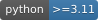
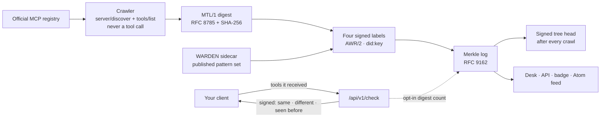

# HISTOR

<!-- mcp-name: io.github.alexar76/histor -->

<!-- aicom-readme-badges -->
<p align="center">
  <a href="https://github.com/alexar76/histor/actions/workflows/ci.yml"></a>
  <a href="https://glama.ai/mcp/servers/alexar76/histor"></a>
  <a href="https://github.com/alexar76/histor/actions/workflows/pages.yml"></a>
  <a href="https://histor.modelmarket.dev/"></a>
  <a href="https://histor.modelmarket.dev/log"></a>
  <a href="https://histor.modelmarket.dev/servers"></a>
  <a href="https://histor.modelmarket.dev/changes"></a>
  <a href="https://histor.modelmarket.dev/log"></a>
  <a href="https://github.com/alexar76/histor/actions/workflows/pages.yml"></a>
  <a href="https://github.com/alexar76/histor/actions/workflows/pages.yml"></a>
  =3.11" />
  
  
  
  
  <a href="https://github.com/alexar76/histor/blob/main/LICENSE"></a>
</p>
<!-- /aicom-readme-badges -->

<!-- aicom-mirror-notice -->
> 🔄 Synced from the [AI-Factory monorepo](https://github.com/alexar76/aicom) (append-only history). **Pull requests are welcome** — merged PRs are imported back and re-synced here. [Issues](https://github.com/alexar76/histor/issues) · [Pull requests](https://github.com/alexar76/histor/pulls)

<p align="center">
  <strong>HISTOR</strong> (ἵστωρ, “the one who knows because they saw”) — a public transparency log of MCP tool definitions<br>
  What every remote MCP endpoint in the official registry advertised · when it changed · signed, appended, auditable
</p>

<p align="center">
  <a href="README.md"><b>English</b></a> ·
  <a href="README.ru.md">Русский</a> ·
  <a href="README.es.md">Español</a> ·
  <a href="README.fr.md">Français</a> ·
  <a href="README.zh.md">中文</a>
</p>

<!-- histor-try -->
**Try it.** Ask the public log what it has seen at a remote MCP server. No account and no key; you need only `curl` and `jq`:

```bash
curl -sS "https://histor.modelmarket.dev/api/v1/check?endpoint=https://mcp.deepwiki.com/mcp" \
  | jq '{server: .target.name, tools: .observed.toolCount, firstPinned: .observed.firstPinned, unchangedSince: .observed.unchangedSince, changes: .observed.changes, page: .target.page}'
```

```json
{
  "server": "com.deepwiki/deepwiki",
  "tools": 3,
  "firstPinned": "2026-10-10T12:14:16Z",
  "unchangedSince": "2026-11-03T03:49:18Z",
  "changes": 1,
  "page": "https://histor.modelmarket.dev/s/83fd44d4a5952f31"
}
```

That was the answer on 15 November 2026. The full response is signed with Ed25519 and carries the log's current tree head; send your own `tools/list` result to compare it with what HISTOR observed ([API](docs/api.md)).
<!-- /histor-try -->

<!-- star-line -->
Source, issues and releases: [github.com/alexar76/histor](https://github.com/alexar76/histor). If HISTOR was useful to you, a star there helps other people find it.
<!-- /star-line -->

**Live:** [histor.modelmarket.dev](https://histor.modelmarket.dev) ·
**Landing:** [alexar76.github.io/histor](https://alexar76.github.io/histor/) ·
**Capabilities:** `histor.check@v1` · `histor.server@v1` · `histor.changes@v1` ·
**Port:** `9490`

## The problem, in one paragraph

An MCP server can pass your review with harmless tool descriptions and change them later —
a new sentence in a description is all a prompt injection needs, and your client will pass it
to the model without asking you again. MCP has no content addressing for tool definitions, the
official registry verifies namespaces rather than contents, and a scanner on your laptop sees
only what the server shows your laptop. HISTOR is the missing public memory: it records what
each server advertised, signs it, and tells anyone who asks whether what they received is what
everyone else is seeing.

## What it does



See [live coverage](https://histor.modelmarket.dev/stats) for the official registry’s remote endpoints from the last completed crawl and the current index of remote endpoints and packages.

- **Reads** every remote endpoint in the official registry: `server/discover`, then `tools/list` (legacy servers use initialization)
  drained across pages. No tool is called, nothing is installed or executed, private addresses
  are refused before a connection opens.
- **Also reads** a short list of popular remote servers the registry does not carry ([`histor/curated.json`](histor/curated.json), DeepWiki among them), under HISTOR's own namespace `urn:awr:mtl:1:registry:histor.modelmarket.dev/curated`, so no label claims a registry listing. When such a server publishes to the registry, the registry's listing replaces ours.
- **Runs npm and PyPI packages** — the servers people start locally with `npx` or `uvx` — in a [sandbox](docs/operations.md#package-sandbox): installed without running their code, started under gVisor with decoy credentials and no route out, read with discovery and `tools/list` (legacy initialization when needed), then up to 15 tools called once with canary arguments, inside the sandbox. gVisor's own trace says what the package did — programs started, names looked up, decoys opened — at install, at startup and when its tools were called. Completed observations are cached per published version; incomplete observations are retried; a new version that changes what its tools tell the model is a change in the log, like any endpoint's.
- **Digests** the tool set exactly as [MTL/1](https://github.com/alexar76/aicom/blob/main/awr/adoption/mcp-trust-label/PROFILE.md)
  defines it — name, description, input and output schema, UTF-16 code-unit order, RFC 8785.
- **Signs** four kinds of label, each a standalone AWR/2 `VerificationVerdict`: what was observed,
  what the WARDEN pattern set matched, whether the definitions changed since the previous label,
  and whether the name is on a threat list.
- **Appends** every label to an RFC 9162 Merkle log and signs a tree head after each crawl, so a
  consistency proof shows the history was only ever appended to.
- **Answers** `/check`: send the tools your client received; get back, signed, whether HISTOR
  observed the same set at that endpoint, an earlier one, or none.

Remote checks run independently of the daily registry/package cycle. The default target interval
is six hours; endpoints with at least two observed changes in the last seven days are checked
every 30 minutes. These are scheduling targets: host limits, failures and queue capacity can
make actual gaps longer. Intermediate states can still be missed. See
[remote polling operations](docs/remote-polling.md) for configuration and measured intervals.

Release changes and upgrade notes: [CHANGELOG.md](CHANGELOG.md).

**MCP 2026-07-28:** [modern and legacy compatibility](docs/mcp-compatibility.md).
**Local upgrade brief:** choose your dependencies and workflows, compare saved observations, and get a retest checklist.
From this source directory, run `python3 -m histor upgrade-brief --watchlist examples/upgrade-brief/watchlist.json --out-dir ../output/histor-upgrade-brief-example/en` (Python 3.11+).
Reports and checklists support `--lang ru|en|es|fr|zh` (default `en`).
See the [guide](docs/upgrade-brief.md) and [reproducible synthetic example](examples/upgrade-brief/README.md), available in five languages.

## What a label does not say

The profile forbids the words *safe, secure, audited, certified, approved* and *trusted*, and so
does this README. A pattern match is a reason to read a definition, not a finding. Three of the
four methods can never return `fail`; the fourth (continuity) fails only in the mechanical sense
that two digests differ. No source is read, no package resolved, no behaviour observed. A change
is shown as a date and a diff, never as an accusation. Details: [docs/labels.md](docs/labels.md).

**What a tool list costs.** In the [2026-10-19 snapshot](docs/tool-list-cost.md), HISTOR counted names, descriptions and input schemas across the full lists of 18,204 packages and 16,170 remote servers using `o200k_base`. The median was 1,272 tokens for packages and 1,328 for remote servers. The 90th percentiles were 8,361 and 7,425 respectively, and 31 packages exceeded 100,000 tokens. What a model receives and what the provider bills depend on tool selection, request format and caching. Each recorded change has a token diff (`/api/v1/changes/<id>/cost`), and [`histor tool-cost check`](docs/tool-list-cost.md#where-the-tokens-are-and-what-a-release-changed) can enforce a token budget in CI.

**Watch the servers you use.** `https://histor.modelmarket.dev/feed.xml?watch=<id>,<id>` is a feed of the changes of up to 100 servers you follow; `/api/v1/changes?watch=…&after=<cursor>` is the same for a program, oldest first, resumable. Teams can have each change pushed, signed, to Slack or their own endpoint: [docs/watch.md](docs/watch.md). Registries, scanners and rating services: [docs/data-feed.md](docs/data-feed.md).

**Download the data.** Once a week the log's whole view is published as files at [histor.modelmarket.dev/datasets/](https://histor.modelmarket.dev/datasets/): every listed server, every tool set it showed, every recorded change and the WARDEN scans. The files are JSON Lines (gzip) with a manifest signed by the log's key; the compilation is CC BY 4.0. Each snapshot's README lists the fields and loads in pandas or DuckDB ([histor/dataset.py](histor/dataset.py)). Also on [Hugging Face](https://huggingface.co/datasets/alexar76/histor-mcp-tool-definitions); to cite a number, give the version DOI of the snapshot it was counted on (each archived snapshot has its own, listed on the datasets page); [doi:10.5281/zenodo.23512759](https://doi.org/10.5281/zenodo.23512759) stands for all of them and opens the newest.

**Cross-checked with other observers.** HISTOR compares its records with other services that read the same servers — CrawlCheck, ScraperWatch and the MCP Transparency Log, every day — and publishes every comparison, disagreements included, at [histor.modelmarket.dev/datasets/peers/](https://histor.modelmarket.dev/datasets/peers/). The observers are one list in the configuration, and adding one is one entry: [docs/cross-check.md](docs/cross-check.md).

**Public payer evidence.** The `histor payer-audit` command (since 0.4.1) checks Base USDC
receipts and exports sourced behavioural indications while retaining payment totals and unknown
cases. It needs no production database or wallet: [docs/payer-audit.md](docs/payer-audit.md).

## Install

```bash
pip install aimarket-histor        # the package is aimarket-histor — "histor" on PyPI is an unrelated project
histor audit https://histor.modelmarket.dev   # verify the public log's tree heads and proofs; needs no keys or database
uvx aimarket-histor                           # MCP server over stdio against the public log: histor_changes, histor_check, histor_server
```

Python 3.11 or newer. `histor audit` is the first command to run: it checks the live log the way a
stranger should, without trusting HISTOR ([docs/log.md](docs/log.md)).

In an MCP client (Claude Code, Cursor, …): `{ "mcpServers": { "histor": { "command": "uvx", "args": ["aimarket-histor"] } } }` —
three tools that ask the public log; nothing is crawled or stored locally. `aimarket-histor --local`
(or `histor mcp`) serves your own log from `HISTOR_DATA_DIR` instead. Listed in the official MCP registry as
`io.github.alexar76/histor`.

After connecting, ask: “Use `histor_server` with endpoint `npm:mongodb-mcp-server`.
Show the last observation, the number of tools, and the link to its HISTOR record.”
Substitute your own `npm:` or `pypi:` package, or
[look it up in the browser](https://histor.modelmarket.dev/servers?from=pypi-histor).

## Quick start

To run your own log from source:

```bash
git clone https://github.com/alexar76/histor && cd histor
npm ci --prefix scanner                     # the WARDEN sidecar (node >= 20)
uv sync --extra dev --project .
HISTOR_CRAWL_LIMIT=40 uv run --project . python -m histor crawl   # observe 40 endpoints
uv run --project . python -m histor serve   # desk + API on :9490 (SQLite under ./data)
```

For a local MCP client or Glama, run `python -m histor mcp`. It exposes
`histor_changes`, `histor_check` and `histor_server` over stdio using the local log.
It opens no HTTP port and starts no crawl; use the separate `crawl` command above to
populate a fresh log. See [Glama build settings](docs/GLAMA.md).

Production runs on Postgres, and `HISTOR_PROFILE=prod` refuses to start without it:

```bash
HISTOR_POSTGRES_PASSWORD=… HISTOR_OPERATOR_TOKEN=… HISTOR_PUBLIC_BASE=https://histor.example \
  docker compose -f docker-compose.yml -f docker-compose.postgres.yml up -d
```

Schema changes are numbered migrations (`python -m histor migrate up|status`), applied before the
service listens; see [docs/operations.md](docs/operations.md).

## Ask the log

```bash
# Is what my client received what HISTOR observed at that endpoint? Three lines that run as
# written: take a listed server, send its endpoint and tool list to /check, read the signed answer.
# With your own client, replace the second line by the endpoint and the tools/list result it received.
H=https://histor.modelmarket.dev/api/v1
S=$(curl -sS "$H/servers?limit=1" | jq -r '.servers[0].id')
curl -sS "$H/servers/$S" | jq '{endpoint: .server.endpoint, tools: .tools}' > received.json
curl -sS "$H/check" -H 'Content-Type: application/json' -d @received.json | jq '.match, .target.page'

# Only looking a server up: a GET with the endpoint (it writes nothing)
curl -sS "$H/check?endpoint=$(jq -r .endpoint received.json)" | jq '.observed, .target.page'

# The signed tree head, and a proof that today's log extends yesterday's
curl -sS https://histor.modelmarket.dev/api/v1/log/sth
curl -sS "https://histor.modelmarket.dev/api/v1/log/proof/consistency?first=1000&second=1200"
```

Every endpoint is in [docs/api.md](docs/api.md). How to audit the log without trusting HISTOR is
in [docs/log.md](docs/log.md); the format itself (leaf input, tree, signed head, verification rule) is specified in [docs/spec/transparency-log.md](docs/spec/transparency-log.md) with normative vectors in [test-vectors/](test-vectors/). The internals are in [docs/architecture.md](docs/architecture.md).

## Tests

```bash
make test          # unit tests; set HISTOR_TEST_DATABASE_URL to run each storage test on Postgres too
make integration   # real sockets: a loopback registry and MCP servers, uvicorn, the real WARDEN sidecar
```

The test and coverage badges show the unit test results from the last deployment by the
[Pages workflow](https://github.com/alexar76/histor/actions/workflows/pages.yml). See the
[CI workflow](https://github.com/alexar76/histor/actions/workflows/ci.yml) for lint, Postgres,
integration and Docker checks on a specific commit. The log badges query the live service.

## ERC-8004 identity

HISTOR is ERC-8004 agent [`96683` on Base](https://8004scan.io/agents/base/96683), registered on
2026-10-01 in the canonical IdentityRegistry `0x8004A169…a432` and owned by the AIMarket operator
wallet `0x1218ff36…Ad0a`. Its [registration file](https://modelmarket.dev/.well-known/erc-8004/histor.json)
lists the web page, the hosted `histor-check` endpoint and the `did:key` that signs every label, so a
label's signature can be tied back to the registered agent. Transactions and how to check them:
[ERC-8004 identities](https://github.com/alexar76/aicom/blob/main/docs/erc-8004-identities.md).

## Where it sits

| Component | Role |
|---|---|
| [WARDEN](https://github.com/alexar76/warden) | checks tool definitions at connect time, on the client |
| **HISTOR** | remembers what servers advertised, publicly |
| [THEMIS](https://github.com/alexar76/themis) | admits a capability at publish time on a Hub |
| [AIMarket Hub](https://modelmarket.dev) | lists `histor.check@v1` in the catalogue |
| [AWR](https://github.com/alexar76/aicom/tree/main/awr) | the signed document format every label uses |

> [WARDEN quality cycle: MOMUS → AI-Factory → SKOPOS → shared node agent → deployment](https://github.com/alexar76/momus/blob/main/docs/quality-cycle.md).

## License

MIT — see [LICENSE](LICENSE). Part of the [AIMarket ecosystem](https://ecosystem.modelmarket.dev/).
