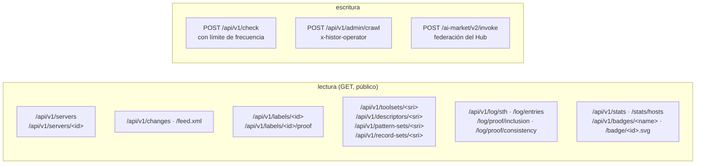

# API

> 🌐 [English](api.md) · [Русский](api.ru.md) · **Español** · [Français](api.fr.md) · [中文](api.zh.md)

URL base: `https://histor.modelmarket.dev`. Todo es público, sin autenticación y de solo lectura,
excepto `POST /api/v1/check` (con límite de frecuencia) y la ruta del operador. Las lecturas públicas
envían `Access-Control-Allow-Origin: *`. OpenAPI: [`/api/openapi.json`](https://histor.modelmarket.dev/api/openapi.json).



## Servidores

| Método | Ruta | Devuelve |
|---|---|---|
| GET | `/api/v1/servers?q=&state=&limit=&offset=` | endpoints; `state` ∈ `all`, `pinned`, `changed`, `flagged`, `unobserved`; `q` busca en el nombre, el endpoint y el título |
| GET | `/api/v1/servers/<id>` | un endpoint: conjunto de herramientas actual, coincidencias de WARDEN con sus fragmentos, etiquetas, cronología compactada, cambios e informes de clientes de 30 días y conjuntos que declara el editor (`declaredToolSets`) |
| GET | `/badge/<id>.svg` | insignia para README: `pinned ‹date›`, `unchanged Nd`, `changed ‹date›`, `not observed`, `not listed` |

`<id>` son los primeros 16 caracteres hexadecimales de `sha256(name + "\n" + endpoint)`: estable, uno por remoto.

Para un paquete, cada fila de `timeline` lleva `packageVersion`, la versión que se ejecutó en esa observación (`serverVersion` es lo que el servidor dijo en `initialize`, a menudo distinto de la versión del paquete), y dos versiones son dos filas aunque sirvieran la misma lista. Se registra desde el 2026-10-26; las filas anteriores tienen `null`. `launch` indica cómo se inició esa ejecución: `observer`, `image`, `entry`, `network` (`no route out`) y, cuando HISTOR aportó configuración, `supplied` con los nombres de las variables de entorno (nunca sus valores), los argumentos y los pins. La misma versión puede listar otras herramientas con otros argumentos de arranque o con red.

## Cambios

| Método | Ruta | Devuelve |
|---|---|---|
| GET | `/api/v1/changes?limit=&before=` | primero los más recientes; cada uno con `summary.added`, `summary.removed`, `summary.modified[].fields` (diff por palabras de las descripciones, diff por JSON-path de los esquemas) |
| GET | `/api/v1/changes/<id>` | un cambio |
| GET | `/api/v1/changes/<id>/cost` | qué hizo el cambio con el coste en tokens de la lista de herramientas: cada total antes y después (`sent`, desglosado en `names`, `descriptions`, `inputSchemas` y `structure`; al lado `outputSchemas` y `listed`), herramientas añadidas y quitadas, y cada herramienta cuyo recuento se movió, con su descripción, su esquema de entrada y cada propiedad de primer nivel de ese esquema por separado |
| GET | `/api/v1/servers/<id>/cost?limit=` | el coste de la lista actual por herramienta y los totales de sus últimos cambios (hasta 50) |
| GET | `/api/v1/cost/toolsets/<digest>` | el coste de un conjunto de herramientas guardado |
| GET | `/feed.xml` | feed Atom de los últimos 50 cambios; `?watch=<id>,<id>,…` (hasta 100 ids de destino, como los dan `/check` y las páginas de servidor) deja solo esos servidores y paquetes: una suscripción en cualquier lector de feeds |

Contado como en [tool-list-cost.es.md](tool-list-cost.es.md) (`o200k_base`). Un despliegue sin el extra `cost` responde 503 a estas tres rutas.

Para un paquete, un cambio lleva además `from_package_version` y `to_package_version` (en `/cost`, `fromPackageVersion` y `toPackageVersion`): la última versión que sirvió la lista anterior y la versión que sirvió la nueva. Ambas son `null` en un servidor remoto; `from_package_version` es `null` cuando la lista anterior se sirvió por última vez antes del 2026-10-26.

## Etiquetas y evidencia

| Método | Ruta | Devuelve |
|---|---|---|
| GET | `/api/v1/labels/<id>` | la etiqueta firmada, `application/vc`, inmutable |
| GET | `/api/v1/labels/<id>/proof?tree_size=` | el índice de la hoja, el encabezado de árbol firmado (STH) y la prueba de inclusión |
| GET | `/api/v1/toolsets/<sri>` · `/descriptors/<sri>` · `/pattern-sets/<sri>` · `/record-sets/<sri>` | evidencia direccionada por contenido, inmutable |
| GET | `/api/v1/issuer` | el `did:key` del registro, la clave pública en bruto, los resúmenes criptográficos (digests) actuales del conjunto de patrones y del conjunto de registros, y el paquete de WARDEN |

## Registro

| Método | Ruta | Devuelve |
|---|---|---|
| GET | `/api/v1/log/sth` | el último encabezado de árbol firmado |
| GET | `/api/v1/log/sth/<size>` | el encabezado firmado con ese tamaño |
| GET | `/api/v1/log/entries?start=&end=` | hojas en orden (≤ 1000 por llamada) |
| GET | `/api/v1/log/proof/inclusion?leaf_index=&tree_size=` | prueba de inclusión RFC 9162, en hex |
| GET | `/api/v1/log/proof/consistency?first=&second=` | prueba de consistencia RFC 9162, en hex |

## Registro de recibos

Un segundo registro, independiente: anclas de recibos de trabajo del mercado (AWR/2), enviadas
por los hubs que los emitieron. Un ancla lleva cuatro hechos — el digest del recibo, el `did:key`
del emisor, la hora de emisión y la firma del emisor sobre ellos — y nunca el recibo en sí. Sus
encabezados son `histor.receipts-sth/v1`, firmados con la misma clave que los del registro de
etiquetas, sobre un árbol aparte.

| Método | Ruta | Devuelve |
|---|---|---|
| POST | `/api/v1/receipts/anchors` | `{"anchors": [...]}` (1–100) → un resultado por ancla: `logged`, `duplicate` o `refused` con el motivo |
| GET | `/api/v1/receipts/sth` | el último encabezado firmado del registro de recibos |
| GET | `/api/v1/receipts/sth/<size>` | el encabezado firmado con ese tamaño |
| GET | `/api/v1/receipts/proof?digest=&tree_size=` | el ancla, su índice de hoja y una prueba de inclusión RFC 9162 frente a un encabezado firmado |
| GET | `/api/v1/receipts/proof/consistency?first=&second=` | prueba de consistencia RFC 9162, en hex |

Solo se aceptan envíos de los emisores listados en `HISTOR_RECEIPT_ISSUERS` (`did:key` separados
por comas; vacío = cerrado, que es el valor por defecto) y solo con la firma Ed25519 del propio
emisor sobre los bytes RFC 8785 de `type`, `issuer`, `receiptDigest` e `issuedAt`. `issuedAt`
puede ir hasta 30 días por detrás (un atraso tras una caída) y como mucho 5 minutos por delante.

## /check

```http
POST /api/v1/check
Content-Type: application/json

{
  "endpoint": "https://example.com/mcp",      // or "name": "io.github.org/server"
  // a stdio server instead: "package": "npm:@scope/name" or "pypi:name"
  "tools": [ … ],                             // the tools array you received, or:
  "toolSetDigest": "sha256-…",                // its MTL/1 digest
  "contribute": true                          // optional: add (endpoint, digest, day) to a count
}
```

```json
{
  "type": "histor.check/v1",
  "checkedAt": "2026-09-23T10:02:11Z",
  "issuer": "did:key:z6Mk…",
  "query": { "endpoint": "…", "toolSetDigest": "sha256-…" },
  "target": { "id": "9c7f2af79fa057b2", "page": "…/s/9c7f2af79fa057b2", "badge": "…", "lastStatus": "ok" },
  "observed": { "toolSetDigest": "sha256-…", "unchangedSince": "…", "observations": 12, "changes": 0 },
  "match": "same",
  "note": "The tool definitions you sent are the set HISTOR currently observes at this endpoint.",
  "patternScan": { "status": "scanned", "block": 0, "advise": 1, "matches": [ … ] },
  "log": { "treeSize": 21480, "rootHash": "…", "timestamp": "…" },
  "signature": { "alg": "Ed25519", "verificationMethod": "…", "value": "…" }
}
```

`match` es uno de `same`, `different`, `previously-observed` (con `seenBefore`), `not-observed`,
`not-listed`, `no-digest`. La respuesta se firma igual que un encabezado de árbol (`type` `histor.check/v1`).
Si el conjunto nunca se escaneó y su dirección aún tiene presupuesto de escaneo, el sidecar de WARDEN
lo escanea en el acto. Límites: 30 comprobaciones por minuto y 20 escaneos nuevos por hora por
dirección; los cuerpos de más de 2 MiB se rechazan. Con `contribute` no se guarda nada salvo el
recuento del día para ese resumen.

Para un servidor stdio (un paquete de npm o PyPI que arranca tu cliente), envía `package` —`npm:<nombre>` o `pypi:<nombre>`— en lugar de `endpoint`; los nombres de PyPI se normalizan por ti. `target.packageVersion` es la última versión que HISTOR observó en su [sandbox de paquetes](operations.es.md#sandbox-de-paquetes). Un nombre de paquete nunca se cuenta como host desconocido. Dos respuestas más para un paquete. `packageLookalike` (`of`, `weekly`, `how`, `ownWeekly`), para cualquier paquete consultado, esté listado o no, nombra el paquete popular al que se parece este nombre —a un carácter, el mismo nombre bajo otro scope u otros separadores— cuando ese se descarga al menos 100 veces más; los nombres genéricos como `mcp-server` no son de nadie. `target.packageSignals` es lo que dice el registro sobre la versión que HISTOR observó: `provenance` (una compilación atestiguada en CI), `publisher` (nunca un correo), `installScripts` y `flags` con lo que cambió desde la versión observada antes: `provenance-lost`, `publisher-changed`, `install-scripts-added`, `new-dependencies`, las marcas de un token de publicación robado.

`declared` aparece cuando el conjunto que enviaste es uno que declara el editor del servidor (sección siguiente): `toolSetDigest`, `toolCount`, `when` (la condición del editor, con sus palabras), `source` — `registry` si está en la propia entrada del registro, `url` si está en el archivo de declaración al que apunta (entonces con `url`) —, `registryVersion`, `firstDeclared`, `lastDeclared`. `match` sigue diciendo lo que HISTOR observó: un conjunto declarado que HISTOR nunca vio sigue siendo `different`, o `not-observed` si HISTOR no tiene ningún conjunto, y la nota añade que el editor lo declara, y dónde.

## Declarar conjuntos de herramientas (editores)

Un servidor puede listar herramientas distintas en máquinas distintas. Un lanzador cede stdio a un programa instalado a su lado y, donde el programa falta (como en el sandbox de HISTOR), lista solo una herramienta de «instálame»; una clave real puede desbloquear herramientas que un valor de relleno no. HISTOR registra lo que observa. Un editor que conoce los otros conjuntos los nombra por su digest MTL/1 en el `server.json` que publica en el registro oficial de MCP, en el campo que el registro guarda para registros posteriores:

```json
"_meta": {
  "io.modelcontextprotocol.registry/publisher-provided": {
    "dev.modelmarket.histor/tool-sets": {
      "mtl": "1",
      "sets": [
        { "digest": "sha256-…", "count": 23, "when": "the runner is installed" }
      ],
      "url": "https://example.com/.well-known/mcp-tool-sets.json"
    }
  }
}
```

`sets`, `url` o ambos.

- `sets`: como máximo 8 (aquí el registro guarda unos 4 KB). Cada uno tiene `digest` (obligatorio: el digest MTL/1 del resultado de `tools/list`), `count` (opcional: el número de herramientas, para mostrarlo) y `when` (opcional, como máximo 200 caracteres: la condición con tus palabras, mostrada como tuya; se descartan los caracteres de control e invisibles).
- `url`: un archivo de declaración en tu propio dominio, para conjuntos que cambian sin una nueva entrada en el registro: un runner publicado aparte del paquete, uno por sistema operativo. El archivo es el mismo objeto, `{"mtl": "1", "sets": [...]}`, con hasta 64 conjuntos. HISTOR lo lee en cada rastreo y cada hora entre rastreos, así que un conjunto añadido con una versión del runner se conoce en menos de una hora. Un `"sets": []` explícito retira todos los conjuntos que listaba el archivo.

**Dónde puede estar el archivo.** En el dominio que el registro verificó para el espacio de nombres del servidor, o en un subdominio: `ai.example/server` → `example.com`, `docs.example.com`. Para `io.github.<user>/…`: `<user>.github.io`, o bajo `/<user>/` en `raw.githubusercontent.com` o `gist.githubusercontent.com`. https en el puerto por defecto, sin redirecciones, como máximo 64 KiB, solo direcciones públicas. Una `url` en cualquier otro sitio se omite: nadie más puede hablar por el editor a través de un archivo.

**Cómo escribirlo.** WARDEN 0.16 lo hace en una máquina que recibe el conjunto:

```bash
npx -y @aimarket/warden declare --when "runner 1.4, macOS" --out mcp-tool-sets.json -- npx -y @example/launcher
```

arranca el servidor como lo haría un cliente, calcula el digest de su `tools/list` y añade el conjunto al archivo (lo crea si no existe; conserva los demás y reemplaza el mismo digest). Ejecútalo en cada sistema operativo y versión del runner y publica el archivo. `--server-json --link URL` imprime el bloque de arriba para la entrada del registro; `--check URL --name SERVER` lee el archivo publicado como lo leerá HISTOR y dice qué tomará de él. Con un WARDEN anterior, `npx -y @aimarket/warden scan --json` imprime el digest como `mtlDigest`.

**Qué hace HISTOR con ello.** Aplica la declaración a cada endpoint y paquete del servidor, según la última entrada del servidor en el registro, y guarda el primer y el último día en que leyó cada conjunto; un conjunto que deja de nombrarse se marca como retirado, no se borra. Un archivo que no se puede leer conserva lo que declaró hasta la siguiente lectura correcta —una lectura fallida no es una retirada— y la página del servidor muestra cuándo se leyó el archivo por última vez y por qué falló una lectura. Cuando la entrada deja de apuntar a un archivo, se retira lo que solo declaraba el archivo. Un digest nombrado en ambos sitios cuenta como de la entrada del registro. Todo lo que incumple las reglas se omite, y el rastreo dice por qué (`lastRun.declaredToolSets.ignored`, y `unread` para un archivo que no pudo leer, en `/api/v1/stats`).

Una declaración es la palabra del editor: el registro garantiza que viene de quien controla el espacio de nombres del servidor, y el archivo está ligado al mismo dominio o cuenta. HISTOR nunca la cuenta como observación, no emite etiquetas sobre ella y nunca ve las herramientas que hay detrás. WARDEN informa de un conjunto declarado como `HISTOR_DECLARED_TOOLSET` (low; info cuando HISTOR no tiene un conjunto propio) en lugar de `HISTOR_UNSEEN_TOOLSET`, dice dónde está la declaración y sigue ejecutando todas sus comprobaciones sobre las herramientas.

## Estadísticas e insignias en vivo

| Ruta | Devuelve |
|---|---|
| `/api/v1/stats` | el último rastreo (tamaño del registro de MCP, qué respondieron los endpoints, qué no se contactó, etiquetas emitidas), recuentos actuales, cambios en las últimas 24 h / 7 d / 30 d, tamaño del registro de transparencia, informes de clientes en 7 d; `lastRun.declaredToolSets`: servidores que declaran conjuntos de herramientas y entradas omitidas con el motivo |
| `/api/v1/stats/hosts?limit=` | endpoints por host entre los contactados |
| `/api/v1/badges/log` · `pinned` · `changes` · `sth` | JSON de [endpoint de shields.io](https://shields.io/badges/endpoint-badge) para insignias de README |
| `/health` | estado de vida (liveness), backend de almacenamiento, tamaño del árbol, si hay un rastreo en curso, último error de rastreo |

## Federación (AIMarket Hub)

HISTOR es un peer de AIMarket: `/.well-known/ai-market.json` (firmado entero), `/ai-market/v2/manifest`
(firmado con la forma canónica de manifiesto del Hub) y `POST /ai-market/v2/invoke` con tres
capacidades gratuitas:

| Capacidad | Entrada | Resultado |
|---|---|---|
| `histor.check@v1` | el cuerpo de `/check` | la respuesta firmada de `/check` |
| `histor.server@v1` | `{"endpoint": …}` o `{"name": …}` | hasta 10 endpoints coincidentes |
| `histor.changes@v1` | `{"limit": 1–100}` | los cambios más recientes |

Cada respuesta lleva un recibo de interoperabilidad que un Hub verifica con la clave de `.well-known`,
híbrido Ed25519 + ML-DSA-65 cuando `HISTOR_PQC=1`.

## Operador

`POST /api/v1/admin/crawl` con `x-histor-operator: $HISTOR_OPERATOR_TOKEN` inicia un rastreo en ese
momento (202), o responde 409 si ya hay uno en curso. Sin un token configurado, la ruta responde 503.

`GET /api/v1/admin/unlisted?days=7&limit=100` (la misma cabecera) lista los hosts por los que se preguntó a `/check` y que HISTOR no lista, los más consultados primero: `host`, `queries`, `days`, `first_day`, `last_day`. Solo se cuenta el nombre de host de un endpoint https con un nombre DNS público — nunca la ruta ni los parámetros, la dirección de quien pregunta ni las herramientas —, una vez por dirección, host y día; los días de más de 90 se eliminan. Así crece la lista propia de HISTOR (`histor/curated.json`) con los servidores que la gente usa de verdad.
