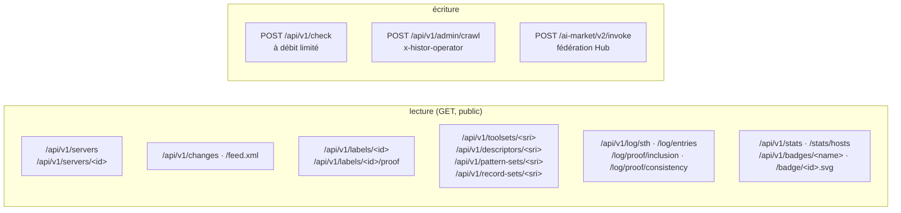

# API

> 🌐 [English](api.md) · [Русский](api.ru.md) · [Español](api.es.md) · **Français** · [中文](api.zh.md)

URL de base : `https://histor.modelmarket.dev`. Tout est public, sans authentification et en lecture
seule, sauf `POST /api/v1/check` (à débit limité) et la route opérateur. Les lectures publiques
envoient `Access-Control-Allow-Origin: *`. OpenAPI : [`/api/openapi.json`](https://histor.modelmarket.dev/api/openapi.json).



## Serveurs

| Méthode | Chemin | Renvoie |
|---|---|---|
| GET | `/api/v1/servers?q=&state=&limit=&offset=` | des points de terminaison (endpoints) ; `state` ∈ `all`, `pinned`, `changed`, `flagged`, `unobserved` ; `q` cherche dans le nom, le point de terminaison et le titre |
| GET | `/api/v1/servers/<id>` | un point de terminaison : ensemble d’outils actuel, correspondances WARDEN avec leurs positions, étiquettes, chronologie condensée, changements, signalements de clients sur 30 jours, ensembles que déclare l’éditeur (`declaredToolSets`) |
| GET | `/badge/<id>.svg` | badge pour README : `pinned ‹date›`, `unchanged Nd`, `changed ‹date›`, `not observed`, `not listed` |

`<id>` est formé des 16 premiers caractères hexadécimaux de `sha256(name + "\n" + endpoint)` —
stable, un par entrée distante.

Pour un paquet, chaque ligne de `timeline` porte `packageVersion`, la version exécutée lors de cette observation (`serverVersion` est ce que le serveur a annoncé dans `initialize`, souvent différent de la version du paquet), et deux versions font deux lignes même si elles servaient la même liste. Enregistré depuis le 2026-10-26 ; les lignes plus anciennes ont `null`. `launch` indique comment cette exécution a été lancée : `observer`, `image`, `entry`, `network` (`no route out`) et, quand HISTOR a fourni une configuration, `supplied` avec les noms des variables d’environnement (jamais leurs valeurs), les arguments et les pins. La même version peut lister d’autres outils avec d’autres arguments de lancement ou avec le réseau.

## Changements

| Méthode | Chemin | Renvoie |
|---|---|---|
| GET | `/api/v1/changes?limit=&before=` | du plus récent au plus ancien ; chacun avec `summary.added`, `summary.removed`, `summary.modified[].fields` (diff mot à mot des descriptions, diff par chemin JSON des schémas) |
| GET | `/api/v1/changes/<id>` | un changement |
| GET | `/api/v1/changes/<id>/cost` | ce que le changement a fait au coût en tokens de la liste d’outils : chaque total avant et après (`sent`, réparti en `names`, `descriptions`, `inputSchemas` et `structure` ; à côté, `outputSchemas` et `listed`), les outils ajoutés et retirés, et chaque outil dont le compte a bougé, description, schéma d’entrée et chaque propriété de premier niveau de ce schéma à part |
| GET | `/api/v1/servers/<id>/cost?limit=` | le coût de la liste actuelle par outil, et les totaux de ses derniers changements (jusqu’à 50) |
| GET | `/api/v1/cost/toolsets/<digest>` | le coût d’un ensemble d’outils enregistré |
| GET | `/feed.xml` | flux Atom des 50 derniers changements ; `?watch=<id>,<id>,…` (jusqu’à 100 identifiants de cible, tels que `/check` et les pages de serveur les donnent) ne garde que ces serveurs et paquets — un abonnement dans n’importe quel lecteur de flux |

Compté comme dans [tool-list-cost.fr.md](tool-list-cost.fr.md) (`o200k_base`). Un déploiement sans l’extra `cost` répond 503 à ces trois chemins.

Pour un paquet, un changement porte aussi `from_package_version` et `to_package_version` (dans `/cost`, `fromPackageVersion` et `toPackageVersion`) : la dernière version qui servait l’ancienne liste et la version qui sert la nouvelle. Les deux valent `null` pour un serveur distant ; `from_package_version` vaut `null` quand l’ancienne liste a été servie pour la dernière fois avant le 2026-10-26.

Chaque changement, de serveur distant ou de paquet, porte aussi `from_server_version` et `to_server_version` (dans `/cost`, `fromServerVersion` et `toServerVersion`) : la version que le serveur annonçait de lui-même (`serverInfo`) lors de la dernière observation qui servait l’ancienne liste et lors de celle qui a vu la nouvelle ; et `from_registry_version` et `to_registry_version` (`fromRegistryVersion`, `toRegistryVersion`) : la version que le registre MCP indiquait pour l’entrée lors de ces deux observations. Quand les deux paires sont égales, la liste a changé à version inchangée, ce qu’un enregistrement indexé sur la version ne peut pas voir. Les versions du serveur sont renseignées pour tous les changements (`null` si le serveur n’en annonçait aucune) ; celles du registre sont enregistrées depuis le 2026-10-28 et valent `null` avant cette date et pour les entrées de la liste curée. Chaque ligne de `timeline` porte aussi `registryVersion`, et une nouvelle version du serveur ou du registre ouvre une nouvelle ligne.

## Étiquettes et éléments de preuve

| Méthode | Chemin | Renvoie |
|---|---|---|
| GET | `/api/v1/labels/<id>` | l’étiquette signée, `application/vc`, immuable |
| GET | `/api/v1/labels/<id>/proof?tree_size=` | l’index de la feuille, la tête d’arbre signée (STH) et la preuve d’inclusion |
| GET | `/api/v1/toolsets/<sri>` · `/descriptors/<sri>` · `/pattern-sets/<sri>` · `/record-sets/<sri>` | éléments de preuve adressés par contenu, immuables |
| GET | `/api/v1/issuer` | le `did:key` du journal, la clé publique brute, les empreintes (digest) actuelles de l’ensemble de motifs et de l’ensemble d’enregistrements, le paquet WARDEN |

## Journal

| Méthode | Chemin | Renvoie |
|---|---|---|
| GET | `/api/v1/log/sth` | la dernière tête d’arbre signée |
| GET | `/api/v1/log/sth/<size>` | la tête signée à cette taille |
| GET | `/api/v1/log/entries?start=&end=` | les feuilles dans l’ordre (≤ 1000 par appel) |
| GET | `/api/v1/log/proof/inclusion?leaf_index=&tree_size=` | preuve d’inclusion RFC 9162, en hexadécimal |
| GET | `/api/v1/log/proof/consistency?first=&second=` | preuve de cohérence RFC 9162, en hexadécimal |

## Journal des reçus

Un second journal, indépendant : les ancres des reçus de travail du marché (AWR/2), soumises par
les hubs qui les ont émis. Une ancre porte quatre faits — l'empreinte du reçu, le `did:key` de
l'émetteur, l'heure d'émission et la signature de l'émetteur sur ces faits — et jamais le reçu
lui-même. Ses têtes sont des `histor.receipts-sth/v1`, signées par la même clé que celles du
journal des étiquettes, sur un arbre distinct.

| Méthode | Chemin | Renvoie |
|---|---|---|
| POST | `/api/v1/receipts/anchors` | `{"anchors": [...]}` (1–100) → un résultat par ancre : `logged`, `duplicate` ou `refused` avec la raison |
| GET | `/api/v1/receipts/sth` | la dernière tête signée du journal des reçus |
| GET | `/api/v1/receipts/sth/<size>` | la tête signée à cette taille |
| GET | `/api/v1/receipts/proof?digest=&tree_size=` | l'ancre, son indice de feuille et une preuve d'inclusion RFC 9162 par rapport à une tête signée |
| GET | `/api/v1/receipts/proof/consistency?first=&second=` | preuve de cohérence RFC 9162, en hex |

Les soumissions ne sont acceptées que des émetteurs listés dans `HISTOR_RECEIPT_ISSUERS`
(`did:key` séparés par des virgules ; vide = fermé, la valeur par défaut) et seulement sous la
signature Ed25519 de l'émetteur lui-même sur les octets RFC 8785 de `type`, `issuer`,
`receiptDigest` et `issuedAt`. `issuedAt` peut avoir jusqu'à 30 jours de retard (un arriéré après
une panne) et au plus 5 minutes d'avance.

## /check

```http
POST /api/v1/check
Content-Type: application/json

{
  "endpoint": "https://example.com/mcp",      // or "name": "io.github.org/server"
  // a stdio server instead: "package": "npm:@scope/name" or "pypi:name"
  "tools": [ … ],                             // the tools array you received, or:
  "toolSetDigest": "sha256-…",                // its MTL/1 digest
  "contribute": true                          // optional: add (endpoint, digest, day) to a count
}
```

```json
{
  "type": "histor.check/v1",
  "checkedAt": "2026-09-23T10:02:11Z",
  "issuer": "did:key:z6Mk…",
  "query": { "endpoint": "…", "toolSetDigest": "sha256-…" },
  "target": { "id": "9c7f2af79fa057b2", "page": "…/s/9c7f2af79fa057b2", "badge": "…", "lastStatus": "ok" },
  "observed": { "toolSetDigest": "sha256-…", "unchangedSince": "…", "observations": 12, "changes": 0 },
  "match": "same",
  "note": "The tool definitions you sent are the set HISTOR currently observes at this endpoint.",
  "patternScan": { "status": "scanned", "block": 0, "advise": 1, "matches": [ … ] },
  "log": { "treeSize": 21480, "rootHash": "…", "timestamp": "…" },
  "signature": { "alg": "Ed25519", "verificationMethod": "…", "value": "…" }
}
```

`match` vaut `same`, `different`, `previously-observed` (avec `seenBefore`), `not-observed`,
`not-listed` ou `no-digest`. La réponse est signée comme une tête d’arbre (`type` `histor.check/v1`).
Si l’ensemble n’a jamais été analysé et que votre adresse dispose encore d’un budget d’analyse, le
sidecar WARDEN l’analyse sur-le-champ. Limites : 30 contrôles par minute et 20 nouvelles analyses par
heure, par adresse ; les corps de plus de 2 MiB sont refusés. Avec `contribute`, rien d’autre que le
décompte du jour pour cette empreinte n’est stocké.

Pour un serveur stdio (un paquet npm ou PyPI que votre client lance), envoyez `package` — `npm:<nom>` ou `pypi:<nom>` — au lieu d’`endpoint` ; les noms PyPI sont normalisés pour vous. `target.packageVersion` est la dernière version qu’HISTOR a observée dans son [bac à sable des paquets](operations.fr.md#bac-à-sable-des-paquets). Un nom de paquet n’est jamais compté comme hôte inconnu. Deux réponses de plus pour un paquet. `packageLookalike` (`of`, `weekly`, `how`, `ownWeekly`), pour tout paquet demandé, listé ou non, nomme le paquet populaire auquel ce nom ressemble — à un caractère près, le même nom sous un autre scope, ou d’autres séparateurs — quand celui-ci est téléchargé au moins 100 fois plus ; les noms génériques comme `mcp-server` ne sont à personne. `target.packageSignals` est ce que dit le registre de la version qu’HISTOR a observée : `provenance` (une compilation attestée en CI), `publisher` (jamais un e-mail), `installScripts`, et `flags` pour ce qui a changé depuis la version observée avant : `provenance-lost`, `publisher-changed`, `install-scripts-added`, `new-dependencies` — les marques d’un jeton de publication volé.

`declared` apparaît quand l’ensemble envoyé est un ensemble que déclare l’éditeur du serveur (section suivante) : `toolSetDigest`, `toolCount`, `when` (la condition de l’éditeur, dans ses mots), `source` — `registry` s’il est dans l’entrée du registre elle-même, `url` s’il est dans le fichier de déclaration vers lequel elle pointe (alors avec `url`) —, `registryVersion`, `firstDeclared`, `lastDeclared`. `match` dit toujours ce qu’HISTOR a observé : un ensemble déclaré qu’HISTOR n’a jamais vu reste `different`, ou `not-observed` quand HISTOR n’a aucun ensemble, et la note ajoute que l’éditeur le déclare, et où.

## Déclarer des ensembles d’outils (éditeurs)

Un serveur peut lister des outils différents sur des machines différentes. Un lanceur passe stdio à un programme installé à côté et, là où le programme manque (comme dans le bac à sable d’HISTOR), ne liste qu’un outil « installez-moi » ; une vraie clé peut débloquer des outils qu’une valeur factice ne débloque pas. HISTOR enregistre ce qu’il observe. Un éditeur qui connaît les autres ensembles les nomme par leur condensé MTL/1 dans le `server.json` qu’il publie au registre MCP officiel, dans le champ que le registre conserve pour les registres en aval :

```json
"_meta": {
  "io.modelcontextprotocol.registry/publisher-provided": {
    "dev.modelmarket.histor/tool-sets": {
      "mtl": "1",
      "sets": [
        { "digest": "sha256-…", "count": 23, "when": "the runner is installed" }
      ],
      "url": "https://example.com/.well-known/mcp-tool-sets.json"
    }
  }
}
```

`sets`, `url` ou les deux.

- `sets` : 8 au plus (le registre conserve ici environ 4 Ko). Chacun a `digest` (obligatoire : le condensé MTL/1 du résultat de `tools/list`), `count` (facultatif : le nombre d’outils, pour l’affichage) et `when` (facultatif, 200 caractères au plus : la condition dans vos mots, affichée comme la vôtre ; les caractères de contrôle et invisibles sont supprimés).
- `url` : un fichier de déclaration sur votre propre domaine, pour des ensembles qui changent sans nouvelle entrée au registre — un runner publié à part du paquet, un par système d’exploitation. Le fichier est le même objet, `{"mtl": "1", "sets": [...]}`, avec jusqu’à 64 ensembles. HISTOR le lit à chaque passage et toutes les heures entre deux passages : un ensemble ajouté avec une version du runner est connu dans l’heure. Un `"sets": []` explicite retire tous les ensembles que le fichier listait.

**Où le fichier peut se trouver.** Sur le domaine que le registre a vérifié pour l’espace de noms du serveur, ou un sous-domaine : `ai.example/server` → `example.com`, `docs.example.com`. Pour `io.github.<user>/…` : `<user>.github.io`, ou sous `/<user>/` sur `raw.githubusercontent.com` ou `gist.githubusercontent.com`. https sur le port par défaut, sans redirection, 64 Kio au plus, adresses publiques uniquement. Une `url` ailleurs est ignorée : personne d’autre ne peut parler au nom de l’éditeur par un fichier.

**L’écrire.** WARDEN 0.16 le fait sur une machine qui reçoit l’ensemble :

```bash
npx -y @aimarket/warden declare --when "runner 1.4, macOS" --out mcp-tool-sets.json -- npx -y @example/launcher
```

démarre le serveur comme le ferait un client, calcule le condensé de son `tools/list` et ajoute l’ensemble au fichier (créé s’il n’existe pas ; les autres ensembles sont gardés, le même condensé remplacé). Lancez-le sur chaque système et chaque version du runner, puis publiez le fichier. `--server-json --link URL` affiche le bloc ci-dessus pour l’entrée du registre ; `--check URL --name SERVER` lit le fichier publié comme HISTOR le lira et dit ce qu’HISTOR en retiendra. Avec un WARDEN plus ancien, `npx -y @aimarket/warden scan --json` affiche le condensé dans `mtlDigest`.

**Ce qu’HISTOR en fait.** Il applique la déclaration à chaque endpoint et paquet du serveur, d’après la dernière entrée du serveur au registre, et garde le premier et le dernier jour où il a lu chaque ensemble ; un ensemble qui n’est plus nommé est marqué retiré, pas supprimé. Un fichier illisible garde ce qu’il déclarait jusqu’à la prochaine lecture réussie — un échec de lecture n’est pas un retrait — et la page du serveur montre quand le fichier a été lu pour la dernière fois et pourquoi une lecture a échoué. Quand l’entrée cesse de pointer vers un fichier, ce que seul le fichier déclarait est retiré. Un condensé nommé aux deux endroits compte comme celui de l’entrée du registre. Ce qui enfreint les règles est ignoré, et le passage dit pourquoi (`lastRun.declaredToolSets.ignored`, et `unread` pour un fichier illisible, dans `/api/v1/stats`).

Une déclaration est la parole de l’éditeur : le registre garantit qu’elle vient de qui contrôle l’espace de noms du serveur, et le fichier est lié au même domaine ou compte. HISTOR ne la compte jamais comme une observation, n’émet aucun label à son sujet et ne voit jamais les outils derrière. WARDEN signale un ensemble déclaré comme `HISTOR_DECLARED_TOOLSET` (low ; info quand HISTOR n’a pas d’ensemble à lui) au lieu de `HISTOR_UNSEEN_TOOLSET`, dit où se trouve la déclaration et applique toujours toutes ses propres vérifications aux outils.

## Statistiques et badges en direct

| Chemin | Renvoie |
|---|---|
| `/api/v1/stats` | la dernière exploration (crawl) — taille du registre, ce qu’ont répondu les points de terminaison, ce qui n’a pas été contacté, étiquettes émises —, les décomptes actuels, les changements des dernières 24 h / 7 j / 30 j, la taille du journal, les signalements de clients sur 7 j ; `lastRun.declaredToolSets` : serveurs qui déclarent des ensembles d’outils, et entrées ignorées avec la raison |
| `/api/v1/stats/hosts?limit=` | points de terminaison par hôte, parmi ceux contactés |
| `/api/v1/badges/log` · `pinned` · `changes` · `sth` | JSON au format [endpoint de shields.io](https://shields.io/badges/endpoint-badge) pour les badges de README |
| `/health` | vivacité, backend de stockage, taille de l’arbre, exploration en cours ou non, dernière erreur d’exploration |

## Fédération (AIMarket Hub)

HISTOR est un peer AIMarket : `/.well-known/ai-market.json` (signé en entier), `/ai-market/v2/manifest`
(signé selon la forme canonique de manifeste du Hub) et `POST /ai-market/v2/invoke` avec trois
capacités gratuites :

| Capacité | Entrée | Résultat |
|---|---|---|
| `histor.check@v1` | le corps de `/check` | la réponse `/check` signée |
| `histor.server@v1` | `{"endpoint": …}` ou `{"name": …}` | jusqu’à 10 points de terminaison correspondants |
| `histor.changes@v1` | `{"limit": 1–100}` | les changements les plus récents |

Chaque réponse porte un reçu d’interopérabilité qu’un Hub vérifie avec la clé publiée dans
`.well-known`, en hybride Ed25519 + ML-DSA-65 quand `HISTOR_PQC=1`.

## Opérateur

`POST /api/v1/admin/crawl` avec `x-histor-operator: $HISTOR_OPERATOR_TOKEN` lance une exploration
immédiatement (202), ou répond 409 si une exploration est déjà en cours. Sans jeton configuré, la
route répond 503.

`GET /api/v1/admin/unlisted?days=7&limit=100` (même en-tête) liste les hôtes sur lesquels `/check` a été interrogé et que HISTOR ne liste pas, les plus demandés d’abord : `host`, `queries`, `days`, `first_day`, `last_day`. Seul le nom d’hôte d’un point de terminaison https portant un nom DNS public est compté — jamais le chemin ni les paramètres, l’adresse de l’appelant ou les outils —, une fois par adresse, hôte et jour ; les jours de plus de 90 sont supprimés. C’est ainsi que la liste propre à HISTOR (`histor/curated.json`) s’enrichit des serveurs que les gens utilisent vraiment.
