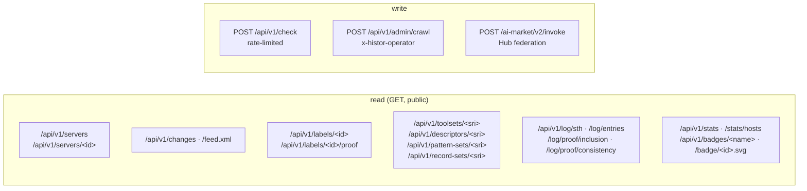

# API

> 🌐 **English** · [Русский](api.ru.md) · [Español](api.es.md) · [Français](api.fr.md) · [中文](api.zh.md)

Base URL: `https://histor.modelmarket.dev`. Everything is public, unauthenticated and read-only
except `POST /api/v1/check` (rate-limited) and the operator route. Public reads send
`Access-Control-Allow-Origin: *`. OpenAPI: [`/api/openapi.json`](https://histor.modelmarket.dev/api/openapi.json).



## Servers

| Method | Path | Returns |
|---|---|---|
| GET | `/api/v1/servers?q=&state=&limit=&offset=` | endpoints; `state` ∈ `all`, `pinned`, `changed`, `flagged`, `unobserved`; `q` matches name, endpoint, title |
| GET | `/api/v1/servers/<id>` | one endpoint: current tool set, WARDEN matches with spans, labels, collapsed timeline, changes, 30-day client reports, tool sets the publisher declares (`declaredToolSets`) |
| GET | `/badge/<id>.svg` | README badge: `pinned ‹date›`, `unchanged Nd`, `changed ‹date›`, `not observed`, `not listed` |

`<id>` is the first 16 hex characters of `sha256(name + "\n" + endpoint)` — stable, one per remote.

For a package, each `timeline` row carries `packageVersion`, the version that run was about (`serverVersion` is what the server said in `initialize`, often not the package version), and two versions are two rows even when they served the same list. Recorded since 2026-10-26; older rows have `null`. `launch` says how that run was started: `observer`, `image`, `entry`, `network` (`no route out`) and, when HISTOR supplied configuration, `supplied` with the env variable names (never values), args and pins. The same version can list other tools under other launch args or with the network.

## Changes

| Method | Path | Returns |
|---|---|---|
| GET | `/api/v1/changes?limit=&before=` | newest first; each with `summary.added`, `summary.removed`, `summary.modified[].fields` (word diff of descriptions, JSON-path diff of schemas) |
| GET | `/api/v1/changes/<id>` | one change |
| GET | `/api/v1/changes/<id>/cost` | what the change did to the tool list's token cost: every total before and after (`sent`, split into `names`, `descriptions`, `inputSchemas` and `structure`; `outputSchemas` and `listed` beside it), tools added and removed, and each tool whose count moved, with its description, its input schema and each top-level property of that schema apart |
| GET | `/api/v1/servers/<id>/cost?limit=` | the current list's cost per tool, and the totals of its last changes (up to 50) |
| GET | `/api/v1/cost/toolsets/<digest>` | the cost of one stored tool set |
| GET | `/feed.xml` | Atom feed of the latest 50 changes; `?watch=<id>,<id>,…` (up to 100 target ids, as `/check` and the server pages give them) keeps only those servers and packages — a subscription in any feed reader |

Counted as [tool-list-cost.md](tool-list-cost.md) counts (`o200k_base`). A deployment without the `cost` extra answers these three with 503.

For a package, a change also carries `from_package_version` and `to_package_version` (in `/cost`, `fromPackageVersion` and `toPackageVersion`): the last version that served the old list and the version that served the new one. Both are `null` for a remote server; `from_package_version` is `null` when the old list was last served before 2026-10-26.

Every change, remote or package, also carries `from_server_version` and `to_server_version` (in `/cost`, `fromServerVersion` and `toServerVersion`): the version the server reported about itself (`serverInfo`) in the last run that served the old list and in the run that saw the new one; and `from_registry_version` and `to_registry_version` (`fromRegistryVersion`, `toRegistryVersion`): the version the MCP registry listed for the entry at those two runs. When both pairs are equal, the list changed at an unchanged version, which a record keyed on the version cannot see. Server versions are filled for every change (`null` when the server reported none); registry versions are recorded since 2026-10-28 and are `null` before that and for curated entries. Each `timeline` row carries `registryVersion` too, and a new server or registry version starts a new row.

## Labels and evidence

| Method | Path | Returns |
|---|---|---|
| GET | `/api/v1/labels/<id>` | the signed label, `application/vc`, immutable |
| GET | `/api/v1/labels/<id>/proof?tree_size=` | leaf index, the STH, and the inclusion proof |
| GET | `/api/v1/toolsets/<sri>` · `/descriptors/<sri>` · `/pattern-sets/<sri>` · `/record-sets/<sri>` | content-addressed evidence, immutable |
| GET | `/api/v1/issuer` | the log's `did:key`, raw public key, current pattern-set and record-set digests, WARDEN package |

## Log

| Method | Path | Returns |
|---|---|---|
| GET | `/checkpoint` | the latest head as a C2SP checkpoint note (`text/plain`): log signature plus any witness cosignatures stored for that size — [spec §4.3](spec/transparency-log.md) |
| GET | `/api/v1/log/checkpoint/<size>` | the head at that size as a checkpoint note |
| POST | `/api/v1/log/cosignatures` | operator (`X-Histor-Operator`): `{"treeSize": N, "lines": ["— <witness> <base64>", …]}` — store cosignature lines a witness returned |
| POST | `/witness/v1/add-checkpoint` | c2sp.org/tlog-witness: co-sign another log's checkpoint (logs listed in `HISTOR_WITNESS_LOGS`) — [spec §8](spec/transparency-log.md) |
| GET | `/witness/v1/logs/<origin sha256 hex>/checkpoint` | the newest checkpoint this witness co-signed for that log |
| GET | `/api/v1/log/sth` | latest signed tree head |
| GET | `/api/v1/log/sth/<size>` | the head signed at that size |
| GET | `/api/v1/log/entries?start=&end=` | leaves in order (≤ 1000 per call) |
| GET | `/api/v1/log/proof/inclusion?leaf_index=&tree_size=` | RFC 9162 inclusion proof, hex |
| GET | `/api/v1/log/proof/consistency?first=&second=` | RFC 9162 consistency proof, hex |

## Receipts log

A second, independent log: anchors of market work receipts (AWR/2), submitted by the hubs that
issued them. An anchor carries four facts — the receipt's digest, the issuer's `did:key`, the
issue time, and the issuer's signature over them — and never the receipt itself. Its heads are
`histor.receipts-sth/v1`, signed by the same key as the label log's, over a separate tree.

| Method | Path | Returns |
|---|---|---|
| POST | `/api/v1/receipts/anchors` | `{"anchors": [...]}` (1–100) → one result per anchor: `logged`, `duplicate` or `refused` with a reason |
| GET | `/api/v1/receipts/sth` | latest signed head of the receipts log |
| GET | `/api/v1/receipts/sth/<size>` | the head signed at that size |
| GET | `/api/v1/receipts/proof?digest=&tree_size=` | the anchor, its leaf index and an RFC 9162 inclusion proof against a signed head |
| GET | `/api/v1/receipts/proof/consistency?first=&second=` | RFC 9162 consistency proof, hex |

Submissions are accepted only from the issuers listed in `HISTOR_RECEIPT_ISSUERS`
(comma-separated `did:key`s; empty = closed, the default) and only over the issuer's own
Ed25519 signature on the RFC 8785 bytes of `type`, `issuer`, `receiptDigest` and `issuedAt`.
`issuedAt` may lag by up to 30 days (a backlog after an outage) and lead by at most 5 minutes.

## /check

```http
POST /api/v1/check
Content-Type: application/json

{
  "endpoint": "https://example.com/mcp",      // or "name": "io.github.org/server"
  // a stdio server instead: "package": "npm:@scope/name" or "pypi:name"
  "tools": [ … ],                             // the tools array you received, or:
  "toolSetDigest": "sha256-…",                // its MTL/1 digest
  "contribute": true                          // optional: add (endpoint, digest, day) to a count
}
```

```json
{
  "type": "histor.check/v1",
  "checkedAt": "2026-09-23T10:02:11Z",
  "issuer": "did:key:z6Mk…",
  "query": { "endpoint": "…", "toolSetDigest": "sha256-…" },
  "target": { "id": "9c7f2af79fa057b2", "page": "…/s/9c7f2af79fa057b2", "badge": "…", "lastStatus": "ok" },
  "observed": { "toolSetDigest": "sha256-…", "unchangedSince": "…", "observations": 12, "changes": 0 },
  "match": "same",
  "note": "The tool definitions you sent are the set HISTOR currently observes at this endpoint.",
  "patternScan": { "status": "scanned", "block": 0, "advise": 1, "matches": [ … ] },
  "log": { "treeSize": 21480, "rootHash": "…", "timestamp": "…" },
  "signature": { "alg": "Ed25519", "verificationMethod": "…", "value": "…" }
}
```

`match` is one of `same`, `different`, `previously-observed` (with `seenBefore`), `not-observed`,
`not-listed`, `no-digest`. The answer is signed like a tree head (`type` `histor.check/v1`). If the
set was never scanned and your address still has scan budget, the WARDEN sidecar scans it on the
spot. Limits: 30 checks a minute and 20 fresh scans an hour per address; bodies over 2 MiB are
refused. With `contribute`, nothing but the day's count for that digest is stored.

For a stdio server (an npm or PyPI package your client starts), send `package` — `npm:<name>` or `pypi:<name>` — instead of `endpoint`; PyPI names are normalised for you. `target.packageVersion` is the version HISTOR last observed in its [package sandbox](operations.md#package-sandbox). A package name is never counted as an unlisted host. Two more answers for a package. `packageLookalike` (`of`, `weekly`, `how`, `ownWeekly`), for any package asked about, listed or not, names the popular package this one is named like — one character away, the same name under another scope, or other separators — when that one is downloaded at least 100 times more; generic names such as `mcp-server` are nobody's to imitate. `target.packageSignals` is what the registry says about the version HISTOR observed: `provenance` (an attested CI build), `publisher` (never an email), `installScripts`, and `flags` for what changed since the version observed before it — `provenance-lost`, `publisher-changed`, `install-scripts-added`, `new-dependencies` — the marks of a stolen publishing token.

`declared` appears when the set you sent is one the server's publisher declares (next section): `toolSetDigest`, `toolCount`, `when` (the publisher's condition, in its words), `source` — `registry` for the registry entry itself, `url` for the declaration file it points at (then with `url`) — `registryVersion`, `firstDeclared`, `lastDeclared`. `match` still says what HISTOR observed: a declared set HISTOR never saw stays `different`, or `not-observed` when HISTOR holds no set at all, and the note adds that the publisher declares it, and where.

## Declaring tool sets (publishers)

A server can list different tools on different machines. A launcher hands stdio to a program installed next to it and, where the program is missing (as in HISTOR's sandbox), lists only an "install me" tool; a real key can unlock tools a placeholder does not. HISTOR records what it observes. A publisher who knows the other sets names them by MTL/1 digest in the `server.json` it publishes to the official MCP registry, in the field the registry keeps for downstream registries:

```json
"_meta": {
  "io.modelcontextprotocol.registry/publisher-provided": {
    "dev.modelmarket.histor/tool-sets": {
      "mtl": "1",
      "sets": [
        { "digest": "sha256-…", "count": 23, "when": "the runner is installed" }
      ],
      "url": "https://example.com/.well-known/mcp-tool-sets.json"
    }
  }
}
```

`sets`, `url` or both.

- `sets`: at most 8 (the registry keeps about 4 KB here). Each has `digest` (required: the MTL/1 digest of the `tools/list` result), `count` (optional: the number of tools, for display) and `when` (optional, at most 200 characters: the condition in your words, shown as yours; control and invisible characters are dropped).
- `url`: a declaration file on your own domain, for sets that change without a new registry entry — a runner released apart from the package, one per operating system. The file is the same object, `{"mtl": "1", "sets": [...]}`, with up to 64 sets. HISTOR reads it at every crawl and every hour between crawls, so a set added with a runner release is known within the hour. An explicit `"sets": []` withdraws every set the file listed.

**Where the file may be.** On the domain the registry verified for the server's namespace, or a subdomain: `ai.example/server` → `example.com`, `docs.example.com`. For `io.github.<user>/…`: `<user>.github.io`, or under `/<user>/` on `raw.githubusercontent.com` or `gist.githubusercontent.com`. https on the default port, no redirects, at most 64 KiB, public addresses only. A `url` anywhere else is skipped: nobody else can speak for the publisher through a file.

**Writing it.** WARDEN 0.16 does it on a machine that gets the set:

```bash
npx -y @aimarket/warden declare --when "runner 1.4, macOS" --out mcp-tool-sets.json -- npx -y @example/launcher
```

starts the server the way a client would, digests its `tools/list` and adds the set to the file (created if missing; other sets kept, the same digest replaced). Run it on each operating system and runner version, then publish the file. `--server-json --link URL` prints the block above for the registry entry; `--check URL --name SERVER` reads the published file the way HISTOR will and says what HISTOR takes from it. With an older WARDEN, `npx -y @aimarket/warden scan --json` prints the digest as `mtlDigest`.

**What HISTOR does with it.** It applies the declaration to every endpoint and package of the server, from the server's latest registry entry, and keeps the first and the last day it read each set; a set no longer named is marked withdrawn, not deleted. A file that cannot be read keeps what it declared until the next good read — a failed read is not a withdrawal — and the server page shows when the file was last read and why a read failed. When the entry stops pointing at a file, what only the file declared is withdrawn. A digest named in both places counts as the registry entry's. Anything that breaks the rules is skipped, and the crawl says why (`lastRun.declaredToolSets.ignored`, and `unread` for a file it could not read, in `/api/v1/stats`).

A declaration is the publisher's word: the registry vouches that it comes from whoever controls the server's namespace, and the file is bound to the same domain or account. HISTOR never counts it as an observation, issues no label about it and never sees the tools behind it. WARDEN reports a declared set as `HISTOR_DECLARED_TOOLSET` (low; info when HISTOR has no set of its own) instead of `HISTOR_UNSEEN_TOOLSET`, says where the declaration is, and still runs every one of its own checks on the tools.

## Stats and live badges

| Path | Returns |
|---|---|
| `/api/v1/stats` | the last crawl (registry size, what the endpoints answered, what was not dialled, labels issued), current counts, changes in the last 24 h / 7 d / 30 d, log size, client reports in 7 d; `lastRun.declaredToolSets`: servers that declare tool sets, and entries skipped with the reason |
| `/api/v1/stats/hosts?limit=` | endpoints per host among dialled ones |
| `/api/v1/badges/log` · `pinned` · `changes` · `sth` | [shields.io endpoint](https://shields.io/badges/endpoint-badge) JSON for README badges |
| `/health` | liveness, store backend, tree size, whether a crawl is running, last crawl error |

## Federation (AIMarket Hub)

HISTOR is an AIMarket peer: `/.well-known/ai-market.json` (signed whole), `/ai-market/v2/manifest`
(signed with the Hub's manifest canonical), and `POST /ai-market/v2/invoke` with three free
capabilities:

| Capability | Input | Result |
|---|---|---|
| `histor.check@v1` | the `/check` body | the signed `/check` answer |
| `histor.server@v1` | `{"endpoint": …}` or `{"name": …}` | up to 10 matching endpoints |
| `histor.changes@v1` | `{"limit": 1–100}` | the newest changes |

Every reply carries an interop receipt a Hub verifies against the key in `.well-known`, hybrid
Ed25519 + ML-DSA-65 when `HISTOR_PQC=1`.

## Operator

`POST /api/v1/admin/crawl` with `x-histor-operator: $HISTOR_OPERATOR_TOKEN` starts a crawl now
(202), or answers 409 if one is running. Without a configured token the route answers 503.

`GET /api/v1/admin/unlisted?days=7&limit=100` (same header) lists the hosts `/check` was asked about that HISTOR does not list, most asked first: `host`, `queries`, `days`, `first_day`, `last_day`. Only the host name of an https endpoint with a public DNS name is counted — never the path or query, the caller's address or any tool — once per address, host and day; days older than 90 are pruned. This is how the curated list (`histor/curated.json`) grows from the servers people actually use.
