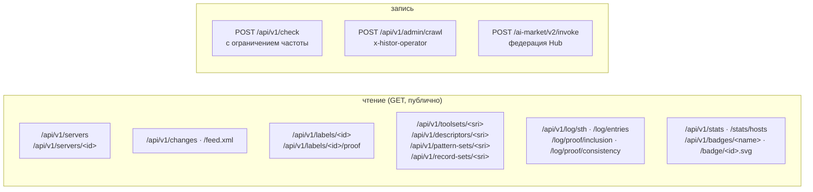

# API

> 🌐 [English](api.md) · **Русский** · [Español](api.es.md) · [Français](api.fr.md) · [中文](api.zh.md)

Базовый URL: `https://histor.modelmarket.dev`. Всё публично, без аутентификации и только для
чтения, кроме `POST /api/v1/check` (с ограничением частоты) и маршрута оператора. Публичные чтения
отдают `Access-Control-Allow-Origin: *`. OpenAPI: [`/api/openapi.json`](https://histor.modelmarket.dev/api/openapi.json).



## Серверы

| Метод | Путь | Возвращает |
|---|---|---|
| GET | `/api/v1/servers?q=&state=&limit=&offset=` | эндпоинты; `state` ∈ `all`, `pinned`, `changed`, `flagged`, `unobserved`; `q` ищет по имени, эндпоинту и заголовку |
| GET | `/api/v1/servers/<id>` | один эндпоинт: текущий набор инструментов, совпадения WARDEN с позициями в тексте, метки, свёрнутая хронология, изменения, сообщения клиентов за 30 дней, наборы, которые заявляет издатель (`declaredToolSets`) |
| GET | `/badge/<id>.svg` | бейдж для README: `pinned ‹date›`, `unchanged Nd`, `changed ‹date›`, `not observed`, `not listed` |

`<id>` — первые 16 шестнадцатеричных символов `sha256(name + "\n" + endpoint)`: стабильный, по
одному на удалённый эндпоинт.

У пакета каждая строка `timeline` несёт `packageVersion` — версию, которую запускало это наблюдение (`serverVersion` — то, что сервер сообщил в `initialize`, и это часто не версия пакета); две версии — две строки, даже если они отдавали один и тот же список. Записывается с 2026-10-26; у более старых строк `null`.

## Изменения

| Метод | Путь | Возвращает |
|---|---|---|
| GET | `/api/v1/changes?limit=&before=` | сначала новые; у каждого `summary.added`, `summary.removed`, `summary.modified[].fields` (пословный дифф описаний, дифф схем по JSON-путям) |
| GET | `/api/v1/changes/<id>` | одно изменение |
| GET | `/api/v1/changes/<id>/cost` | что изменение сделало со стоимостью списка инструментов в токенах: каждый итог до и после (`sent`, разложенный на `names`, `descriptions`, `inputSchemas` и `structure`; рядом `outputSchemas` и `listed`), добавленные и удалённые инструменты и каждый инструмент, чей счёт сдвинулся, с описанием, входной схемой и каждым свойством верхнего уровня этой схемы отдельно |
| GET | `/api/v1/servers/<id>/cost?limit=` | стоимость текущего списка по инструментам и итоги его последних изменений (до 50) |
| GET | `/api/v1/cost/toolsets/<digest>` | стоимость одного сохранённого набора инструментов |
| GET | `/feed.xml` | Atom-лента последних 50 изменений; `?watch=<id>,<id>,…` (до 100 идентификаторов целей, как их дают `/check` и страницы серверов) оставляет только эти серверы и пакеты — подписка в любом читателе лент |

Считается так же, как в [tool-list-cost.ru.md](tool-list-cost.ru.md) (`o200k_base`). Развёртывание без extra `cost` отвечает на эти три пути 503.

У пакета изменение также несёт `from_package_version` и `to_package_version` (в `/cost` — `fromPackageVersion` и `toPackageVersion`): последнюю версию, которая отдавала старый список, и версию, которая отдала новый. У удалённого сервера обе `null`; `from_package_version` равна `null`, если старый список последний раз отдавался до 2026-10-26.

## Метки и свидетельства

| Метод | Путь | Возвращает |
|---|---|---|
| GET | `/api/v1/labels/<id>` | подписанная метка, `application/vc`, неизменяемая |
| GET | `/api/v1/labels/<id>/proof?tree_size=` | индекс листа, подписанная вершина дерева (STH) и доказательство включения |
| GET | `/api/v1/toolsets/<sri>` · `/descriptors/<sri>` · `/pattern-sets/<sri>` · `/record-sets/<sri>` | свидетельства с адресацией по содержимому, неизменяемые |
| GET | `/api/v1/issuer` | `did:key` журнала, сырой открытый ключ, текущие дайджесты набора шаблонов и набора записей, пакет WARDEN |

## Журнал

| Метод | Путь | Возвращает |
|---|---|---|
| GET | `/api/v1/log/sth` | последняя подписанная вершина дерева |
| GET | `/api/v1/log/sth/<size>` | вершина, подписанная при этом размере |
| GET | `/api/v1/log/entries?start=&end=` | листья по порядку (≤ 1000 за вызов) |
| GET | `/api/v1/log/proof/inclusion?leaf_index=&tree_size=` | доказательство включения по RFC 9162, hex |
| GET | `/api/v1/log/proof/consistency?first=&second=` | доказательство согласованности по RFC 9162, hex |

## Журнал квитанций

Второй, независимый журнал: якоря рабочих квитанций рынка (AWR/2), которые присылают выпустившие
их хабы. Якорь несёт четыре факта — digest квитанции, `did:key` издателя, время выпуска и подпись
издателя над ними — и никогда саму квитанцию. Его вершины — `histor.receipts-sth/v1`, подписаны
тем же ключом, что и у журнала меток, но над отдельным деревом.

| Метод | Путь | Возвращает |
|---|---|---|
| POST | `/api/v1/receipts/anchors` | `{"anchors": [...]}` (1–100) → по результату на якорь: `logged`, `duplicate` или `refused` с причиной |
| GET | `/api/v1/receipts/sth` | последняя подписанная вершина журнала квитанций |
| GET | `/api/v1/receipts/sth/<size>` | вершина, подписанная при этом размере |
| GET | `/api/v1/receipts/proof?digest=&tree_size=` | якорь, индекс листа и доказательство включения по RFC 9162 относительно подписанной вершины |
| GET | `/api/v1/receipts/proof/consistency?first=&second=` | доказательство согласованности по RFC 9162, hex |

Приём открыт только издателям из `HISTOR_RECEIPT_ISSUERS` (`did:key` через запятую; пусто —
журнал закрыт, так по умолчанию) и только по собственной подписи издателя Ed25519 над байтами
RFC 8785 полей `type`, `issuer`, `receiptDigest` и `issuedAt`. `issuedAt` может отставать до
30 дней (накопившееся после сбоя) и опережать не больше чем на 5 минут.

## /check

```http
POST /api/v1/check
Content-Type: application/json

{
  "endpoint": "https://example.com/mcp",      // or "name": "io.github.org/server"
  // a stdio server instead: "package": "npm:@scope/name" or "pypi:name"
  "tools": [ … ],                             // the tools array you received, or:
  "toolSetDigest": "sha256-…",                // its MTL/1 digest
  "contribute": true                          // optional: add (endpoint, digest, day) to a count
}
```

```json
{
  "type": "histor.check/v1",
  "checkedAt": "2026-09-23T10:02:11Z",
  "issuer": "did:key:z6Mk…",
  "query": { "endpoint": "…", "toolSetDigest": "sha256-…" },
  "target": { "id": "9c7f2af79fa057b2", "page": "…/s/9c7f2af79fa057b2", "badge": "…", "lastStatus": "ok" },
  "observed": { "toolSetDigest": "sha256-…", "unchangedSince": "…", "observations": 12, "changes": 0 },
  "match": "same",
  "note": "The tool definitions you sent are the set HISTOR currently observes at this endpoint.",
  "patternScan": { "status": "scanned", "block": 0, "advise": 1, "matches": [ … ] },
  "log": { "treeSize": 21480, "rootHash": "…", "timestamp": "…" },
  "signature": { "alg": "Ed25519", "verificationMethod": "…", "value": "…" }
}
```

`match` принимает одно из значений `same`, `different`, `previously-observed` (с `seenBefore`),
`not-observed`, `not-listed`, `no-digest`. Ответ подписан так же, как вершина дерева (`type`
`histor.check/v1`). Если набор ещё ни разу не сканировался, а у вашего адреса остался бюджет
сканирований, сайдкар WARDEN сканирует его на месте. Лимиты: 30 проверок в минуту и 20 новых
сканирований в час на адрес; тела запросов больше 2 MiB отклоняются. С `contribute` не хранится
ничего, кроме дневного счётчика для этого дайджеста.

Для stdio-сервера (пакета npm или PyPI, который запускает ваш клиент) передайте `package` — `npm:<имя>` или `pypi:<имя>` — вместо `endpoint`; имена PyPI нормализуются за вас. `target.packageVersion` — версия, которую HISTOR последней прочитал в своей [песочнице для пакетов](operations.ru.md#песочница-для-пакетов). Имя пакета никогда не считается незнакомым хостом. Ещё два ответа для пакета. `packageLookalike` (`of`, `weekly`, `how`, `ownWeekly`) — для любого пакета, о котором спросили, в списке он или нет, — называет популярный пакет, на который это имя похоже: на один символ, то же имя под другим scope или с другими разделителями, если популярный скачивают хотя бы в 100 раз чаще; общие имена вроде `mcp-server` ничьи. `target.packageSignals` — что реестр говорит о прочитанной HISTOR версии: `provenance` (подтверждённая сборка в CI), `publisher` (никогда не email), `installScripts` и `flags` — что изменилось с предыдущей прочитанной версии: `provenance-lost`, `publisher-changed`, `install-scripts-added`, `new-dependencies`. Это признаки украденного токена публикации.

`declared` появляется, когда присланный набор заявляет издатель сервера (следующий раздел): `toolSetDigest`, `toolCount`, `when` (условие издателя, его словами), `source` — `registry`, если набор в самой записи реестра, `url`, если в файле заявления, на который запись ссылается (тогда есть и `url`), — `registryVersion`, `firstDeclared`, `lastDeclared`. `match` по-прежнему говорит, что наблюдал HISTOR: заявленный набор, которого HISTOR не видел, остаётся `different`, или `not-observed`, если у HISTOR нет никакого набора, а в примечании добавлено, что его заявляет издатель и где.

## Заявленные наборы инструментов (для издателей)

Сервер может отдавать разные инструменты на разных машинах. Запускатель передаёт stdio программе, установленной рядом, а там, где её нет (как в песочнице HISTOR), отдаёт только инструмент «установи меня»; настоящий ключ может открыть инструменты, которых нет с заглушкой. HISTOR записывает то, что наблюдает. Издатель, который знает другие наборы, называет их по дайджесту MTL/1 в `server.json`, который он публикует в официальный реестр MCP, в поле, которое реестр хранит для последующих реестров:

```json
"_meta": {
  "io.modelcontextprotocol.registry/publisher-provided": {
    "dev.modelmarket.histor/tool-sets": {
      "mtl": "1",
      "sets": [
        { "digest": "sha256-…", "count": 23, "when": "the runner is installed" }
      ],
      "url": "https://example.com/.well-known/mcp-tool-sets.json"
    }
  }
}
```

`sets`, `url` или оба.

- `sets`: не больше 8 (здесь реестр хранит около 4 КБ). У каждого — `digest` (обязательно: дайджест MTL/1 результата `tools/list`), `count` (необязательно: число инструментов, для показа) и `when` (необязательно, не длиннее 200 символов: условие вашими словами, показывается как ваше; управляющие и невидимые символы отбрасываются).
- `url`: файл заявления на вашем домене — для наборов, которые меняются без новой записи в реестре: раннер выходит отдельно от пакета, отдельно под каждую ОС. Файл — тот же объект, `{"mtl": "1", "sets": [...]}`, до 64 наборов. HISTOR читает его при каждом обходе и каждый час между обходами, так что набор, добавленный вместе с выпуском раннера, известен в течение часа. Явный `"sets": []` отзывает все наборы, которые были в файле.

**Где может лежать файл.** На домене, который реестр проверил для пространства имён сервера, или на его поддомене: `ai.example/server` → `example.com`, `docs.example.com`. Для `io.github.<user>/…` — `<user>.github.io` или путь `/<user>/` на `raw.githubusercontent.com` или `gist.githubusercontent.com`. https на стандартном порту, без перенаправлений, не больше 64 КиБ, только публичные адреса. `url` в любом другом месте пропускается: через файл никто другой не может говорить за издателя.

**Как его написать.** WARDEN 0.16 делает это на машине, которая получает набор:

```bash
npx -y @aimarket/warden declare --when "runner 1.4, macOS" --out mcp-tool-sets.json -- npx -y @example/launcher
```

запускает сервер так же, как клиент, считает дайджест его `tools/list` и добавляет набор в файл (создаёт, если файла нет; остальные наборы сохраняются, тот же дайджест заменяется). Запустите на каждой ОС и версии раннера, затем опубликуйте файл. `--server-json --link URL` печатает блок выше для записи в реестре; `--check URL --name SERVER` читает опубликованный файл так же, как прочтёт HISTOR, и говорит, что HISTOR из него возьмёт. Со старым WARDEN дайджест печатает `npx -y @aimarket/warden scan --json` в поле `mtlDigest`.

**Что HISTOR с этим делает.** Относит заявление ко всем адресам и пакетам сервера, по последней записи сервера в реестре, и хранит первый и последний день, когда прочитал каждый набор; набор, который перестали называть, помечается отозванным, а не удаляется. Файл, который не удалось прочитать, сохраняет заявленное до следующего удачного чтения — неудачное чтение не считается отзывом, — а страница сервера показывает, когда файл читали последний раз и почему чтение не удалось. Когда запись перестаёт ссылаться на файл, всё, что заявлял только файл, отзывается. Дайджест, названный в обоих местах, считается заявленным в записи реестра. Всё, что нарушает правила, пропускается, и обход говорит почему (`lastRun.declaredToolSets.ignored`, а для файла, который не удалось прочитать, — `unread`, в `/api/v1/stats`).

Заявление — слово издателя: реестр ручается, что оно от того, кто владеет пространством имён сервера, а файл привязан к тому же домену или аккаунту. HISTOR никогда не считает его наблюдением, не выдаёт о нём меток и не видит инструментов за ним. WARDEN сообщает о заявленном наборе как `HISTOR_DECLARED_TOOLSET` (low; info, когда у HISTOR нет своего набора) вместо `HISTOR_UNSEEN_TOOLSET`, говорит, где заявление, и по-прежнему выполняет над инструментами все свои проверки.

## Статистика и живые бейджи

| Путь | Возвращает |
|---|---|
| `/api/v1/stats` | последний обход (размер реестра, что ответили эндпоинты, к чему не подключались, сколько меток выпущено), текущие счётчики, изменения за последние 24 ч / 7 дн / 30 дн, размер журнала, сообщения клиентов за 7 дн; `lastRun.declaredToolSets` — серверы, заявляющие наборы инструментов, и пропущенные записи с причиной |
| `/api/v1/stats/hosts?limit=` | число эндпоинтов на хост среди тех, к которым подключались |
| `/api/v1/badges/log` · `pinned` · `changes` · `sth` | JSON для [эндпоинт-бейджа shields.io](https://shields.io/badges/endpoint-badge) в README |
| `/health` | liveness, бэкенд хранилища, размер дерева, идёт ли обход, последняя ошибка обхода |

## Федерация (AIMarket Hub)

HISTOR — пир AIMarket: `/.well-known/ai-market.json` (подписан целиком), `/ai-market/v2/manifest`
(подписан по канонической форме манифеста Hub) и `POST /ai-market/v2/invoke` с тремя бесплатными
capability:

| Capability | Вход | Результат |
|---|---|---|
| `histor.check@v1` | тело `/check` | подписанный ответ `/check` |
| `histor.server@v1` | `{"endpoint": …}` или `{"name": …}` | до 10 подходящих эндпоинтов |
| `histor.changes@v1` | `{"limit": 1–100}` | самые новые изменения |

Каждый ответ несёт interop-квитанцию, которую Hub верифицирует по ключу из `.well-known`; при
`HISTOR_PQC=1` это гибридная подпись Ed25519 + ML-DSA-65.

## Оператор

`POST /api/v1/admin/crawl` с `x-histor-operator: $HISTOR_OPERATOR_TOKEN` сразу запускает обход
(202) или отвечает 409, если обход уже идёт. Без настроенного токена маршрут отвечает 503.

`GET /api/v1/admin/unlisted?days=7&limit=100` (тот же заголовок) показывает хосты, о которых спрашивали `/check`, но которых HISTOR не знает, — самые частые первыми: `host`, `queries`, `days`, `first_day`, `last_day`. Считается только имя хоста https-эндпоинта с публичным DNS-именем — никогда путь или параметры, адрес спрашивающего или инструменты — не чаще раза в день на адрес и хост; дни старше 90 удаляются. Так собственный список HISTOR (`histor/curated.json`) пополняется серверами, которыми люди действительно пользуются.
