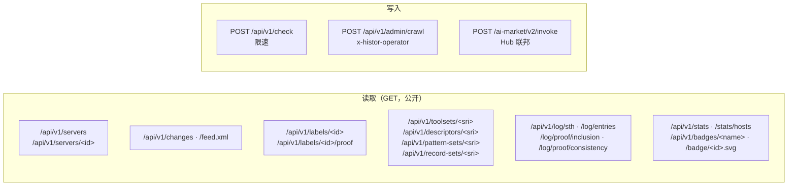

# API

> 🌐 [English](api.md) · [Русский](api.ru.md) · [Español](api.es.md) · [Français](api.fr.md) · **中文**

基础 URL：`https://histor.modelmarket.dev`。除 `POST /api/v1/check`（限速）和运营方路由外，一切都是
公开、无需鉴权且只读的。公开读取接口会发送 `Access-Control-Allow-Origin: *`。OpenAPI：
[`/api/openapi.json`](https://histor.modelmarket.dev/api/openapi.json)。



## 服务器

| 方法 | 路径 | 返回 |
|---|---|---|
| GET | `/api/v1/servers?q=&state=&limit=&offset=` | 端点列表；`state` ∈ `all`、`pinned`、`changed`、`flagged`、`unobserved`（未读到工具列表）、`undigested`（已读到列表但没有摘要）；`q` 匹配名称、端点、标题 |
| GET | `/api/v1/servers/<id>` | 单个端点：当前工具集、带匹配区间的 WARDEN 匹配项、标签、折叠后的时间线、变更、30 天内的客户端报告、发布者声明的工具集（`declaredToolSets`） |
| GET | `/badge/<id>.svg` | README 徽章：`pinned ‹date›`、`unchanged Nd`、`changed ‹date›`、`not observed`、`not listed` |

`<id>` 是 `sha256(name + "\n" + endpoint)` 的前 16 个十六进制字符——稳定不变，每个远程端点一个。

对于软件包，`timeline` 的每一行都带有 `packageVersion`，即该次观测运行的版本（`serverVersion` 是服务器在 `initialize` 中报告的版本，往往不是软件包版本）；两个版本即使提供同一份列表，也是两行。自 2026-10-26 起记录；更早的行为 `null`。`launch` 说明该次运行如何启动：`observer`、`image`、`entry`、`network`（`no route out`），以及 HISTOR 提供配置时的 `supplied`：环境变量名（从不包含值）、参数和 pins。同一版本在不同启动参数下或有网络时，可能列出不同的工具。

`/fingerprints` 让客户端以自己的格式比较它收到的定义与 HISTOR 观察到的定义。使用 Vercel AI SDK：`detectToolDrift(await fingerprintTools(await mcpClient.tools()), (await (await fetch(url)).json()).fingerprints)`；出现在 `changed` 或 `added` 中的工具与公开观察不同。各格式覆盖的成员不同（Vercel 的不含 `outputSchema` 和注解提示），而且服务器可能向另一个客户端提供不同的定义：协议版本、启动环境或配置不同时都会如此。`lastObserved` 表示 HISTOR 最后一次看到该集合的时间。

## 变更

| 方法 | 路径 | 返回 |
|---|---|---|
| GET | `/api/v1/changes?limit=&before=` | 最新的在前；每条含 `summary.added`、`summary.removed`、`summary.modified[].fields`（描述按词比较差异，schema 按 JSON 路径比较差异） |
| GET | `/api/v1/changes/<id>` | 单条变更 |
| GET | `/api/v1/changes/<id>/cost` | 该变更对工具列表 token 成本的影响：前后各项合计（`sent`，拆分为 `names`、`descriptions`、`inputSchemas` 和 `structure`；另列 `outputSchemas` 和 `listed`），新增和移除的工具，以及每个计数有变化的工具（描述、输入 schema 以及该 schema 的每个顶层属性分开列出） |
| GET | `/api/v1/servers/<id>/cost?limit=` | 当前列表按工具的成本，以及最近几次变更（最多 50 次）的合计 |
| GET | `/api/v1/servers/<id>/fingerprints?format=` | 以其他格式给出当前工具集中每个工具的指纹：`vercel-ai`（Vercel AI SDK 的 `fingerprintTools`，默认）、`heldfast`（heldfast 锁文件摘要）或 `agentavow-v1`（`agentavow.mcp-tool-definition.v1`）；额外成员超出存储上限的工具列在 `incomplete` 中，不给指纹 |
| GET | `/api/v1/cost/toolsets/<digest>` | 一个已存储工具集的成本 |
| GET | `/feed.xml` | 最近 50 条变更的 Atom 订阅源；`?watch=<id>,<id>,…`（最多 100 个目标 id，即 `/check` 和服务器页面给出的 id）只保留这些服务器和软件包——可在任意订阅阅读器中订阅 |

计数方法同 [tool-list-cost.zh.md](tool-list-cost.zh.md)（`o200k_base`）。未安装 `cost` extra 的部署对这三个路径返回 503。

对于软件包，变更还带有 `from_package_version` 和 `to_package_version`（在 `/cost` 中为 `fromPackageVersion` 和 `toPackageVersion`）：最后一个提供旧列表的版本，以及提供新列表的版本。远程服务器两者均为 `null`；旧列表最后一次提供早于 2026-10-26 时，`from_package_version` 为 `null`。

每个变更（远程服务器或软件包）还带有 `from_server_version` 和 `to_server_version`（在 `/cost` 中为 `fromServerVersion` 和 `toServerVersion`）：服务器在提供旧列表的最后一次观测和看到新列表的那次观测中自报的版本（`serverInfo`）；以及 `from_registry_version` 和 `to_registry_version`（`fromRegistryVersion`、`toRegistryVersion`）：MCP 注册表在这两次观测时为该条目列出的版本。两组值都相同时，说明列表在版本未变的情况下发生了变化，以版本为键的记录看不到这种变化。所有变更都填有服务器版本（服务器未报告时为 `null`）；注册表版本自 2026-10-28 起记录，此前以及精选条目为 `null`。`timeline` 的每一行也带有 `registryVersion`，服务器或注册表版本变化时另起一行。

## 标签与证据

| 方法 | 路径 | 返回 |
|---|---|---|
| GET | `/api/v1/labels/<id>` | 签名标签，`application/vc`，不可变 |
| GET | `/api/v1/labels/<id>/proof?tree_size=` | 叶子索引、签名树头（STH）以及包含证明 |
| GET | `/api/v1/toolsets/<sri>` · `/descriptors/<sri>` · `/pattern-sets/<sri>` · `/record-sets/<sri>` | 内容寻址的证据，不可变 |
| GET | `/api/v1/issuer` | 日志的 `did:key`、原始公钥、当前模式集与记录集的摘要、WARDEN 软件包 |

## 日志

| 方法 | 路径 | 返回 |
|---|---|---|
| GET | `/api/v1/log/sth` | 最新的签名树头 |
| GET | `/api/v1/log/sth/<size>` | 在该大小时签发的树头 |
| GET | `/api/v1/log/entries?start=&end=` | 按顺序排列的叶子（每次调用 ≤ 1000 条） |
| GET | `/api/v1/log/proof/inclusion?leaf_index=&tree_size=` | RFC 9162 包含证明，十六进制 |
| GET | `/api/v1/log/proof/consistency?first=&second=` | RFC 9162 一致性证明，十六进制 |

## 收据日志

第二个彼此独立的日志：市场工作收据（AWR/2）的锚点，由签发收据的中心节点提交。一个锚点只携带四项事实——收据的摘要、签发方的 `did:key`、签发时间，以及签发方对这些事实的签名——绝不包含收据本身。它的树头是 `histor.receipts-sth/v1`，与标签日志使用同一把密钥签名，但覆盖的是另一棵树。

| 方法 | 路径 | 返回 |
|---|---|---|
| POST | `/api/v1/receipts/anchors` | `{"anchors": [...]}`（1–100 个）→ 每个锚点一个结果：`logged`、`duplicate` 或附带原因的 `refused` |
| GET | `/api/v1/receipts/sth` | 收据日志最新的已签名树头 |
| GET | `/api/v1/receipts/sth/<size>` | 在该大小时签名的树头 |
| GET | `/api/v1/receipts/proof?digest=&tree_size=` | 锚点、其叶子索引，以及相对某个已签名树头的 RFC 9162 包含证明 |
| GET | `/api/v1/receipts/proof/consistency?first=&second=` | RFC 9162 一致性证明，十六进制 |

只接受 `HISTOR_RECEIPT_ISSUERS` 中列出的签发方（以逗号分隔的 `did:key`；为空即关闭，这是默认值）提交，且必须带有签发方本人对 `type`、`issuer`、`receiptDigest` 和 `issuedAt` 的 RFC 8785 字节所做的 Ed25519 签名。`issuedAt` 最多可滞后 30 天（故障后的积压），最多只能超前 5 分钟。

## /check

```http
POST /api/v1/check
Content-Type: application/json

{
  "endpoint": "https://example.com/mcp",      // or "name": "io.github.org/server"
  // a stdio server instead: "package": "npm:@scope/name" or "pypi:name"
  "tools": [ … ],                             // the tools array you received, or:
  "toolSetDigest": "sha256-…",                // its MTL/1 digest
  "contribute": true                          // optional: add (endpoint, digest, day) to a count
}
```

```json
{
  "type": "histor.check/v1",
  "checkedAt": "2026-09-23T10:02:11Z",
  "issuer": "did:key:z6Mk…",
  "query": { "endpoint": "…", "toolSetDigest": "sha256-…" },
  "target": { "id": "9c7f2af79fa057b2", "page": "…/s/9c7f2af79fa057b2", "badge": "…", "lastStatus": "ok" },
  "observed": { "toolSetDigest": "sha256-…", "unchangedSince": "…", "observations": 12, "changes": 0 },
  "match": "same",
  "note": "The tool definitions you sent are the set HISTOR currently observes at this endpoint.",
  "patternScan": { "status": "scanned", "block": 0, "advise": 1, "matches": [ … ] },
  "log": { "treeSize": 21480, "rootHash": "…", "timestamp": "…" },
  "signature": { "alg": "Ed25519", "verificationMethod": "…", "value": "…" }
}
```

`match` 取值为 `same`、`different`、`previously-observed`（附 `seenBefore`）、`not-observed`、
`not-listed`、`no-digest` 之一。应答像树头一样签名（`type` 为 `histor.check/v1`）。如果该工具集从未
被扫描过，而您的地址仍有扫描预算，WARDEN 边车会当场扫描它。限制：每个地址每分钟 30 次检查、每小时
20 次新扫描；超过 2 MiB 的请求体会被拒绝。使用 `contribute` 时，除了该摘要当天的计数之外，不存储
任何内容。

对于 stdio 服务器（由你的客户端启动的 npm 或 PyPI 软件包），用 `package`——`npm:<名称>` 或 `pypi:<名称>`——代替 `endpoint`；PyPI 名称会替你规范化。`target.packageVersion` 是 HISTOR 在其[软件包沙箱](operations.zh.md#软件包沙箱)中最近观察到的版本。软件包名称永远不会被计为未知主机。 对软件包还有两项应答。`packageLookalike`（`of`、`weekly`、`how`、`ownWeekly`）：对任何被询问的软件包（无论是否已收录），当某个热门软件包的下载量至少高出 100 倍时，指出此名称模仿的那个热门软件包——相差一个字符、在另一个 scope 下同名，或仅分隔符不同；`mcp-server` 这类通用名称不属于任何人。`target.packageSignals` 是注册表对 HISTOR 所观察版本的说明：`provenance`（经证明的 CI 构建）、`publisher`（从不包含邮箱）、`installScripts`，以及 `flags`——相对上一个观察到的版本发生了什么变化：`provenance-lost`、`publisher-changed`、`install-scripts-added`、`new-dependencies`，这些是发布令牌被盗的典型迹象。

当你发送的工具集是服务器发布者声明的工具集时（见下一节），会出现 `declared`：`toolSetDigest`、`toolCount`、`when`（发布者的条件，用其原话）、`source`——`registry` 表示在注册表条目本身中，`url` 表示在条目指向的声明文件中（此时还有 `url`）——、`registryVersion`、`firstDeclared`、`lastDeclared`。`match` 仍然表示 HISTOR 观测到的情况：HISTOR 从未见过的已声明工具集仍为 `different`，HISTOR 完全没有工具集时为 `not-observed`，说明中会补充发布者声明了它以及在哪里声明。

## 声明工具集（发布者）

同一个服务器在不同机器上可能列出不同的工具。启动器把 stdio 交给安装在旁边的程序，而在缺少该程序的地方（例如 HISTOR 的沙箱），只列出一个“请安装我”的工具；真实的密钥可能解锁占位符无法解锁的工具。HISTOR 记录它观测到的内容。知道其他工具集的发布者，用 MTL/1 摘要在发布到官方 MCP 注册表的 `server.json` 中列出它们，放在注册表为下游注册表保留的字段里：

```json
"_meta": {
  "io.modelcontextprotocol.registry/publisher-provided": {
    "dev.modelmarket.histor/tool-sets": {
      "mtl": "1",
      "sets": [
        { "digest": "sha256-…", "count": 23, "when": "the runner is installed" }
      ],
      "url": "https://example.com/.well-known/mcp-tool-sets.json"
    }
  }
}
```

`sets`、`url` 或两者都写。

- `sets`：最多 8 个（注册表在这里保存约 4 KB）。每个包含 `digest`（必填：`tools/list` 结果的 MTL/1 摘要）、`count`（可选：工具数量，用于显示）和 `when`（可选，最多 200 个字符：用你自己的话写的条件，按你的原话显示；控制字符和不可见字符会被去掉）。
- `url`：放在你自己域名上的声明文件，用于不发布新注册表条目也会变化的工具集——与软件包分开发布的运行器、每个操作系统各一个。文件是同样的对象 `{"mtl": "1", "sets": [...]}`，最多 64 个工具集。HISTOR 在每次爬取时读取它，并在两次爬取之间每小时读取一次，因此随运行器发布而新增的工具集在一小时内就会被知道。显式的 `"sets": []` 会撤回该文件列出的全部工具集。

**文件可以放在哪里。** 注册表为该服务器命名空间验证过的域名或其子域名：`ai.example/server` → `example.com`、`docs.example.com`。对于 `io.github.<user>/…`：`<user>.github.io`，或 `raw.githubusercontent.com`、`gist.githubusercontent.com` 上 `/<user>/` 之下。默认端口的 https，不跟随重定向，最多 64 KiB，只允许公网地址。放在其他任何地方的 `url` 都会被跳过：别人无法通过文件替发布者发言。

**如何编写。** WARDEN 0.16 在能拿到该工具集的机器上完成：

```bash
npx -y @aimarket/warden declare --when "runner 1.4, macOS" --out mcp-tool-sets.json -- npx -y @example/launcher
```

会像客户端一样启动服务器，计算其 `tools/list` 的摘要，并把该工具集加入文件（文件不存在时创建；保留其他工具集，相同摘要则替换）。在每个操作系统和每个运行器版本上运行它，然后发布文件。`--server-json --link URL` 打印上面用于注册表条目的块；`--check URL --name SERVER` 按 HISTOR 的方式读取已发布的文件，并说明 HISTOR 会从中采用什么。使用较早版本的 WARDEN 时，`npx -y @aimarket/warden scan --json` 会把摘要打印为 `mtlDigest`。

**HISTOR 如何处理。** 它按服务器在注册表中的最新条目，把声明应用于该服务器的每个端点和软件包，并保存读到每个工具集的第一天和最后一天；不再列出的工具集会被标记为已撤回，而不是删除。无法读取的文件会保留其声明，直到下一次成功读取——读取失败不算撤回——服务器页面会显示文件最近一次读取的时间以及读取失败的原因。当条目不再指向文件时，只由文件声明的内容会被撤回。两处都列出的摘要按注册表条目计。违反规则的内容会被跳过，爬取会说明原因（`/api/v1/stats` 中的 `lastRun.declaredToolSets.ignored`，以及无法读取的文件对应的 `unread`）。

声明是发布者的说法：注册表担保它来自控制该服务器命名空间的人，而文件绑定在同一个域名或账号上。HISTOR 从不把它算作观测，不为其签发标签，也看不到其背后的工具。WARDEN 把已声明的工具集报告为 `HISTOR_DECLARED_TOOLSET`（low；当 HISTOR 没有自己的工具集时为 info），而不是 `HISTOR_UNSEEN_TOOLSET`，说明声明在哪里，并且仍对这些工具执行它自己的全部检查。

## 统计与实时徽章

| 路径 | 返回 |
|---|---|
| `/api/v1/stats` | 最近一次抓取（注册表规模、各端点如何应答、哪些未连接、签发了多少标签）、当前计数、最近 24 小时 / 7 天 / 30 天的变更、日志大小、7 天内的客户端报告；`lastRun.declaredToolSets`：声明了工具集的服务器，以及被跳过的条目及原因 |
| `/api/v1/stats/hosts?limit=` | 在已连接的端点中，按主机统计的端点数 |
| `/api/v1/badges/log` · `pinned` · `changes` · `sth` | 供 README 徽章使用的 [shields.io endpoint](https://shields.io/badges/endpoint-badge) JSON |
| `/health` | 存活状态、存储后端、树大小、是否正在抓取、上次抓取的错误 |

## 联邦（AIMarket Hub）

HISTOR 是一个 AIMarket peer：`/.well-known/ai-market.json`（整体签名）、`/ai-market/v2/manifest`
（按 Hub 的 manifest 规范化形式签名），以及提供三项免费能力的 `POST /ai-market/v2/invoke`：

| 能力 | 输入 | 结果 |
|---|---|---|
| `histor.check@v1` | `/check` 的请求体 | 签名的 `/check` 应答 |
| `histor.server@v1` | `{"endpoint": …}` 或 `{"name": …}` | 最多 10 个匹配的端点 |
| `histor.changes@v1` | `{"limit": 1–100}` | 最新的变更 |

每个回复都附带一份互操作收据，Hub 用 `.well-known` 中的密钥验证它；在 `HISTOR_PQC=1` 时为
Ed25519 + ML-DSA-65 混合签名。

## 运营方

带上 `x-histor-operator: $HISTOR_OPERATOR_TOKEN` 调用 `POST /api/v1/admin/crawl`，会立即启动一次
抓取（202）；如果已有抓取在运行，则返回 409。未配置令牌时，该路由返回 503。

`GET /api/v1/admin/unlisted?days=7&limit=100`（同样的请求头）列出向 `/check` 询问过、但 HISTOR 尚未收录的主机，按询问次数从多到少：`host`、`queries`、`days`、`first_day`、`last_day`。只统计具有公共 DNS 名称的 https 端点的主机名——从不记录路径或参数、调用方地址或任何工具——每个地址、主机每天最多计一次；超过 90 天的记录会被删除。HISTOR 自己的名单（`histor/curated.json`）就是这样按人们真正使用的服务器扩充的。
