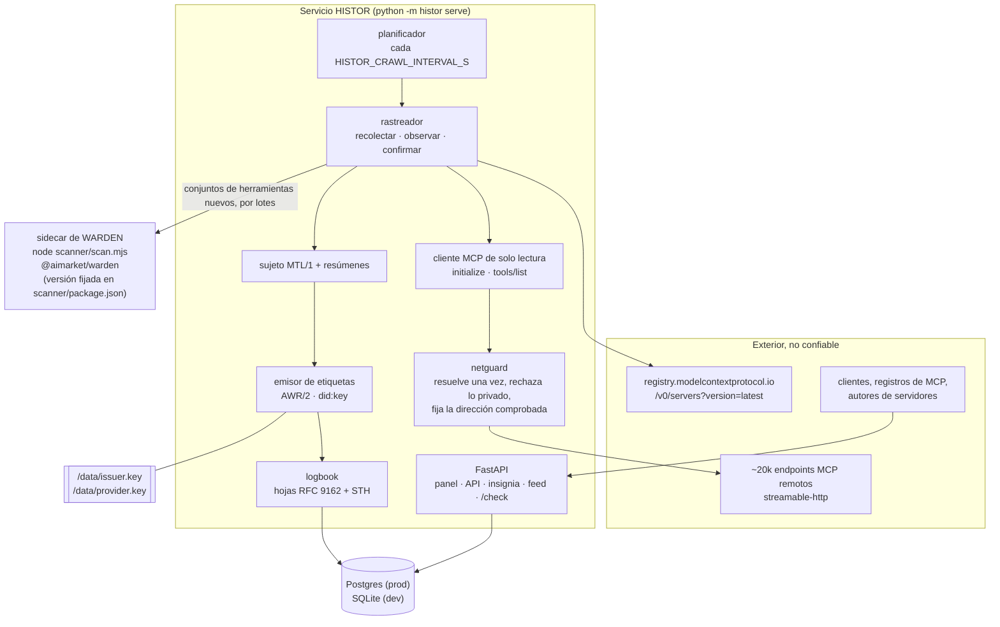
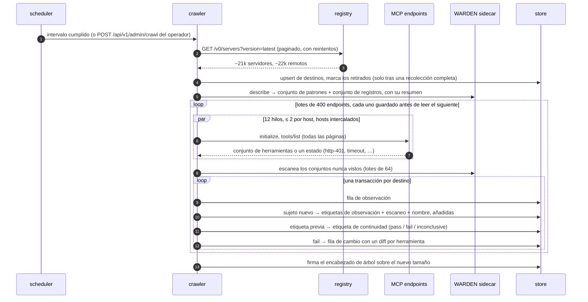
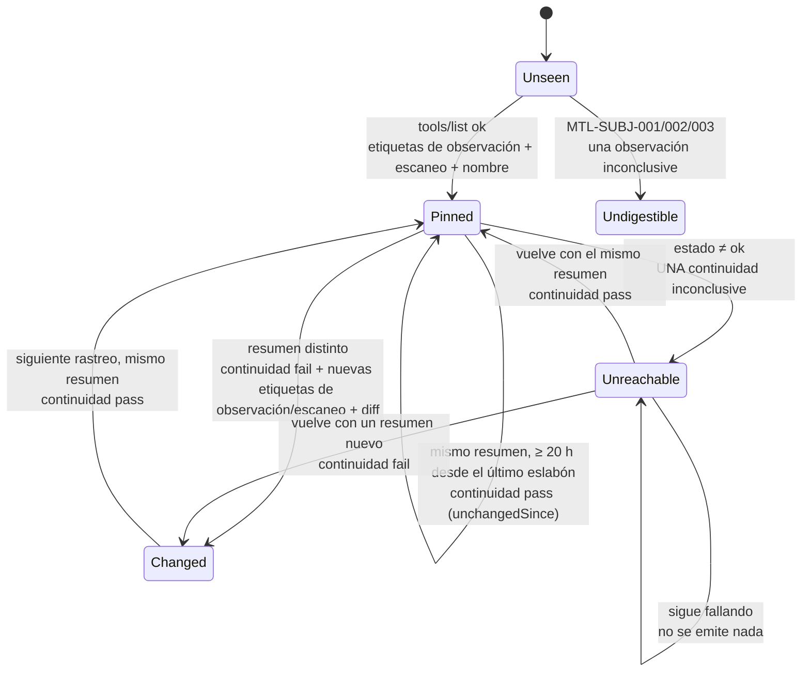
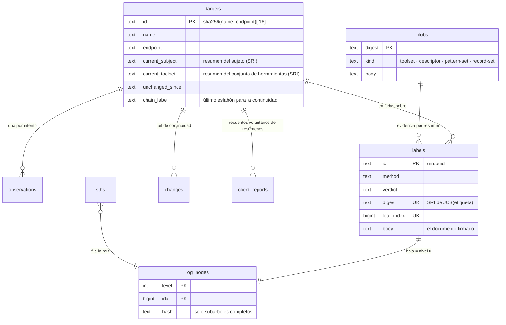

# Arquitectura

> 🌐 [English](architecture.md) · [Русский](architecture.ru.md) · **Español** · [Français](architecture.fr.md) · [中文](architecture.zh.md)

HISTOR es un único servicio Python con un proceso auxiliar. Todo lo que sabe procede de dos
lecturas —el registro oficial de MCP y el `tools/list` de cada servidor listado— y todo lo que
publica lo firma una sola clave y se añade a un único registro de transparencia.

## Módulos

| Módulo | Responsabilidad |
|---|---|
| `histor/registry.py` | Recorre las páginas del registro oficial de MCP (`version=latest`, con reintentos: cada página tarda de 1 a 50 s), conserva una entrada por nombre y convierte cada remoto en un destino. Los endpoints que no contactará se conservan con un motivo (`transport-not-observed`, `templated-url`, `cleartext-url`), para que las cifras públicas nunca reduzcan su denominador. Después añade la lista propia de HISTOR (`histor/curated.json`) de servidores populares que el registro no incluye, en su propio espacio de nombres; un endpoint que el registro lista se lee solo del registro. |
| `histor/packages.py` + `histor/sandbox/` | Paquetes de npm y PyPI: destinos `npm:<nombre>` / `pypi:<nombre>`, en cada rastreo la última versión y los hechos del registro (procedencia, publicador, scripts de instalación, dependencias), y una observación desde el host del sandbox por HTTPS fijado a su certificado: instalación sin ejecutar código del paquete, scripts de instalación aparte, arranque bajo el runtime de trazas de gVisor con credenciales señuelo y sin ruta hacia fuera, `initialize` + `tools/list`, cada herramienta una vez con argumentos canario; la traza de gVisor y el registro DNS del observador dicen lo que hizo. Una versión se observa una vez (una versión publicada no puede cambiar) y otra si el observador es más nuevo; un fallo del sandbox es un error interno de HISTOR, nunca una etiqueta sobre el paquete. `histor/lookalike.py` nombra un paquete que imita a uno popular. Hasta ocho hosts de sandbox se reparten los paquetes, cada uno según sus huecos libres; un host que falla se salta y el paquete se intenta una vez en otro ([varios hosts de sandbox](operations.es.md#varios-hosts-de-sandbox)). Ver [operación](operations.es.md#sandbox-de-paquetes). |
| `histor/netguard.py` | Resuelve el host una sola vez, rechaza el destino si **cualquiera** de las respuestas no es pública y después se conecta a la dirección comprobada, con `Host` y el SNI de TLS fijados al nombre. El DNS rebinding nunca obtiene una segunda consulta. |
| `histor/mcpclient.py` | `initialize` → `notifications/initialized` → `tools/list` recorrido por completo mediante `nextCursor`. Streaming con límite de tamaño, SSE leído hasta nuestro id de respuesta, sin redirecciones, miembros JSON duplicados rechazados. No tiene ninguna ruta de código que llame a una herramienta. |
| `histor/subject.py` | El descriptor MTL/1 y ambos resúmenes criptográficos (digests), sobre el canonicalizador de referencia de AWR/2. Una prueba de paridad byte a byte lo contrasta con el propio `mtl_subject.py` del perfil. |
| `histor/scanner.py` + `scanner/scan.mjs` | Ejecuta las puertas **publicadas** de WARDEN. Al arrancar, el sidecar describe su propio conjunto de patrones y su conjunto de registros, de modo que una etiqueta nombra el resumen de las reglas que realmente se ejecutaron. |
| `histor/labels.py` | Cuatro métodos de etiqueta, cada uno un documento AWR/2 firmado. Las reglas de veredicto de MTL/1 se imponen en el código (`MTL-METH-002`). |
| `histor/logbook.py` + `histor/merkle.py` | Adición de hojas, encabezados de árbol, pruebas de inclusión y de consistencia. Solo se almacenan subárboles completos, así que cada prueba cuesta O(log n) lecturas. |
| `histor/crawler.py` | Un rastreo: recolectar → observar (pool de hilos, límite por host, hosts intercalados) → escanear los conjuntos de herramientas nuevos → una transacción por destino, en lotes de `HISTOR_CRAWL_BATCH` guardados antes de leer el siguiente → firmar un encabezado de árbol. Los paquetes npm y PyPI van por su propio carril desde el inicio del rastreo, tantos a la vez como ranuras tienen los sandboxes, y cada uno se guarda en cuanto termina. |
| `histor/check.py` | `/check`: compara el conjunto de herramientas de un cliente con lo observado; recuento de resúmenes opcional y voluntario. |
| `histor/app.py` | La interfaz HTTP: panel, API, insignias, feed Atom, ruta del operador y el peer de federación de AIMarket. |
| `histor/db.py` + `histor/migrations.py` + `histor/store.py` | Almacenamiento independiente del backend: un solo dialecto SQL para SQLite y Postgres, migraciones numeradas y un contrato de columnas que se comprueba al arrancar. |

## Un rastreo

## Condiciones de prueba de los paquetes

Una observación de un paquete npm o PyPI es cierta para las condiciones en que se ejecutó, y para
ninguna otra. Las mismas condiciones están en el sitio ([histor.modelmarket.dev/#conditions](https://histor.modelmarket.dev/#conditions));
el registro de cada paquete guarda el digest exacto de la imagen y la configuración que recibió
(`packageSignals.conditions`, `packageSignals.supplied`).

| | |
|---|---|
| Sistema | Linux x86_64, dentro de gVisor (`runsc`); usuario sin privilegios, sin capabilities, raíz de solo lectura |
| Entornos de ejecución | npm: `histor-node:22`; PyPI: `histor-python:3.12` (`3.13`, `3.14` si Requires-Python excluye 3.12) — las oficiales `node:22-bookworm-slim` y `python:3.12-slim` más bash, git, Python 3 o Node 22 y un entorno Java 21 (nunca Docker), construidas al instalar un host del sandbox; el id de la imagen se registra en cada observación |
| Instalación | npm `--ignore-scripts`, luego los scripts de instalación en su propia etapa trazada; PyPI solo wheels (un sdist se señala, nunca se compila) |
| Red | sin ruta hacia fuera; cada nombre resuelve a las trampas de HISTOR, que registran y no reenvían nada |
| Secretos | ninguno real: credenciales señuelo en HOME, un `.env` señuelo; una variable que el paquete necesita recibe un valor de relleno |
| Límites | 512 MB, 1 CPU, 64 MB de `/tmp`; 360 s para instalar, 150 s para arrancar y responder; ≤ 15 herramientas llamadas una vez, 8 s cada una |
| Configuración | solo nombres (abajo); el observador crea todos los valores |

Las cifras son constantes del propio observador (`sandbox/histor_observe.py`); una prueba hace fallar
la compilación si las publicadas se desvían de ellas.

**Por qué terminó un paquete.** Una ejecución que acaba en `exited` se clasifica por lo que imprimió el
paquete (`histor/exit_reasons.py`) y se guarda como `packageSignals.exit`: `needs-config` (con los
nombres de variables que dio), `needs-arguments` (con un argumento de arranque como `serve` o
`--transport=stdio` cuando su texto de uso lo ofrece), `sdk-incompatible` (categoría heurística de fallo de importación/API, no prueba de la versión SDK instalada), `needs-other-os`, `needs-glibc`, `needs-terminal`, `needs-program`, `needs-service`, `needs-network`,
`broken-package`, `not-a-server` (código de salida 0), `silent`, `crashed`. Una ejecución que agota el
tiempo sirviendo HTTP en lugar de stdio es `starts-http`, y la siguiente pasa `--transport=stdio`. Desde
el observador 4 el informe guarda el código de salida y la salida estándar que no era protocolo: una CLI
imprime ahí su uso.

**Arrancarlo de nuevo con lo que pidió.** El siguiente rastreo arranca la misma versión otra vez con
valores de relleno para esos nombres — y, desde la primera ejecución, para las variables que su entrada
en el registro marca `isRequired`. HISTOR envía solo nombres; el observador rechaza los que controlan el
entorno de ejecución (`PATH`, `NODE_OPTIONS`, `LD_*`, `PYTHON*`, …) y crea los valores:
`histor-envkey-<run>` para una clave, una dirección en `histor-trap.invalid` para una URL, el directorio
de trabajo para una ruta. Un paquete que termina pidiendo un Node más reciente (`needs-newer-node`) se ejecuta de nuevo en `histor-node:24`, la LTS actual, y su página lo indica. Se registra adónde se envió una clave de relleno (`envKeyDestinations`): a su
propia API o a otro sitio.

**Fallos relacionados con SDK y repetición diagnóstica.** `sdk-incompatible` clasifica el texto impreso, no demuestra su causa. El clasificador antiguo también incluía extras ausentes y errores MCP 1/Pydantic cuando el traceback mencionaba FastMCP; la categoría no prueba que una dependencia sin límite instalara MCP 2. El registro principal conserva la instalación nueva. Repetir la misma versión con la restricción fija `mcp<2` del observador es diagnóstico, no prueba de cómo funcionaba cualquier instalación histórica. `packageSignals.legacy` mantiene aparte estado, tools, patrones WARDEN y comportamiento: no emite etiqueta ni sustituye el conjunto del objetivo. Las versiones nuevas se ejecutan primero sin esa restricción diagnóstica. [Revisión de 292 paquetes y límites](measurement-limits.es.md): recuperaciones, extras declarados, controles que fallan y versiones/autenticación no disponibles.

**Qué no se vuelve a ejecutar.** Una versión que terminó en `exited`, `no-entry-point`, `no-wheel`,
`not-found` o `protocol` con el observador actual, sin nada nuevo que aportar, espera a una nueva versión
o a un nuevo observador (`settled` en las estadísticas del rastreo). Los paquetes nunca observados van por
orden de descargas; su última versión se consulta solo cuando les toca, con un ritmo por registro (npm
responde a una ráfaga con 429 y un `Retry-After` de diez minutos, que HISTOR espera en lugar de leerlo
como «sin versión»).

## Cuándo se emite una etiqueta

El registro debe recoger hechos, no ruido, así que los resultados deterministas idénticos no se
vuelven a emitir cada día.

Un nuevo conjunto de patrones o de registros de WARDEN (un nuevo paquete publicado) vuelve a emitir
las etiquetas de escaneo de todos los sujetos actuales, porque dos etiquetas de escaneo solo son
comparables bajo el mismo conjunto.

## Modelo de datos

## Almacenamiento y migraciones

SQLite es el almacén de desarrollo: un archivo bajo `HISTOR_DATA_DIR`, modo WAL y una conexión por
lectura, para que ningún lector se quede anclado en una instantánea antigua bloqueando los
checkpoints. Postgres es el de producción: `HISTOR_PROFILE=prod` se niega a arrancar sin una URL
`postgresql://`. Todo el SQL se escribe una sola vez en el subconjunto que comparten ambos motores;
donde discrepan (columnas de identidad), una migración lleva una sentencia por backend. Las
adiciones al registro toman un bloqueo consultivo (advisory lock) de Postgres dentro de su
transacción, de modo que dos procesos apuntados a una misma base de datos siguen añadiendo hojas de
una en una.

Las migraciones siguen el estilo de la casa, compartido con HESTIA y el Hub: una tabla
`schema_migrations`, una lista numerada de revisiones, cada revisión en su propia transacción y
fallos ruidosos (fail-loud). Una revisión ya publicada nunca se edita; se rechaza una base de datos
que haya aplicado una revisión que esta compilación no conoce.

## Claves

| Archivo | Firma | Por qué por separado |
|---|---|---|
| `issuer.key` | cada etiqueta (AWR/2, `did:key`), cada encabezado de árbol firmado o STH (`histor.sth/v1`), cada respuesta de `/check` (`histor.check/v1`) | una sola identidad para todo lo que verifica un lector; el `type` dentro de los bytes firmados impide que una firma sobre un tipo de documento se reutilice como si fuera de otro |
| `provider.key` (+ `_mldsa`) | los documentos de federación de AIMarket (`.well-known`, manifiesto, recibos de interoperabilidad), híbridos Ed25519 + ML-DSA-65 cuando `HISTOR_PQC=1` | habla el protocolo del Hub; ninguna de las dos claves puede firmar por la otra |

Ambas residen en el volumen de datos, con modo 0600, nunca en variables de entorno ni en la base de
datos; los enlaces y los archivos corruptos se rechazan al arrancar.
