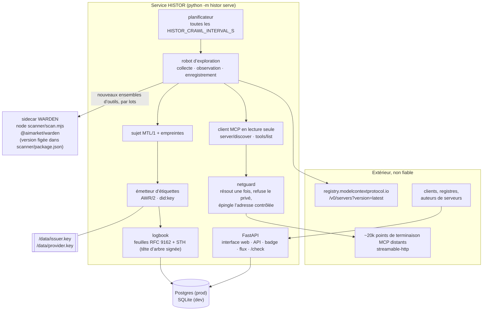
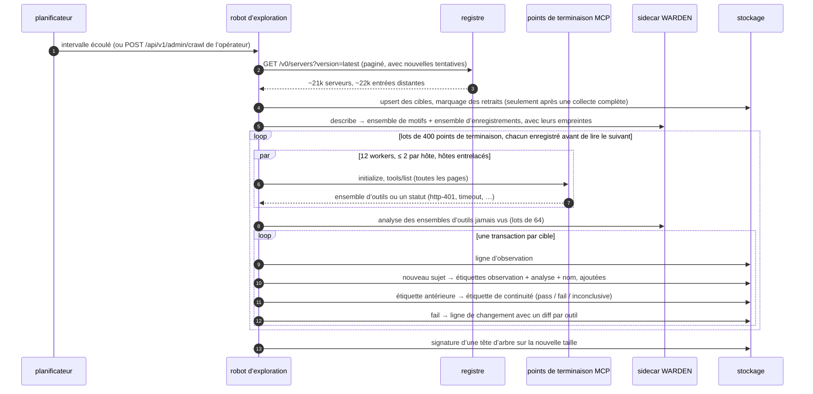
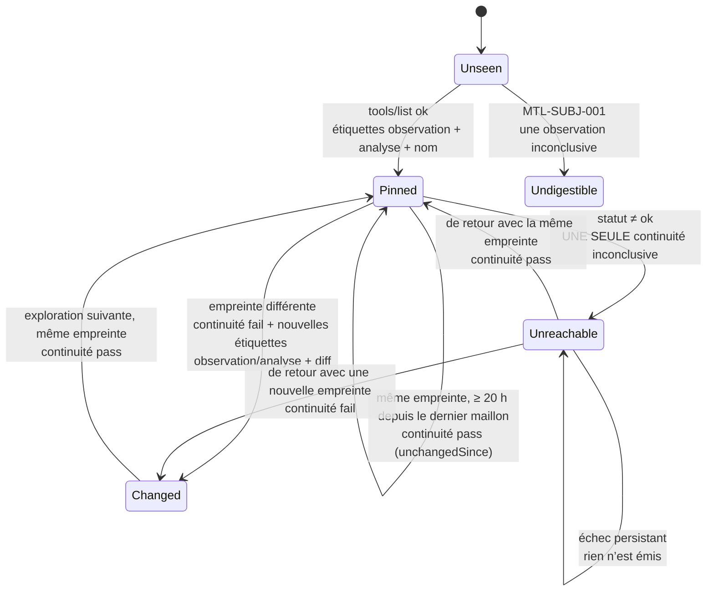
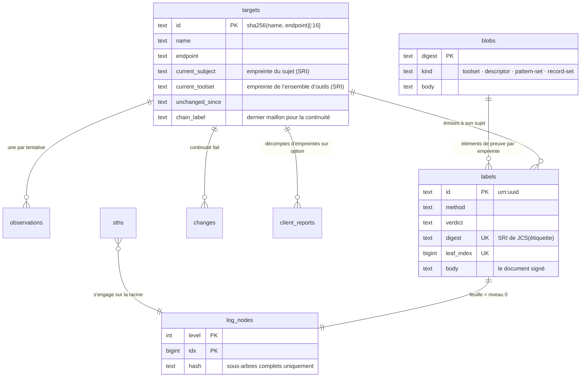

# Architecture

> 🌐 [English](architecture.md) · [Русский](architecture.ru.md) · [Español](architecture.es.md) · **Français** · [中文](architecture.zh.md)

HISTOR est un service Python unique accompagné d’un processus auxiliaire. Tout ce qu’il sait provient
de deux lectures — le registre MCP officiel et le `tools/list` de chaque serveur répertorié — et tout
ce qu’il publie est signé par une seule clé et ajouté à un seul journal.

## Modules

| Module | Responsabilité |
|---|---|
| `histor/registry.py` | Parcourt les pages du registre officiel (`version=latest`, avec nouvelles tentatives : une page prend de 1 à 50 s), garde un enregistrement par nom et fait de chaque entrée distante une cible. Les points de terminaison (endpoints) qu’il ne contactera pas sont conservés avec une raison (`transport-not-observed`, `templated-url`, `cleartext-url`), pour que les chiffres publics ne réduisent jamais leur dénominateur. Il ajoute ensuite la liste propre à HISTOR (`histor/curated.json`) de serveurs populaires absents du registre, dans leur propre espace de noms ; un point de terminaison que le registre liste n’est lu que depuis le registre. |
| `histor/packages.py` + `histor/sandbox/` | Paquets npm et PyPI : cibles `npm:<nom>` / `pypi:<nom>`, à chaque exploration la dernière version et les faits du registre (provenance, éditeur, scripts d’installation, dépendances), et une observation depuis l’hôte du bac à sable en HTTPS épinglé à son certificat : installation sans exécuter le code du paquet, scripts d’installation à part, démarrage sous le runtime de traçage de gVisor avec des identifiants leurres et sans route vers l’extérieur, `server/discover` + `tools/list` (legacy: `initialize`), chaque outil une fois avec des arguments canaris ; la trace de gVisor et le journal DNS de l’observateur disent ce qu’il a fait. Une version est observée une fois (une version publiée ne peut pas changer), de nouveau si l’observateur est plus récent ; une panne du bac à sable est une erreur interne d’HISTOR, jamais une étiquette sur le paquet. `histor/lookalike.py` désigne un paquet qui en imite un populaire. Jusqu’à huit hôtes de bac à sable se partagent les paquets, chacun selon ses emplacements libres ; un hôte en panne est sauté et le paquet tenté une fois ailleurs ([plusieurs hôtes de bac à sable](operations.fr.md#plusieurs-hôtes-de-bac-à-sable)). Voir [exploitation](operations.fr.md#bac-à-sable-des-paquets). |
| `histor/netguard.py` | Résout l’hôte une seule fois, refuse la cible si **une seule** des réponses n’est pas publique, puis se connecte à l’adresse contrôlée avec `Host` et le SNI TLS réglés sur le nom. Le DNS rebinding n’obtient jamais de seconde résolution. |
| `histor/mcpclient.py` | `server/discover` → modern `tools/list`, or legacy `initialize` → `notifications/initialized` → `tools/list` parcouru via `nextCursor`. Flux plafonné en taille, SSE lu jusqu’à notre identifiant de réponse, aucune redirection, membres JSON en double refusés. Il ne contient aucun chemin de code qui appelle un outil. |
| `histor/subject.py` | Le descripteur MTL/1 et les deux empreintes (digest), calculés avec le canonicaliseur de référence AWR/2. Un test de parité octet par octet le confronte au `mtl_subject.py` du profil lui-même. |
| `histor/scanner.py` + `scanner/scan.mjs` | Exécute les contrôles WARDEN **publiés**. Au démarrage, le sidecar décrit son propre ensemble de motifs et son ensemble d’enregistrements, si bien qu’une étiquette nomme l’empreinte des règles réellement exécutées. |
| `histor/labels.py` | Quatre méthodes d’étiquetage, chacune produisant un document AWR/2 signé. Les règles de verdict de MTL/1 sont appliquées dans le code (`MTL-METH-002`). |
| `histor/logbook.py` + `histor/merkle.py` | Ajout de feuilles, têtes d’arbre, preuves d’inclusion et de cohérence. Seuls les sous-arbres complets sont stockés, donc chaque preuve coûte O(log n) lectures. |
| `histor/crawler.py` | Une exploration (crawl) : collecte → observation (pool de threads, limite par hôte, hôtes entrelacés) → analyse des nouveaux ensembles d’outils → une transaction par cible, par lots de `HISTOR_CRAWL_BATCH` enregistrés avant de lire le suivant → signature d’une tête d’arbre. Les paquets npm et PyPI suivent leur propre voie dès le début de l’exploration, autant à la fois que les bacs à sable ont d’emplacements, chacun enregistré dès qu’il est terminé. |
| `histor/check.py` | `/check` : compare l’ensemble d’outils d’un client avec ce qui a été observé ; décompte d’empreintes facultatif, sur option. |
| `histor/app.py` | La surface HTTP : interface web, API, badges, flux Atom, route opérateur et le peer de fédération AIMarket. |
| `histor/db.py` + `histor/migrations.py` + `histor/store.py` | Stockage indépendant du backend : un seul dialecte SQL pour SQLite et Postgres, des migrations numérotées, un contrat de colonnes contrôlé au démarrage. |

## Une exploration

## Conditions de test des paquets

Une observation d’un paquet npm ou PyPI vaut pour les conditions dans lesquelles il a tourné, et pour
aucune autre. Les mêmes conditions sont sur le site ([histor.modelmarket.dev/#conditions](https://histor.modelmarket.dev/#conditions)) ;
l’enregistrement de chaque paquet conserve le digest exact de l’image et la configuration reçue
(`packageSignals.conditions`, `packageSignals.supplied`).

| | |
|---|---|
| Système | Linux x86_64, dans gVisor (`runsc`) ; utilisateur non privilégié, aucune capability, racine en lecture seule |
| Environnements d’exécution | npm : `histor-node:22` ; PyPI : `histor-python:3.12` (`3.13`, `3.14` si Requires-Python exclut 3.12) — les images officielles `node:22-bookworm-slim` et `python:3.12-slim` plus bash, git, Python 3 ou Node 22 et un environnement Java 21 (jamais Docker), construites à l’installation d’un hôte du bac à sable ; l’id de l’image est enregistré à chaque observation |
| Installation | npm `--ignore-scripts`, puis les scripts d’installation dans une étape tracée à part ; PyPI wheels uniquement (un sdist est signalé, jamais compilé) |
| Réseau | aucune route vers l’extérieur ; chaque nom pointe vers les pièges de HISTOR, qui enregistrent et ne transmettent rien |
| Secrets | aucun réel : identifiants leurres dans HOME, un `.env` leurre ; une variable réclamée par le paquet reçoit une valeur factice |
| Limites | 512 Mo, 1 CPU, 64 Mo de `/tmp` ; 360 s pour installer, 150 s pour démarrer et répondre ; ≤ 15 outils appelés une fois, 8 s chacun |
| Configuration | des noms seulement (ci-dessous) ; l’observateur fabrique toutes les valeurs |

Les chiffres sont les constantes de l’observateur lui-même (`sandbox/histor_observe.py`) ; un test fait
échouer la construction si les chiffres publiés s’en écartent.

**Pourquoi un paquet s’est arrêté.** Une exécution qui finit en `exited` est classée d’après ce que le
paquet a affiché (`histor/exit_reasons.py`) et conservée dans `packageSignals.exit` : `needs-config`
(avec les noms de variables qu’il a donnés), `needs-arguments` (avec un argument de démarrage comme
`serve` ou `--transport=stdio` quand son texte d’usage en propose un), `sdk-incompatible` (catégorie heuristique d’échec import/API, pas preuve de la version SDK installée), `needs-other-os`, `needs-glibc`, `needs-terminal`, `needs-program`, `needs-service`, `needs-network`,
`broken-package`, `not-a-server` (code de sortie 0), `silent`, `crashed`. Un lancement qui expire en
servant HTTP au lieu de stdio est `starts-http`, et le suivant passe `--transport=stdio`. Depuis
l’observateur 4, le rapport garde le code de sortie et la sortie standard qui n’était pas du protocole :
une CLI y imprime son usage.

**Le relancer avec ce qu’il a demandé.** Le crawl suivant relance la même version avec des valeurs
factices pour ces noms — et, dès le premier lancement, pour les variables que son entrée de registre
marque `isRequired`. HISTOR n’envoie que des noms ; l’observateur refuse ceux qui pilotent
l’environnement d’exécution (`PATH`, `NODE_OPTIONS`, `LD_*`, `PYTHON*`, …) et fabrique les valeurs :
`histor-envkey-<run>` pour une clé, une adresse sur `histor-trap.invalid` pour une URL, le répertoire de
travail pour un chemin. Un paquet qui s’arrête en réclamant un Node plus récent (`needs-newer-node`) est relancé sur `histor-node:24`, la LTS actuelle, et sa page l’indique. L’endroit où une clé factice a été envoyée est enregistré
(`envKeyDestinations`) : sa propre API, ou ailleurs.

**Échecs liés au SDK et essai diagnostique.** `sdk-incompatible` classe le texte affiché, sans prouver sa cause. L’ancien classificateur incluait aussi extras manquants et erreurs MCP 1/Pydantic lorsque le traceback mentionnait FastMCP ; cette catégorie ne prouve pas qu’une dépendance non bornée ait installé MCP 2. L’enregistrement principal conserve l’installation neuve. Relancer la même version avec la contrainte fixe `mcp<2` de l’observateur est un diagnostic, pas une preuve de toute installation historique. `packageSignals.legacy` garde séparément statut, tools, motifs WARDEN et comportement : aucune étiquette émise, aucun remplacement des tools de la cible. Toute nouvelle version est d’abord exécutée sans cette contrainte diagnostique. [Recontrôle des 292 paquets et limites](measurement-limits.fr.md) : récupération, extras déclarés, contrôles en échec et versions/authentification indisponibles.

**Ce qui n’est pas relancé.** Une version terminée en `exited`, `no-entry-point`, `no-wheel`,
`not-found` ou `protocol` avec l’observateur actuel, sans rien de nouveau à fournir, attend une nouvelle
version ou un nouvel observateur (`settled` dans les statistiques du crawl). Les paquets jamais observés
passent dans l’ordre des téléchargements ; leur dernière version n’est demandée que lorsque leur tour
vient, à un rythme borné par registre (npm répond à une rafale par 429 et un `Retry-After` de dix
minutes, que HISTOR attend au lieu de le lire comme « pas de version »).

## Quand une étiquette est émise

Le journal doit consigner des faits, pas du bruit : des résultats déterministes identiques ne sont
donc pas réémis chaque jour.

Un nouvel ensemble de motifs ou d’enregistrements WARDEN (un nouveau paquet publié) réémet les
étiquettes d’analyse de chaque sujet courant, car deux étiquettes d’analyse ne sont comparables que
sous le même ensemble.

## Modèle de données

## Stockage et migrations

SQLite est le stockage de développement : un fichier unique sous `HISTOR_DATA_DIR`, en mode WAL, une
connexion par lecture, pour qu’aucun lecteur ne reste bloqué sur un ancien instantané et n’empêche les
checkpoints. Postgres est le stockage de production : `HISTOR_PROFILE=prod` refuse de démarrer sans
URL `postgresql://`. Tout le SQL est écrit une seule fois, dans le sous-ensemble commun aux deux
moteurs ; là où ils divergent (colonnes d’identité), une migration porte une instruction par backend.
Les ajouts au journal prennent un verrou consultatif (advisory lock) Postgres à l’intérieur de leur
transaction : deux processus pointés vers la même base ajoutent donc quand même les feuilles une par
une.

Les migrations suivent le style maison partagé avec HESTIA et le Hub : une table `schema_migrations`,
une liste de révisions numérotées, chaque révision dans sa propre transaction, échec bruyant
(fail-loud). Une révision livrée n’est jamais modifiée ; une base qui a appliqué une révision que ce
build ne connaît pas est refusée.

## Clés

| Fichier | Signe | Pourquoi séparé |
|---|---|---|
| `issuer.key` | chaque étiquette (AWR/2, `did:key`), chaque tête d’arbre (`histor.sth/v1`), chaque réponse `/check` (`histor.check/v1`) | une seule identité pour tout ce qu’un lecteur vérifie ; le `type` inclus dans les octets signés empêche qu’une signature portant sur un type de document soit rejouée comme un autre |
| `provider.key` (+ `_mldsa`) | les documents de fédération AIMarket (`.well-known`, manifeste, reçus d’interopérabilité), en hybride Ed25519 + ML-DSA-65 quand `HISTOR_PQC=1` | parle le protocole du Hub ; aucune des deux clés ne peut signer pour l’autre |

Les deux résident sur le volume de données, en mode 0600, jamais dans l’environnement ni dans la base
de données ; les liens et les fichiers corrompus sont refusés au démarrage.
