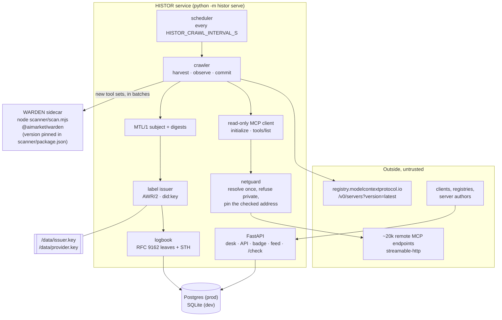
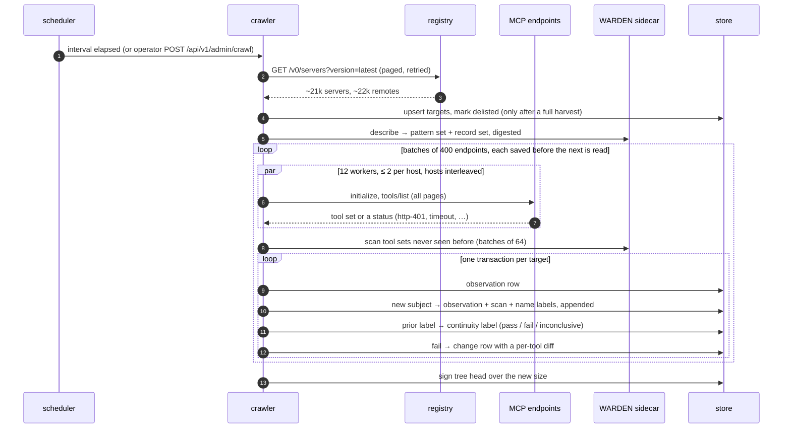
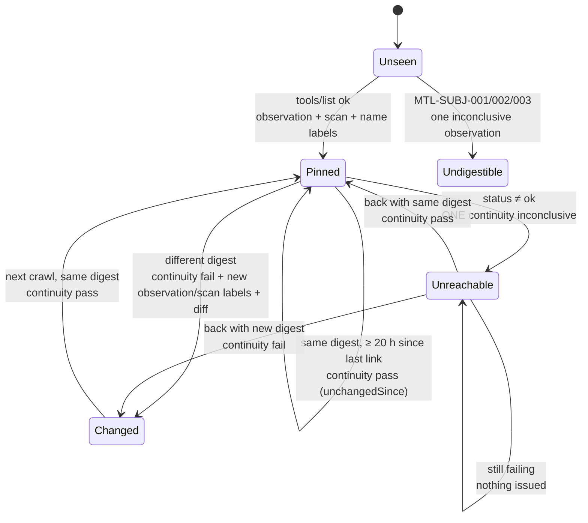
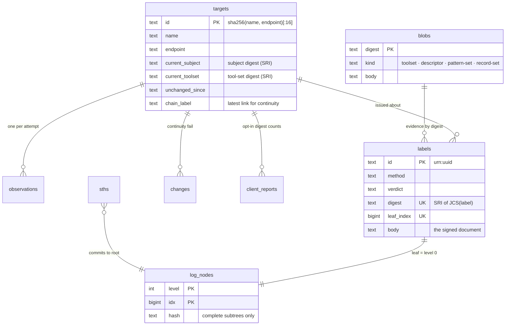

# Architecture

> 🌐 **English** · [Русский](architecture.ru.md) · [Español](architecture.es.md) · [Français](architecture.fr.md) · [中文](architecture.zh.md)

HISTOR is one Python service with one helper process. Everything it knows comes from two reads —
the official MCP registry and each listed server's `tools/list` — and everything it publishes is
signed by one key and appended to one log.

## Modules

| Module | Responsibility |
|---|---|
| `histor/registry.py` | Pages the official registry (`version=latest`, retried: pages take 1–50 s), keeps one record per name, turns every remote into a target. Endpoints it will not dial are kept with a reason (`transport-not-observed`, `templated-url`, `cleartext-url`) so the public numbers never shrink their denominator. It then adds HISTOR's curated list (`histor/curated.json`) of popular servers the registry does not carry, in their own namespace; an endpoint the registry lists is read from the registry only. |
| `histor/packages.py` + `histor/sandbox/` | npm and PyPI packages: `npm:<name>` / `pypi:<name>` targets, the latest version and the registry's facts (provenance, publisher, install scripts, dependencies) every crawl, and an observation from the sandbox host over HTTPS pinned to its certificate: install without running the package's code, install scripts on their own, start under gVisor's tracing runtime with decoy credentials and no route out, `initialize` + `tools/list`, each tool once with canary arguments; gVisor's trace and the observer's DNS logger say what it did. A version is observed once (a published version cannot change), again when the observer is newer; a sandbox failure is HISTOR's internal error, never a label about the package. `histor/lookalike.py` names a package imitating a popular one. Up to eight sandbox hosts share the packages, each by its free slots; a host that fails is passed over and the package tried once elsewhere ([several sandbox hosts](operations.md#several-sandbox-hosts)). See [operations](operations.md#package-sandbox). |
| `histor/netguard.py` | Resolves the host once, refuses the target if **any** answer is non-public, then connects to the checked address with `Host` and TLS SNI set to the name. DNS rebinding never gets a second lookup. |
| `histor/mcpclient.py` | `initialize` → `notifications/initialized` → `tools/list` drained over `nextCursor`. Size-capped streaming, SSE read up to our response id, no redirects, duplicate JSON members refused. It has no code path that calls a tool. |
| `histor/subject.py` | The MTL/1 descriptor and both digests, over the AWR/2 reference canonicalizer. A byte-for-byte parity test runs it against the profile's own `mtl_subject.py`. |
| `histor/scanner.py` + `scanner/scan.mjs` | Runs the **published** WARDEN gates. The sidecar describes its own pattern set and record set at startup, so a label names the digest of the rules that actually ran. |
| `histor/labels.py` | Four label methods, each one signed AWR/2 document. The verdict rules of MTL/1 are enforced in code (`MTL-METH-002`). |
| `histor/logbook.py` + `histor/merkle.py` | Leaf append, tree heads, inclusion and consistency proofs. Only complete subtrees are stored, so every proof is O(log n) reads. |
| `histor/crawler.py` | One crawl: harvest → observe (thread pool, per-host limit, hosts interleaved) → scan new tool sets → one transaction per target, in batches of `HISTOR_CRAWL_BATCH` saved before the next is read → sign a tree head. |
| `histor/check.py` | `/check`: compare a client's tool set with what was observed; optional opt-in digest count. |
| `histor/app.py` | The HTTP surface: desk, API, badges, Atom feed, operator route, and the AIMarket federation peer. |
| `histor/db.py` + `histor/migrations.py` + `histor/store.py` | Backend-neutral storage: one SQL dialect for SQLite and Postgres, numbered migrations, a column contract checked at startup. |

## One crawl

## Package test conditions

An observation of an npm or PyPI package is true for the conditions it ran under, and no others.
The same conditions are on the site ([histor.modelmarket.dev/#conditions](https://histor.modelmarket.dev/#conditions));
each package record carries the exact image digest and any configuration the package was given
(`packageSignals.conditions`, `packageSignals.supplied`).

| | |
|---|---|
| System | Linux x86_64, inside gVisor (`runsc`); unprivileged user, no capabilities, read-only root |
| Runtimes | npm: `node:22-alpine`; PyPI: `python:3.12-slim` — tags pulled when a sandbox host is installed; the exact digest is recorded per observation |
| Install | npm `--ignore-scripts`, then install scripts in their own traced stage; PyPI wheels only (an sdist is reported, never built) |
| Network | no route out; every name resolves to HISTOR's traps, which record and forward nothing |
| Secrets | none real: decoy credentials in HOME, a decoy `.env`; a variable the package needs gets a placeholder |
| Limits | 512 MB, 1 CPU, 64 MB `/tmp`; 240 s to install, 150 s to start and answer; ≤ 15 tools called once, 8 s each |
| Configuration | names only (below); the observer makes every value |

The numbers are the observer's own constants (`sandbox/histor_observe.py`); a test fails the build
when the published ones drift from them.

**Why a package exited.** A run that ends with `exited` is classified from what the package printed
(`histor/exit_reasons.py`) and kept as `packageSignals.exit`: `needs-config` (with the variable names
it gave), `needs-arguments` (with a start argument such as `serve` or `--transport=stdio` when its
usage text offers one), `sdk-incompatible` (written for MCP SDK 1.x and run with 2.x),
`needs-other-os`, `needs-network`, `silent`, `crashed`.

**Starting it again with what it asked for.** The next crawl starts the same version once more with
placeholders for those names — and, from the first run, for the variables its registry entry marks
`isRequired`. HISTOR sends names only; the observer refuses names that steer the runtime (`PATH`,
`NODE_OPTIONS`, `LD_*`, `PYTHON*`, …) and makes the values: `histor-envkey-<run>` for a key, an
address on `histor-trap.invalid` for a URL, the working directory for a path. Where a placeholder key
was sent is recorded (`envKeyDestinations`): to its own API, or somewhere else.

**Servers broken by MCP SDK 2.0.** A PyPI server written for `mcp` 1.x (`from mcp.server.fastmcp import
FastMCP`) whose dependency is not pinned below 2 crashes on import since `mcp` 2.0.0 (2026-07-28)
renamed FastMCP. Its status stays what a fresh install gets (`exited`, `sdk-incompatible`); the next
crawl starts the same version once more with pip held to `mcp<2` (the observer's fixed pin list —
HISTOR never sends a requirement string) and keeps the result beside the record as
`packageSignals.legacy`: status, tools, WARDEN pattern matches and sandbox behaviour. It issues no
label and never becomes the target's tool set. A new version runs as a fresh install first.

**What is not run again.** A version that ended `exited`, `no-entry-point`, `no-wheel`, `not-found`
or `protocol` under the current observer, with nothing new to supply, waits for a new version or a
new observer (`settled` in the crawl's stats). Never-observed packages go in download order; their
latest version is asked for only when they are next in line, paced per registry (npm answers a burst
with 429 and a ten-minute `Retry-After`, which HISTOR waits out instead of reading as "no version").

## When a label is issued

The log should record facts, not noise, so identical deterministic results are not re-issued daily.

A new WARDEN pattern set or record set (a new published package) re-issues the scan labels of
every current subject, because two scan labels are comparable only under the same set.

## Data model

## Storage and migrations

SQLite is the development store: one file under `HISTOR_DATA_DIR`, WAL mode, a connection per
read so no reader parks on an old snapshot and blocks checkpoints. Postgres is production:
`HISTOR_PROFILE=prod` refuses to start without a `postgresql://` URL. All SQL is written once in
the subset both engines share; where they disagree (identity columns) a migration carries one
statement per backend. Log appends take a Postgres advisory lock inside their transaction, so two
processes pointed at one database still append leaves one at a time.

Migrations follow the house style shared with HESTIA and the Hub: a `schema_migrations` table, a
numbered revision list, each revision in its own transaction, fail-loud. A shipped revision is
never edited; a database that has applied a revision this build does not know is refused.

## Keys

| File | Signs | Why separate |
|---|---|---|
| `issuer.key` | every label (AWR/2, `did:key`), every tree head (`histor.sth/v1`), every `/check` answer (`histor.check/v1`) | one identity for everything a reader verifies; the `type` inside the signed bytes stops a signature over one document type being replayed as another |
| `provider.key` (+ `_mldsa`) | the AIMarket federation documents (`.well-known`, manifest, interop receipts), hybrid Ed25519 + ML-DSA-65 when `HISTOR_PQC=1` | speaks the Hub's protocol; neither key can sign for the other |

Both live on the data volume, mode 0600, never in env or in the database; links and corrupted files
are refused at startup.
