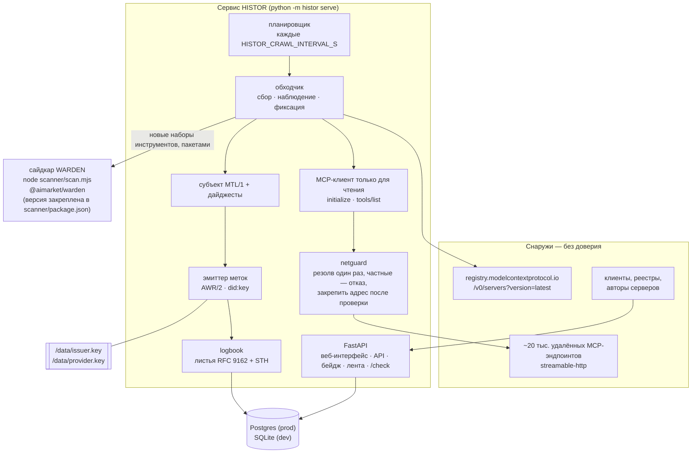
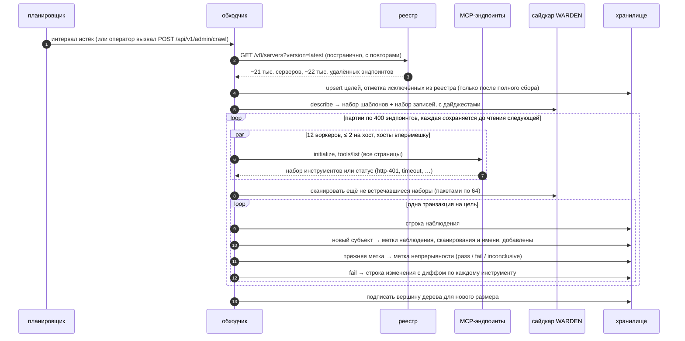
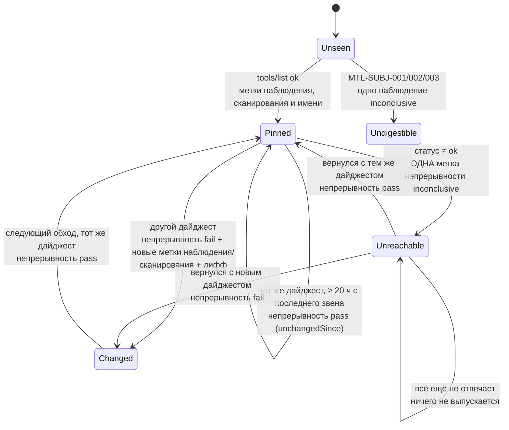
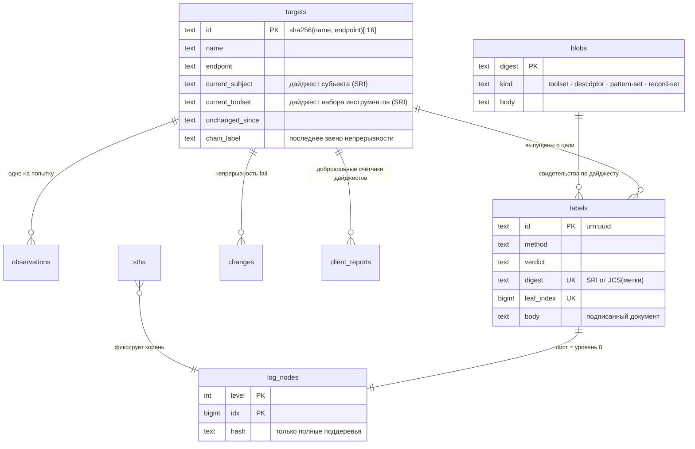

# Архитектура

> 🌐 [English](architecture.md) · **Русский** · [Español](architecture.es.md) · [Français](architecture.fr.md) · [中文](architecture.zh.md)

HISTOR — один сервис на Python и один вспомогательный процесс. Всё, что он знает, берётся из двух
чтений — официального реестра MCP и `tools/list` каждого сервера из этого реестра, — а всё, что он
публикует, подписано одним ключом и добавлено в один журнал.

## Модули

| Модуль | Ответственность |
|---|---|
| `histor/registry.py` | Постранично читает официальный реестр (`version=latest`, с повторами: страница отвечает от 1 до 50 с), оставляет одну запись на имя и превращает каждый удалённый эндпоинт в цель. Эндпоинты, к которым он подключаться не будет, сохраняются с причиной (`transport-not-observed`, `templated-url`, `cleartext-url`), чтобы у публичных цифр никогда не уменьшался знаменатель. Затем добавляет собственный список HISTOR (`histor/curated.json`) популярных серверов, которых нет в реестре, в отдельном пространстве имён; эндпоинт, который есть в реестре, берётся только из реестра. |
| `histor/packages.py` + `histor/sandbox/` | Пакеты npm и PyPI: цели `npm:<имя>` / `pypi:<имя>`, на каждом обходе — последняя версия и факты реестра (подтверждённая сборка, публикующий, установочные скрипты, зависимости) и наблюдение с хоста песочницы по HTTPS с закреплённым сертификатом: установка без запуска кода пакета, отдельно установочные скрипты, старт под gVisor в режиме трассировки с приманками и без маршрута наружу, `initialize` + `tools/list`, каждый инструмент один раз с подставными аргументами; трасса gVisor и DNS-логгер наблюдателя показывают, что пакет делал. Версия читается один раз (опубликованную версию изменить нельзя) и снова, если наблюдатель новее; сбой песочницы — внутренняя ошибка HISTOR, а не метка о пакете. `histor/lookalike.py` называет пакет, подражающий популярному. Пакеты делят до восьми хостов песочницы, каждый по своим свободным слотам; отказавший хост пропускается, а пакет один раз пробуется на другом ([несколько хостов песочницы](operations.ru.md#несколько-хостов-песочницы)). См. [эксплуатацию](operations.ru.md#песочница-для-пакетов). |
| `histor/netguard.py` | Резолвит хост один раз, отклоняет цель, если **хоть один** ответ не публичный, и подключается именно к адресу, прошедшему проверку, с `Host` и TLS SNI, выставленными на имя. Второго резолва для DNS rebinding не бывает. |
| `histor/mcpclient.py` | `initialize` → `notifications/initialized` → `tools/list` со всеми страницами по `nextCursor`. Потоковое чтение с ограничением размера, SSE читается до нашего id ответа, без редиректов, повторяющиеся члены JSON отклоняются. В нём нет ни одного пути кода, который вызывает инструмент. |
| `histor/subject.py` | Дескриптор MTL/1 и оба дайджеста поверх эталонного канонизатора AWR/2. Тест побайтового соответствия прогоняет его против `mtl_subject.py` из самого профиля. |
| `histor/scanner.py` + `scanner/scan.mjs` | Запускает **опубликованные** гейты WARDEN. Сайдкар при старте описывает собственные набор шаблонов и набор записей, поэтому метка называет дайджест именно тех правил, которые реально отработали. |
| `histor/labels.py` | Четыре метода меток, каждая метка — один подписанный документ AWR/2. Правила вердиктов MTL/1 соблюдаются в коде (`MTL-METH-002`). |
| `histor/logbook.py` + `histor/merkle.py` | Добавление листьев, вершины дерева, доказательства включения и согласованности. Хранятся только полные поддеревья, поэтому любое доказательство — это O(log n) чтений. |
| `histor/crawler.py` | Один обход: сбор → наблюдение (пул потоков, лимит на хост, хосты вперемешку) → сканирование новых наборов инструментов → одна транзакция на цель, партиями по `HISTOR_CRAWL_BATCH`, каждая сохраняется до чтения следующей → подпись вершины дерева. Пакеты npm и PyPI идут отдельной полосой с самого начала обхода — столько сразу, сколько слотов у песочниц, и каждый записывается, как только готов. |
| `histor/check.py` | `/check`: сравнивает набор инструментов клиента с наблюдавшимся; необязательный добровольный счётчик дайджестов. |
| `histor/app.py` | HTTP-слой: веб-интерфейс, API, бейджи, Atom-лента, маршрут оператора и пир федерации AIMarket. |
| `histor/db.py` + `histor/migrations.py` + `histor/store.py` | Хранилище, не зависящее от бэкенда: один диалект SQL для SQLite и Postgres, нумерованные миграции, контракт столбцов, который проверяется при старте. |

## Один обход

## Условия проверки пакетов

Наблюдение за пакетом npm или PyPI верно для условий, в которых он запускался, — и только для них.
Те же условия опубликованы на сайте ([histor.modelmarket.dev/#conditions](https://histor.modelmarket.dev/#conditions));
в записи каждого пакета хранятся точный digest образа и конфигурация, которую ему дали
(`packageSignals.conditions`, `packageSignals.supplied`).

| | |
|---|---|
| Система | Linux x86_64 внутри gVisor (`runsc`); непривилегированный пользователь, без capabilities, корень только для чтения |
| Среды выполнения | npm: `node:22-alpine`; PyPI: `python:3.12-slim` — теги скачиваются при установке хоста песочницы; точный digest записывается в каждое наблюдение |
| Установка | npm `--ignore-scripts`, затем установочные скрипты в отдельном трассируемом этапе; PyPI только wheel (sdist отмечается, но не собирается) |
| Сеть | маршрута наружу нет; любое имя указывает на ловушки HISTOR, которые записывают и ничего не пересылают |
| Секреты | настоящих нет: приманки в HOME, приманка `.env`; переменная, которую требует пакет, получает заглушку |
| Ограничения | 512 МБ, 1 CPU, 64 МБ `/tmp`; 240 с на установку, 150 с на запуск и ответ; ≤ 15 инструментов по одному вызову, 8 с на вызов |
| Конфигурация | только имена (ниже); все значения создаёт наблюдатель |

Цифры — константы самого наблюдателя (`sandbox/histor_observe.py`); если опубликованные разойдутся
с ними, тест не даст собрать сборку.

**Почему пакет завершился.** Запуск со статусом `exited` классифицируется по тому, что напечатал пакет
(`histor/exit_reasons.py`), и сохраняется как `packageSignals.exit`: `needs-config` (с именами
переменных, которые он назвал), `needs-arguments` (с аргументом запуска вроде `serve` или
`--transport=stdio`, если его предлагает текст usage), `sdk-incompatible` (написан под MCP SDK 1.x,
запущен с 2.x), `needs-other-os`, `needs-network`, `silent`, `crashed`.

**Повторный запуск с тем, что он просил.** Следующий обход ещё раз запускает ту же версию с заглушками
для этих имён — а для переменных, которые запись реестра помечает `isRequired`, уже с первого запуска.
HISTOR передаёт только имена; наблюдатель отклоняет имена, управляющие средой (`PATH`, `NODE_OPTIONS`,
`LD_*`, `PYTHON*`, …), и сам создаёт значения: `histor-envkey-<run>` для ключа, адрес на
`histor-trap.invalid` для URL, рабочий каталог для пути. Пакет, который завершился, требуя более новый Node (`needs-newer-node`), запускается ещё раз на `node:24-alpine` — текущей LTS, и его страница об этом говорит. Куда был отправлен ключ-заглушка, записывается
(`envKeyDestinations`): в собственный API или куда-то ещё.

**Серверы, сломанные MCP SDK 2.0.** PyPI-сервер, написанный под `mcp` 1.x (`from mcp.server.fastmcp import
FastMCP`), у которого зависимость не ограничена версией ниже 2, падает при импорте с тех пор, как `mcp`
2.0.0 (28.07.2026) переименовал FastMCP. Его статус остаётся тем, что получает свежая установка
(`exited`, `sdk-incompatible`); следующий обход ещё раз запускает ту же версию с pip, ограниченным `mcp<2`
(фиксированный список наблюдателя — HISTOR никогда не передаёт строку требований), и хранит результат
рядом с записью как `packageSignals.legacy`: статус, инструменты, совпадения шаблонов WARDEN и поведение в
песочнице. Метки при этом не выпускаются, и этот набор никогда не становится набором инструментов цели.
Новая версия сначала запускается как свежая установка.

**Что не запускается повторно.** Версия, завершившаяся `exited`, `no-entry-point`, `no-wheel`,
`not-found` или `protocol` при текущем наблюдателе, когда подставить больше нечего, ждёт новой версии
или нового наблюдателя (`settled` в статистике обхода). Ни разу не наблюдавшиеся пакеты идут в порядке
скачиваний; их последняя версия запрашивается, только когда до них доходит очередь, с ограничением
частоты по реестру (на пачку запросов npm отвечает 429 и `Retry-After` в десять минут — HISTOR ждёт,
а не считает это «версии нет»).

## Когда выпускается метка

Журнал должен записывать факты, а не шум, поэтому одинаковые детерминированные результаты не
перевыпускаются каждый день.

Новый набор шаблонов или набор записей WARDEN (новый опубликованный пакет) перевыпускает метки
сканирования для каждого текущего субъекта: две метки сканирования сравнимы только при одном и том же наборе.

## Модель данных

## Хранилище и миграции

SQLite — хранилище для разработки: один файл в `HISTOR_DATA_DIR`, режим WAL, отдельное соединение
на каждое чтение, чтобы ни один читатель не застревал на старом снимке и не блокировал чекпойнты.
Postgres — для продакшена: с `HISTOR_PROFILE=prod` сервис не запускается без URL `postgresql://`.
Весь SQL написан один раз на подмножестве, общем для обоих движков; там, где они расходятся
(identity-столбцы), миграция несёт по одному выражению на каждый бэкенд. Добавление в журнал берёт
advisory lock Postgres внутри своей транзакции, так что даже два процесса, направленные на одну
базу, добавляют листья строго по одному.

Миграции устроены в общем стиле с HESTIA и Hub: таблица `schema_migrations`, нумерованный список
ревизий, каждая ревизия в своей транзакции, ошибки — громко. Выпущенная ревизия никогда не
редактируется; база, в которой применена ревизия, неизвестная этой сборке, отклоняется.

## Ключи

| Файл | Что подписывает | Почему отдельно |
|---|---|---|
| `issuer.key` | каждую метку (AWR/2, `did:key`), каждую вершину дерева (`histor.sth/v1`), каждый ответ `/check` (`histor.check/v1`) | одна идентичность для всего, что верифицирует читатель; `type` внутри подписанных байтов не даёт выдать подпись под документом одного типа за подпись под другим |
| `provider.key` (+ `_mldsa`) | документы федерации AIMarket (`.well-known`, манифест, interop-квитанции); при `HISTOR_PQC=1` — гибридная подпись Ed25519 + ML-DSA-65 | говорит на протоколе Hub; ни один из ключей не может подписывать за другой |

Оба лежат на томе данных с правами 0600 — никогда в env и никогда в базе; ссылки и повреждённые
файлы отклоняются при старте.
