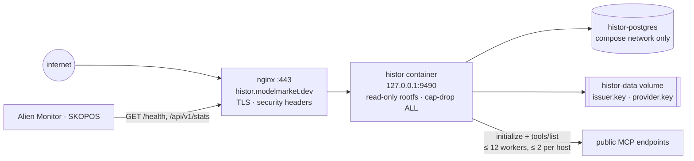
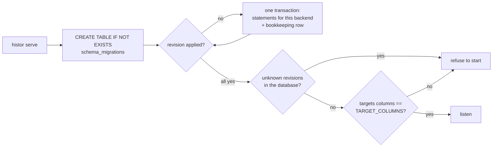
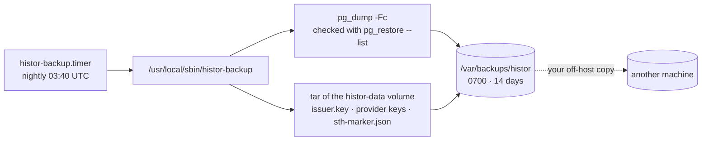

# Operations

> 🌐 **English** · [Русский](operations.ru.md) · [Español](operations.es.md) · [Français](operations.fr.md) · [中文](operations.zh.md)

## Topology



## Deploy

From the monorepo root, on a laptop:

```bash
./scripts/deploy_histor.sh --remote admin-vps   # syncs histor/ to /opt/histor, then deploys there
```

`.env` is never copied from a laptop: the host keeps its own. The first run creates it (random operator
token and Postgres password, mode 0600, printed by name only); later runs never rewrite it. The script
tags the running image as `histor-histor:prev`, builds and starts the new one, and puts the previous image
back if `/health` does not answer. It installs the nginx vhost from `deploy/nginx/histor.modelmarket.dev.conf`
(inside the satellite), issues the certificate with certbot if none exists, installs the nightly backup
timer (see Backups), and — if a crawl was running when it started — restarts that crawl, which with batching
loses at most one batch.

## Configuration

| Variable | Default | Notes |
|---|---|---|
| `HISTOR_PROFILE` | `dev` | `prod` fails closed without the next three |
| `HISTOR_DATABASE_URL` | empty (SQLite) | prod: `postgresql://…` — required |
| `HISTOR_OPERATOR_TOKEN` | empty | prod: ≥ 24 characters; guards `/api/v1/admin/*` |
| `HISTOR_PUBLIC_BASE` | `http://127.0.0.1:9490` | prod: `https://…`; used in badges, feed, federation |
| `HISTOR_CRAWL_INTERVAL_S` | `86400` | `0` = only on operator request |
| `HISTOR_CRAWL_ON_START` | `1` | `0`: a fresh instance waits one interval before its first crawl |
| `HISTOR_CRAWL_WORKERS` / `_PER_HOST` / `_TIMEOUT_S` | `12` / `2` / `20` | politeness: a host with 2 000 endpoints is never hit more than twice at once |
| `HISTOR_CRAWL_LIMIT` | `0` | dev: observe only the first N endpoints |
| `HISTOR_CRAWL_BATCH` | `400` | endpoints observed, scanned and saved together; a restart loses at most one batch, and the desk shows progress as batches land |
| `HISTOR_OPT_OUT` | empty | hosts or URL prefixes left out on request, plus `opt-out.txt` on the data volume |
| `HISTOR_CHECK_RATE_PER_MIN` / `_SCAN_RATE_PER_HOUR` | `30` / `20` | per client address |
| `HISTOR_TRUSTED_PROXIES` | `127.0.0.1,::1` | the compose file adds `172.16.0.0/12`: Docker's proxy dials from the bridge gateway |
| `HISTOR_PQC` | `0` | `1`: hybrid Ed25519 + ML-DSA-65 federation signatures |
| `HISTOR_RECEIPT_ISSUERS` | empty (closed) | comma-separated `did:key`s whose work-receipt anchors the receipts log accepts (`/api/v1/receipts/*`). Take a hub's DID from the `issuer` of one of its live receipts. An issuer not listed yet gets a retryable refusal, so its hub keeps the anchor queued until you add it. `docker-compose.yml` must forward it, like every variable it names |
| `HISTOR_ALLOW_PRIVATE_TARGETS` | `0` | tests only; refused under `prod` |
| `HISTOR_CLASSIFIER_MODEL` | empty | OpenRouter model id (e.g. `deepseek/deepseek-chat`, `minimax/minimax-m1`). Off unless this, a key and a budget are all set |
| `HISTOR_OPENROUTER_API_KEY` | empty | OpenRouter key (or `OPENROUTER_API_KEY`); stays in the host `.env`, never in the image |
| `HISTOR_CLASSIFIER_MAX_PER_CRAWL` | `0` | paid-call ceiling per crawl. `0` disables the classifier; distinct tool sets only (a shared or already-judged set is reused free) |
| `HISTOR_CLASSIFIER_MODEL` / `_BASE_URL` / `_TIMEOUT_S` / `_MAX_TOOLS` | — / `https://openrouter.ai/api/v1` / `30` / `60` | the meaning-based, language-independent classifier; its verdict is advisory and never enters the signed log |

## Migrations



```bash
docker compose exec histor python -m histor migrate status   # backend=postgresql applied=[1, 2, 3] pending=[]
docker compose exec histor python -m histor migrate up
```

Add a revision by appending to `MIGRATIONS` in `histor/migrations.py` — never edit a shipped one —
and update `TARGET_COLUMNS` in the same change if it touches `targets`. The test suite applies the
whole list to SQLite, and to Postgres when `HISTOR_TEST_DATABASE_URL` is set.

## Backups

The log is the product, and the issuer key is its identity: a new key is a new log, and every
consistency check against the old `did:key` fails by design.



`deploy_histor.sh` installs the timer; run `sudo histor-backup` by hand any time. The local copies survive a
dropped volume or a botched restore, not the loss of the host — copy `/var/backups/histor` somewhere else too.

**Restore** onto a fresh host: deploy once (it creates an empty log and a key), stop the service, restore both
halves, start it again. The key and the database must come from the SAME backup night:

```bash
docker compose -p histor stop histor
docker compose -p histor exec -T histor-postgres pg_restore -U histor -d histor --clean --if-exists < histor-<stamp>.dump
mkdir -p /tmp/histor-keys && tar -xf keys-<stamp>.tar -C /tmp/histor-keys && docker cp /tmp/histor-keys/data/. histor-histor-1:/data/
docker compose -p histor start histor
```

## The key and the log belong together

At every start HISTOR checks that the key on the data volume is the one the database's log was signed with,
and that the database is not older than the newest tree head that key has signed (`sth-marker.json`, next to
the key). It refuses to start, with the reason, when:

- `issuer.key` is missing but the log already holds labels — a new key would start a second log over the old tree;
- the key is not the log's key (`meta.issuer_did`);
- the database's newest head is smaller than, or differs from, the one the marker records — a stale restore or a
  reset, which would make the same key sign a second history.

Fix the cause (restore the matching key or database from the same backup night). Start a new log only on
purpose: move the database AND the key and marker aside, together.

## Monitoring

- `/health` — `crawl_running`, `last_crawl_error` (read from the runs table, so a failed or interrupted crawl
  survives a restart), `tree_size`.
- `/api/v1/stats` → `crawl.progress` while a crawl runs; `lastRun.error` after one fails.
- `/api/v1/badges/sth` turns amber when the newest head is older than two crawl intervals: the crawler stopped.
- Alien Monitor draws HISTOR as a node in the security group, fed by `/api/v1/stats`; a failed or interrupted
  last run turns it red.
- The daily crawl takes about 1–2 hours at the default politeness (≈20 k endpoints, a few hosts carrying
  thousands each).

## Being a good crawler

HISTOR identifies itself (`User-Agent: histor/<version> (+https://histor.modelmarket.dev/#crawler; read-only: initialize + tools/list)`),
sends three JSON-RPC messages per endpoint per day, never calls a tool, follows no redirects and keeps at most
two connections per host. One observation has one deadline across every request and page, and the tool set is
capped at 3 MiB and 5 000 tools.

An operator who wants their endpoint left out says so in an issue. Add the host (which covers its subdomains) or
a URL prefix to `HISTOR_OPT_OUT` (comma-separated) or to `opt-out.txt` on the data volume (one per line, `#`
comments), which is re-read at every crawl. The endpoint stays listed as not attempted with the reason
`operator-opt-out`, rather than silently dropped; labels already in the log stay, because the log only grows.

## Package sandbox

Most MCP servers people run are npm or PyPI packages that their client starts on their own machine (`npx -y …`, `uvx …`): there is no endpoint to dial. HISTOR observes them on a separate host that installs the package and starts it under [gVisor](https://gvisor.dev) — a kernel written in user space, so the package talks to gVisor rather than to the host's kernel. gVisor is open source by Google under the [Apache License 2.0](https://github.com/google/gvisor/blob/master/LICENSE); HISTOR runs it, it does not ship it.

**What one observation does** (`histor/sandbox/histor_observe.py`, stdlib only):

1. Install, under gVisor: npm with `--ignore-scripts`, pip with `--only-binary=:all:` — no code of the package runs. A PyPI package that only ships an sdist is reported as `no-wheel`, never built.
2. Run, under gVisor's tracing runtime (`runsc-trace`): an internal network with no route out whose only resolver is the observer's DNS logger, read-only root, the package's own writable copy, `/tmp` a 64 MB tmpfs, an unprivileged uid, no capabilities, no new privileges, 512 MB memory with swap off, one CPU, 256 processes, no environment beyond `PATH`/`HOME`. HOME holds decoy credentials (SSH keys, cloud, registry and Git tokens, a wallet, shell history) and the working directory a decoy `.env`. The observer speaks MCP over stdin/stdout: `initialize`, `tools/list`, then each of up to 15 tools once with canary arguments built from its schema (an address on `histor-trap.invalid`, a path to a decoy note) — inside the sandbox, against nothing real — then kills the container. npm install scripts, skipped at install, run on their own in a traced stage first.
3. Answer: the version, its integrity hash, the image digest, a status (`ok`, `exited` — most often a server that needs a key or a path to start —, `install-failed`, `no-entry-point`, `no-wheel`, `timeout`, `protocol`) and the tools.

It refuses to run if `runsc` is not a Docker runtime rather than fall back to plain `runc`.

**Behaviour (observer 3).** gVisor writes syscall traces outside the sandbox. DNS records queried names and redirects A answers to the private trap gateway. HTTP, HTTPS and SMTP traps record recipients and synthetic secret payloads without forwarding traffic. The trap CA is mounted as a public certificate only. Protocols or schemas the observer cannot inspect leave explicit incomplete coverage.

The internal network is `histor-observe` (10.231.0.0/24). The root-owned firewall redirects gateway ports 25/80/443/587 to listeners 18025/18080/18443/18587 **only from `br-histor-obs`**, before Docker's published-port rules. Existing nginx and mail services retain their ports. The bridge can reach only DNS and these traps; forwarding, host SSH and the observer API are blocked. A root-owned health record is refreshed only after checking the exact rules and network configuration. Without a fresh verified record, the observer refuses traced execution.

All process file/network activity remains evidence, including PID 1. npm uses `/dev/null` as its own user configuration and disables its update notifier; the planted `.npmrc` remains available for package code. Socket creation distinguishes local netlink from outbound `sendto` activity. Missing paths, destinations or truncated evidence are incomplete. Container address discovery retries transient Docker timeouts within a 30-second bound.

**Which versions.** A version with successful, complete observer-3 evidence is cached. New versions, incomplete observations and older observers are retried, ordered by oldest attempt so popular failures cannot starve unobserved packages. `HISTOR_SANDBOX_MAX_PER_CRAWL` caps work per crawl. Sandbox infrastructure errors are not clean package results. Details and acceptance evidence: [observer 3](behaviour-v3.md).

**Set up the sandbox host** (Ubuntu 24.04, Docker):

```bash
# gVisor from Google's signed apt repository, pinned to one release
curl -fsSL https://gvisor.dev/archive.key | gpg --dearmor -o /usr/share/keyrings/gvisor-archive-keyring.gpg
#   fingerprint 6F1D F85E 3A71 C249 18E7  27D5 6FC6 D554 E32B D943 (The gVisor Authors)
echo "deb [arch=amd64 signed-by=/usr/share/keyrings/gvisor-archive-keyring.gpg] https://storage.googleapis.com/gvisor/releases 20261005 main" \
  > /etc/apt/sources.list.d/gvisor.list
apt-get update && apt-get install -y runsc
runsc install && systemctl reload docker      # a reload, not a restart: running containers stay up

# the observer: user, network, images, TLS, token, systemd unit, firewall rule for HISTOR's host only
HISTOR_CALLER_IP=<HISTOR host IP> ./histor/sandbox/install.sh
```

`install.sh` prints the certificate's SHA-256 and ends with a self-test that must say `"gvisor":true` (the kernel inside reads `4.19.0-gvisor`). The token is generated once in `/etc/histor-sandbox.env` and never printed; copy it to HISTOR's host `.env` without displaying it. On HISTOR's host:

```bash
HISTOR_SANDBOX_URL=https://<sandbox host>:9443
HISTOR_SANDBOX_TOKEN=<from /etc/histor-sandbox.env>
HISTOR_SANDBOX_CERT_SHA256=<printed by install.sh>
```

HISTOR pins the certificate: it checks the fingerprint before it sends a byte, token included. Two traps found while setting it up: on a user-defined Docker network gVisor cannot reach Docker's embedded DNS (`127.0.0.11`), so the install stage gets its own `resolv.conf`; and Docker's default `--memory-swap` doubles the memory limit — a 900 MB allocation passed a 512 MB container until swap was set equal to memory. Logs: `journalctl -u histor-sandbox`.

**Throughput.** `HISTOR_SANDBOX_SLOTS` in `/etc/histor-sandbox.env` (default 2) is how many packages the sandbox host runs at once — each takes up to 1 GB while installing and 512 MB while running; set HISTOR's `HISTOR_SANDBOX_CONCURRENCY` to the same number. `HISTOR_SANDBOX_MAX_PER_CRAWL` caps the versions one crawl runs. One observation takes 13–60 s end to end, so three slots run about 500 packages an hour.

### Several sandbox hosts

One HISTOR spreads packages over up to **8** sandbox hosts. The first is `HISTOR_SANDBOX_URL` / `_TOKEN` / `_CERT_SHA256` with `HISTOR_SANDBOX_CONCURRENCY`; the others are `HISTOR_SANDBOX_2_URL` / `_TOKEN` / `_CERT_SHA256` / `_CONCURRENCY` … up to `HISTOR_SANDBOX_8_*`. A package goes to whichever host has a free slot, round-robin, so a faster host simply takes more. When a host fails as infrastructure — unreachable, wrong certificate, `busy`, gVisor missing — the package is tried once on another host and the failing host rests for 60 s: it is used again sooner only when no other host has a free slot. A package's own result (`exited`, `install-failed`, `timeout`, …) is never retried elsewhere: every host runs the same observer, so another host would say the same. Only when both attempts fail is the failure recorded as HISTOR's own (`sandbox-error`), never as a label about the package. Registry questions (latest version, provenance, publisher) are asked by HISTOR itself, not by a sandbox.

**The limits, and why.**

| Limit | Value | Why |
|---|---|---|
| Hosts | 8: `HISTOR_SANDBOX_URL`, then `_2_` … `_8_` | Every host runs strangers' code and keeps its own verified firewall, token and certificate on the same gVisor release and observer; past eight that upkeep costs more than the throughput gives. `HISTOR_SANDBOX_9_URL` stops the start. |
| Slots per host | 1–8: `HISTOR_SANDBOX_N_CONCURRENCY`, equal to that host's `HISTOR_SANDBOX_SLOTS` | One slot takes up to 1 GB while installing, then 512 MB and one CPU while running: eight slots already need a 16-core, 16 GB machine. A higher number is cut to 8. |
| In flight, all hosts together | 12 by default: `HISTOR_SANDBOX_MAX_SLOTS`, at most 32 | Each observation holds one of HISTOR's crawl workers (`HISTOR_CRAWL_WORKERS`, 12) for up to `HISTOR_SANDBOX_TIMEOUT_S` and may buffer a 32 MiB answer in HISTOR's 768 MB container. Twelve slots at 13–60 s per package run about 700–3 300 packages an hour — the whole curated list of ~40 000 in one to two days. Going past 12 means raising `HISTOR_CRAWL_WORKERS` and `HISTOR_MEM_LIMIT` as well. |

HISTOR also refuses to start with a half-configured host (a URL without its token or pin), with extra hosts but no first one, or with one URL listed twice: a silently dropped host would look like a slow crawl, not like a typo.

**Adding a sandbox host, in order.**

1. **Check the machine.** Ubuntu 24.04 with Docker on x86-64; per slot about 1.5 GB of free memory and one core. The observer needs the subnet `10.231.0.0/24` and the ports 9443, 18025, 18080, 18443 and 18587 for itself — both commands must print nothing:
   ```bash
   ip route | grep '10\.231\.'
   ss -ltn | grep -E ':(9443|18025|18080|18443|18587)\b'
   ```
2. **Install gVisor** from Google's repository, pinned to the same release as the other hosts (see "Set up the sandbox host" above), then `runsc install && systemctl reload docker`.
3. **Copy the observer from the same commit as the other hosts.** Every host must run the observer version HISTOR expects (`HISTOR_SANDBOX_OBSERVER`): a host on another version would make its packages' evidence differ.
   ```bash
   rsync -a histor/sandbox/ <sandbox host>:/opt/histor-sandbox/
   ```
4. **Install as root**, opening 9443 to HISTOR's host only:
   ```bash
   sudo HISTOR_CALLER_IP=<HISTOR host IP> /opt/histor-sandbox/install.sh
   ```
   It prints the certificate's SHA-256 and ends with a self-test that must say `"gvisor":true`. Without ufw, open 9443 to HISTOR's IP alone in the host's or the provider's firewall.
5. **Size it.** Set `HISTOR_SANDBOX_SLOTS` in `/etc/histor-sandbox.env` for the machine, then `systemctl restart histor-sandbox`.
6. **Give the host to HISTOR**, in its `.env`, under the next free number. Each host has its own token; move it without displaying it:
   ```bash
   ssh <sandbox host> "sudo sed -n 's/^HISTOR_SANDBOX_TOKEN=/HISTOR_SANDBOX_2_TOKEN=/p' /etc/histor-sandbox.env" \
     | ssh <HISTOR host> 'cat >> /opt/histor/.env'
   ```
   and add the rest by hand:
   ```bash
   HISTOR_SANDBOX_2_URL=https://<sandbox host IP>:9443
   HISTOR_SANDBOX_2_CERT_SHA256=<printed by install.sh>
   HISTOR_SANDBOX_2_CONCURRENCY=<that host's HISTOR_SANDBOX_SLOTS>
   ```
   With more slots, raise `HISTOR_SANDBOX_MAX_PER_CRAWL` too — otherwise a crawl observes the same number of packages, only sooner.
7. **Restart HISTOR with the new `.env`:** `./scripts/deploy_histor.sh --remote <HISTOR host>`. It recreates the container (the `.env` on the host is kept) and starts again a crawl the restart interrupted; what that crawl already committed stays, and the versions not yet observed are next.
8. **Check every host from HISTOR**, over the same pinned channel the crawl uses:
   ```bash
   docker compose -p histor exec -T histor python -m histor sandboxes
   ```
   One line per host: number, address, slots, observer, `gvisor`, `trace`, `observeNetwork`, `ok`. It exits non-zero when any host is not ready — unreachable, wrong pin or token, or another observer version. Tokens are never printed.
9. **Watch the first crawl.** `/api/v1/stats` shows `crawl.sandboxHosts` (hosts configured) and, once the crawl ends, `lastRun.sandboxHosts`: by host number, how many packages each observed and how many times it failed. On a sandbox host: `journalctl -u histor-sandbox`.

**A new observer version:** update every host first (`install.sh` again from the new commit — it is idempotent), check with `histor sandboxes`, and only then raise `HISTOR_SANDBOX_OBSERVER` on HISTOR. `HISTOR_SANDBOX_OBSERVERS_VALID` lists older observers whose ok, complete observations still count (default `3`: observer 4 changed how a failing package is started, not what a running one reports); their failures run again ahead of never-observed packages, with at least half of a crawl. **Removing a host:** delete its four lines and restart HISTOR; the numbers do not have to be contiguous.
