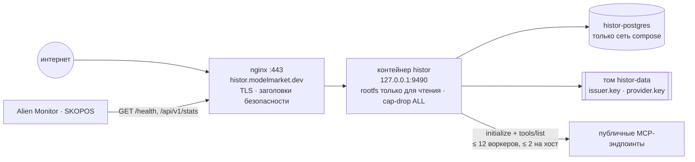
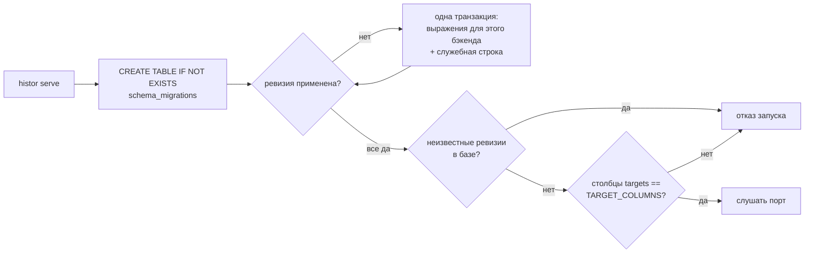
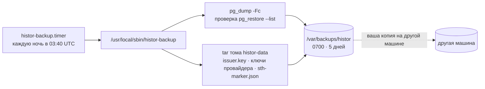

# Эксплуатация

> 🌐 [English](operations.md) · **Русский** · [Español](operations.es.md) · [Français](operations.fr.md) · [中文](operations.zh.md)

## Топология



## Деплой

Из корня монорепозитория, с ноутбука:

```bash
./scripts/deploy_histor.sh --remote admin-vps   # синхронизирует histor/ в /opt/histor и деплоит там
```

`.env` никогда не копируется с ноутбука: у хоста он свой. Первый запуск создаёт его (случайные токен оператора и
пароль Postgres, права 0600, выводятся только имена); последующие запуски его не переписывают. Скрипт помечает
работающий образ как `histor-histor:prev`, собирает и запускает новый и возвращает прежний, если `/health` не
отвечает. Он ставит vhost nginx из `deploy/nginx/histor.modelmarket.dev.conf` (внутри сателлита), получает
сертификат через certbot, если его нет, ставит ночной таймер резервного копирования (см. «Резервные копии») и —
если в момент запуска шёл обход — перезапускает этот обход; с партиями он теряет не больше одной партии.

## Перезапуск посреди обхода

Перезапуск (деплой, падение, убийство по памяти) не стоит обхода. Результат каждой цели фиксируется,
как только он получен, и следующий старт продолжает прерванный цикл:

- **Прочитанное остаётся прочитанным.** Новый прогон вызывает только то, что цикл ещё не пробовал. Цикл
  продолжается, сколько бы он ни шёл, пока он двигался: свежий цикл начинает только процесс, который
  простоял целый `HISTOR_CRAWL_INTERVAL_S`. (До 2026-10-23 цикл бросался, как только его началу исполнялись
  сутки: 22 октября цикл, проработавший 42 часа с шестью перезапусками, начали заново с первого сервера.)
- **У пакетов остаются план и бюджет.** Цикл планирует пакеты один раз (опрос npm и PyPI о версиях всех
  известных пакетов занимал 59 минут) и хранит план в `crawl_plans`; продолженный прогон берёт остаток, а
  `HISTOR_SANDBOX_MAX_PER_CRAWL` и бюджет классификатора — на цикл, а не на каждый прогон.
- **Числа остаются.** Прогон сохраняет свои счётчики каждые 30 секунд, поэтому прерванный прогон говорит, что
  он сделал. `/api/v1/stats` показывает цикл: `lastRun` — то, что зафиксировали все его прогоны (с
  `cycle.startedAt` и `cycle.runs`), а `crawl.progress` считает по циклу, рядом `thisRun`.

Перезапуск теряет только работу в полёте: партию эндпоинтов, которую читали, и пакеты, которые в этот момент
шли в песочнице. Они читаются снова.

`tests/integration/test_restart.py` проверяет это на настоящем процессе: убивает HISTOR через SIGKILL
посреди цикла (часть эндпоинтов и пакетов зафиксирована, часть в полёте), запускает снова и проверяет, что
ничего зафиксированного не прочитано дважды, версии не запрашиваются заново, бюджет пакетов — цикла, а цикл
показан целиком; на SQLite и PostgreSQL. На коде до этого изменения он падает.

## Конфигурация

| Переменная | По умолчанию | Примечания |
|---|---|---|
| `HISTOR_PROFILE` | `dev` | при `prod` без следующих трёх сервис не запускается: fail-closed (отказ по умолчанию) |
| `HISTOR_DATABASE_URL` | пусто (SQLite) | prod: `postgresql://…` — обязательно |
| `HISTOR_OPERATOR_TOKEN` | пусто | prod: ≥ 24 символов; защищает `/api/v1/admin/*` |
| `HISTOR_PUBLIC_BASE` | `http://127.0.0.1:9490` | prod: `https://…`; используется в бейджах, ленте, федерации |
| `HISTOR_CRAWL_INTERVAL_S` | `86400` | discovery реестра и пакеты; `0` = только по запросу оператора |
| `HISTOR_REMOTE_INTERVAL_S` | `21600` | отдельная очередь remote HTTP, цель шесть часов; `0` возвращает remotes в суточный обход |
| `HISTOR_REMOTE_CHANGED_INTERVAL_S` / `HISTOR_REMOTE_CHANGE_WINDOW_S` | `1800` / `604800` | цель 30 минут после как минимум двух наблюдавшихся изменений за семь дней; [границы измерений](measurement-limits.ru.md) |
| `HISTOR_CRAWL_MIN_GAP_S` | `1800` | минимальная пауза после завершённого цикла перед следующим; в эту паузу снимается еженедельный снимок (`deploy/export_dataset.sh`) |
| `HISTOR_DECLARATION_REFRESH_S` | `3600` | как часто между обходами перечитываются файлы заявлений издателей ([api](api.ru.md)); `0` = только при обходе |
| `HISTOR_CRAWL_ON_START` | `1` | `0`: новый экземпляр ждёт один интервал до первого обхода |
| `HISTOR_CRAWL_WORKERS` / `_PER_HOST` / `_TIMEOUT_S` | `12` / `2` / `20` | вежливость: хост с 2 000 эндпоинтов никогда не получает больше двух запросов одновременно |
| `HISTOR_CRAWL_LIMIT` | `0` | dev: наблюдать только первые N эндпоинтов |
| `HISTOR_CRAWL_BATCH` | `400` | эндпоинты, которые наблюдаются, сканируются и сохраняются вместе; перезапуск теряет не больше одной партии, а деск показывает прогресс по мере сохранения партий |
| `HISTOR_OPT_OUT` | пусто | хосты или префиксы URL, исключённые по просьбе владельцев, плюс `opt-out.txt` на томе данных |
| `HISTOR_CHECK_RATE_PER_MIN` / `_SCAN_RATE_PER_HOUR` | `30` / `20` | на адрес клиента |
| `HISTOR_TRUSTED_PROXIES` | `127.0.0.1,::1` | compose-файл добавляет `172.16.0.0/12`: прокси Docker подключается со шлюза моста |
| `HISTOR_PQC` | `0` | `1`: гибридные подписи федерации Ed25519 + ML-DSA-65 |
| `HISTOR_RECEIPT_ISSUERS` | пусто (закрыто) | через запятую — `did:key`, чьи якоря рабочих квитанций принимает журнал квитанций (`/api/v1/receipts/*`). DID хаба берётся из поля `issuer` любой его живой квитанции. Ещё не внесённый издатель получает отказ, который можно повторить, поэтому хаб держит якорь в очереди, пока вы его не добавите. `docker-compose.yml` должен пробрасывать переменную, как и любую из перечисленных в нём |
| `HISTOR_ALLOW_PRIVATE_TARGETS` | `0` | только для тестов; при `prod` отклоняется |
| `HISTOR_CLASSIFIER_MODEL` | пусто | id модели OpenRouter (напр. `deepseek/deepseek-chat`, `minimax/minimax-m1`). Выключен, пока не заданы модель, ключ и бюджет |
| `HISTOR_OPENROUTER_API_KEY` | пусто | ключ OpenRouter (или `OPENROUTER_API_KEY`); остаётся в `.env` хоста, не в образе |
| `HISTOR_CLASSIFIER_MAX_PER_CRAWL` | `0` | потолок платных вызовов за обход. `0` — выключено; считаются только различные наборы (общий или уже оценённый переиспользуется бесплатно) |
| `HISTOR_CLASSIFIER_BASE_URL` / `_TIMEOUT_S` / `_MAX_TOOLS` | `https://openrouter.ai/api/v1` / `30` / `60` | смысловой языконезависимый классификатор; вердикт справочный и не попадает в подписанный лог |

## Снимки открытых данных

Раз в ISO-неделю `histor-export-dataset` (`deploy/export_dataset.sh`, таймер каждые 10 минут) копирует завершённый цикл обхода в `/var/lib/histor-datasets/<дата>/`, отдаёт его на `/datasets/` и, если настроен `/etc/histor-hf/`, загружает на Hugging Face (тег `snapshot-<дата>`). На хосте хранятся восемь последних (`HISTOR_DATASET_KEEP`); `HISTOR_DATASET_PERIOD=month` возвращает один снимок в месяц. Первый снимок каждого месяца архивируется на Zenodo вручную, новой версией концептуальной записи: когда он записан, `histor-notify` отправляет сообщение в Telegram, а `histor-zenodo-reminder` (каждый день в 09:00 UTC) повторяет его, пока снимок не появится на Zenodo. Оба берут токен бота и чат из `/etc/histor-notify.env` (0600: `AICOM_ALERT_TELEGRAM_TOKEN`, `AICOM_ALERT_TELEGRAM_CHAT`); без этого файла ничего не отправляется. `histor-export-dataset --due` и `histor-zenodo-reminder --dry` показывают, что они сделали бы.

Remote polling наблюдает выборку, не каждый переход: A→B→A между проверками невидимо. Отдельная remote-очередь не означает переустановку пакетов каждые 30 минут. Очередь, лимиты хоста и backoff увеличивают фактические пробелы; проверяйте `remotePolling` в `/api/v1/stats`. [Границы](measurement-limits.ru.md) разделяют настроенную частоту и измеренное покрытие.

## Миграции



```bash
docker compose exec histor python -m histor migrate status   # backend=postgresql applied=[1, 2, 3] pending=[]
docker compose exec histor python -m histor migrate up
```

Чтобы добавить ревизию, допишите её в конец `MIGRATIONS` в `histor/migrations.py` — выпущенные
никогда не редактируйте — и, если она затрагивает `targets`, обновите `TARGET_COLUMNS` в том же
изменении. Набор тестов применяет весь список к SQLite, а к Postgres — когда задана `HISTOR_TEST_DATABASE_URL`.

## Резервные копии

Журнал — это и есть продукт, а ключ издателя — его личность: новый ключ означает новый журнал, и любая проверка
согласованности со старым `did:key` по замыслу проваливается.



Таймер ставит `deploy_histor.sh`; вручную — `sudo histor-backup` в любой момент. Локальные копии переживут
потерянный том или неудачное восстановление, но не потерю хоста — копируйте `/var/backups/histor` и в другое место.

**Восстановление** на новый хост: один раз задеплойте (появятся пустой журнал и ключ), остановите сервис,
восстановите обе половины и запустите снова. Ключ и база должны быть из ОДНОЙ ночи:

```bash
docker compose -p histor stop histor
docker compose -p histor exec -T histor-postgres pg_restore -U histor -d histor --clean --if-exists < histor-<stamp>.dump
mkdir -p /tmp/histor-keys && tar -xf keys-<stamp>.tar -C /tmp/histor-keys && docker cp /tmp/histor-keys/data/. histor-histor-1:/data/
docker compose -p histor start histor
```

## Ключ и журнал неразделимы

При каждом старте HISTOR проверяет, что ключ на томе данных — тот, которым подписан журнал в базе, и что база не
старше новейшей вершины дерева, подписанной этим ключом (`sth-marker.json` рядом с ключом). Он отказывается
стартовать и называет причину, если:

- `issuer.key` нет, а в журнале уже есть метки — новый ключ начал бы второй журнал поверх старого дерева;
- ключ не является ключом журнала (`meta.issuer_did`);
- новейшая вершина в базе меньше записанной в маркере или отличается от неё — устаревшее восстановление или сброс,
  при котором тот же ключ подписал бы вторую историю.

Устраните причину (восстановите подходящий ключ или базу из той же ночи). Новый журнал начинайте только
намеренно: уберите в сторону базу И ключ с маркером — вместе.

## Мониторинг

- `/health` — `crawl_running`, `last_crawl_error` (читается из таблицы runs, поэтому неудачный или прерванный обход
  переживает перезапуск), `tree_size`.
- `/api/v1/stats` → `crawl.progress`, пока идёт обход; `lastRun.error` после неудачного.
- `/api/v1/badges/sth` становится янтарным, когда новейшей вершине больше двух интервалов обхода: обходчик остановился.
- Alien Monitor рисует HISTOR узлом в группе безопасности по данным `/api/v1/stats`; неудачный или прерванный
  последний обход окрашивает его в красный.
- Ежедневный обход занимает около 1–2 часов при вежливости по умолчанию (≈20 тыс. эндпоинтов, несколько хостов
  держат по тысяче и больше).

## Как быть вежливым обходчиком

HISTOR представляется (`User-Agent: histor/<version> (+https://histor.modelmarket.dev/#crawler; read-only: initialize + tools/list)`),
отправляет три JSON-RPC-сообщения на эндпоинт в день, никогда не вызывает инструменты, не выполняет редиректы и
держит не больше двух соединений на хост. У одного наблюдения один дедлайн на все запросы и страницы, а набор
инструментов ограничен 3 МиБ и 5 000 инструментов.

Владелец, который не хочет, чтобы его эндпоинт опрашивали, пишет об этом в issue. Добавьте хост (он покрывает и
поддомены) или префикс URL в `HISTOR_OPT_OUT` (через запятую) или в `opt-out.txt` на томе данных (по одному в строке,
комментарии через `#`); файл перечитывается при каждом обходе. Эндпоинт остаётся в списке как не опрошенный с
причиной `operator-opt-out`, а не исчезает молча; метки, уже попавшие в журнал, остаются — журнал только растёт.

## Песочница для пакетов

Большинство MCP-серверов, которыми пользуются люди, — пакеты npm или PyPI, которые клиент запускает на их собственной машине (`npx -y …`, `uvx …`): подключаться не к чему. HISTOR читает их на отдельном хосте, который ставит пакет и запускает его под [gVisor](https://gvisor.dev) — ядром, написанным в пространстве пользователя, так что пакет говорит с gVisor, а не с ядром хоста. gVisor — открытый проект Google под [лицензией Apache 2.0](https://github.com/google/gvisor/blob/master/LICENSE); HISTOR его запускает, но не распространяет.

**Что делает одно наблюдение** (`histor/sandbox/histor_observe.py`, только стандартная библиотека):

1. Установка, под gVisor: npm с `--ignore-scripts`, pip с `--only-binary=:all:` — код пакета не выполняется. Пакет PyPI, у которого есть только sdist, отмечается как `no-wheel` и никогда не собирается.
2. Запуск, под gVisor в режиме трассировки (`runsc-trace`): внутренняя сеть без маршрута наружу, единственный DNS — логгер наблюдателя; корень только для чтения, собственная записываемая копия пакета, `/tmp` — tmpfs на 64 МБ, непривилегированный uid, без capabilities и без повышения привилегий, 512 МБ памяти без swap, один CPU, 256 процессов, в окружении только `PATH`/`HOME`. В HOME лежат приманки (SSH-ключи, токены облаков, реестров и Git, кошелёк, история shell), в рабочей папке — приманка `.env`. Наблюдатель говорит по MCP через stdin/stdout: `initialize`, `tools/list`, затем каждый из не более чем 15 инструментов один раз с подставными аргументами, собранными по его схеме (адрес на `histor-trap.invalid`, путь к заметке-приманке), — внутри песочницы, ни на что настоящее не действуя, — и убивает контейнер. Установочные скрипты npm, пропущенные при установке, сначала выполняются отдельно, тоже под трассировкой.
3. Ответ: версия, её хеш целостности, хеш образа, статус (`ok`, `exited` — чаще всего серверу для старта нужен ключ или путь, —, `install-failed`, `no-entry-point`, `no-wheel`, `timeout`, `protocol`) и инструменты.

Если `runsc` не зарегистрирован в Docker, наблюдатель отказывается работать, а не переходит на обычный `runc`.

**Поведение.** gVisor сам пишет трассу запуска (`execve`, `connect`, `open`/`openat`) вне песочницы, поэтому пакет не может её скрыть или подделать; DNS-логгер записывает каждое запрошенное имя и отвечает уникальным адресом из 198.18.0.0/15, который никуда не ведёт, — так каждая попытка соединения видна вместе с именем, ради которого она была. По фазам — установочные скрипты, запуск, вызовы с подставными аргументами — наблюдение сообщает: запущенные программы, запрошенные имена и адреса, открытые приманки и записи, которые пережили бы песочницу (`.bashrc`, `authorized_keys`, …). Активность входного процесса контейнера на шаге установочных скриптов — это сам npm, она отбрасывается; соединения с loopback тоже. Установка добавляет runtime `runsc-trace`, внутреннюю сеть `histor-observe` (10.231.0.0/24), правило файрвола, пускающее её только к резолверу, `CAP_NET_BIND_SERVICE` для службы и таймер, удаляющий прочитанные трассы. HISTOR снова запускает версию, если её наблюдал наблюдатель старше `HISTOR_SANDBOX_OBSERVER` (2 = поведение).

**Чья это запись ловушки.** Запись засчитывается прогону, только если её соединение открылось, пока адрес
принадлежал контейнеру этого прогона (с его `State.StartedAt`), и в ней нет метки другого прогона. Каждая приманка,
которую HISTOR подкладывает или передаёт, несёт 12-символьную метку прогона (`canary-<метка>@histor-trap.invalid`,
`histor-canary-ssh-<метка>`, `histor-envkey-<метка>` …). Docker отдаёт освободившийся адрес следующему контейнеру, и
соединение, которое поставил в очередь прежний владелец адреса, может быть принято уже после старта следующего: такая
запись показывается как трафик другого прогона и делает прогон неполным (`foreign-run-traffic`), но никогда не
засчитывается ему как получатель, приманка или адрес для ключа. Причины неполноты складываются (`dns-unrecorded` и
`foreign-run-traffic` вместе); прогон без них чистый, так что «наблюдатель не смог полностью учесть прогон» никогда не
читается как «чисто». Предложил читатель статьи об опросе 12 915 серверов; наблюдатель `gvisor-trace/8`.

**Какие версии.** Опубликованную версию в npm и PyPI изменить нельзя, поэтому каждая версия читается один раз. Каждый обход спрашивает у реестров последнюю версию (это дёшево) и запускает песочницу только для версий, которых ещё не видел, не больше `HISTOR_SANDBOX_MAX_PER_CRAWL` (300): сначала новые версии уже известных пакетов — именно так изменённое описание инструмента доходит до всех, кто запускает пакет без закреплённой версии, — затем пакеты, которые ещё не читались. Сбой самой песочницы записывается как внутренняя ошибка HISTOR и не порождает метки о пакете.

**Как поставить хост песочницы** (Ubuntu 24.04, Docker):

```bash
# gVisor из подписанного apt-репозитория Google, закреплённый на одном выпуске
curl -fsSL https://gvisor.dev/archive.key | gpg --dearmor -o /usr/share/keyrings/gvisor-archive-keyring.gpg
#   отпечаток 6F1D F85E 3A71 C249 18E7  27D5 6FC6 D554 E32B D943 (The gVisor Authors)
echo "deb [arch=amd64 signed-by=/usr/share/keyrings/gvisor-archive-keyring.gpg] https://storage.googleapis.com/gvisor/releases 20261005 main" \
  > /etc/apt/sources.list.d/gvisor.list
apt-get update && apt-get install -y runsc
runsc install && systemctl reload docker      # перечитать настройки, а не перезапустить: контейнеры продолжают работать

# наблюдатель: пользователь, сеть, образы, TLS, токен, служба systemd, правило файрвола только для хоста HISTOR
HISTOR_CALLER_IP=<IP хоста HISTOR> ./histor/sandbox/install.sh
```

`install.sh` печатает SHA-256 сертификата и заканчивается самопроверкой, которая должна сказать `"gvisor":true` (ядро внутри — `4.19.0-gvisor`). Токен генерируется один раз в `/etc/histor-sandbox.env` и никогда не печатается; перенесите его в `.env` хоста HISTOR, не выводя на экран. На хосте HISTOR:

```bash
HISTOR_SANDBOX_URL=https://<хост песочницы>:9443
HISTOR_SANDBOX_TOKEN=<из /etc/histor-sandbox.env>
HISTOR_SANDBOX_CERT_SHA256=<напечатан install.sh>
```

HISTOR закрепляет сертификат: проверяет отпечаток до того, как отправит хоть байт, включая токен. Две ловушки, найденные при настройке: в пользовательской сети Docker gVisor не видит встроенный DNS Docker (`127.0.0.11`), поэтому шагу установки дан свой `resolv.conf`; а `--memory-swap` по умолчанию удваивает лимит памяти — выделение 900 МБ проходило в контейнере на 512 МБ, пока swap не приравняли к памяти. Журнал: `journalctl -u histor-sandbox`.

**Пропускная способность.** `HISTOR_SANDBOX_SLOTS` в `/etc/histor-sandbox.env` (по умолчанию 2) — сколько пакетов хост песочницы запускает одновременно; каждый занимает до 1 ГБ при установке и 512 МБ при запуске. В HISTOR задайте `HISTOR_SANDBOX_CONCURRENCY` равным этому числу. `HISTOR_SANDBOX_MAX_PER_CRAWL` ограничивает число версий за один обход. Одно наблюдение целиком занимает 13–60 с, так что три слота проходят около 500 пакетов в час.

### Несколько хостов песочницы

Один HISTOR распределяет пакеты по **8** хостам песочницы максимум. Первый задают `HISTOR_SANDBOX_URL` / `_TOKEN` / `_CERT_SHA256` и `HISTOR_SANDBOX_CONCURRENCY`; остальные — `HISTOR_SANDBOX_2_URL` / `_TOKEN` / `_CERT_SHA256` / `_CONCURRENCY` … до `HISTOR_SANDBOX_8_*`. Пакет уходит на хост со свободным слотом, по кругу, так что более быстрый хост просто берёт больше. Если хост отказал как инфраструктура — недоступен, не тот сертификат, `busy`, нет gVisor, — пакет один раз пробуется на другом хосте, а отказавший хост отдыхает 60 с: раньше его возьмут, только если ни у одного другого нет свободного слота. Собственный результат пакета (`exited`, `install-failed`, `timeout`, …) на другом хосте не повторяется: наблюдатель везде один и тот же, другой хост сказал бы то же самое. Только если не удались обе попытки, сбой записывается как собственная ошибка HISTOR (`sandbox-error`) и никогда — как метка о пакете. Вопросы к реестрам (последняя версия, подтверждённая сборка, публикующий) задаёт сам HISTOR, а не песочница.

**Ограничения и почему такие.**

| Ограничение | Значение | Почему |
|---|---|---|
| Хостов | 8: `HISTOR_SANDBOX_URL`, затем `_2_` … `_8_` | Каждый хост запускает чужой код и держит свой проверяемый файрвол, токен и сертификат на одном релизе gVisor и одной версии наблюдателя; после восьми это обслуживание стоит дороже, чем даёт пропускная способность. `HISTOR_SANDBOX_9_URL` останавливает запуск. |
| Слотов на хост | 1–8: `HISTOR_SANDBOX_N_CONCURRENCY`, равно `HISTOR_SANDBOX_SLOTS` этого хоста | Слот занимает до 1 ГБ при установке, затем 512 МБ и одно ядро при запуске: восьми слотам уже нужна машина на 16 ядер и 16 ГБ. Большее число урезается до 8. |
| Одновременно на всех хостах | 12 по умолчанию: `HISTOR_SANDBOX_MAX_SLOTS`, не больше 32 | Каждое наблюдение держит один из рабочих потоков обхода HISTOR (`HISTOR_CRAWL_WORKERS`, 12) до `HISTOR_SANDBOX_TIMEOUT_S` и может буферизовать ответ в 32 МиБ в контейнере HISTOR на 768 МБ. Двенадцать слотов по 13–60 с на пакет — это примерно 700–3 300 пакетов в час, весь курируемый список из ~40 000 за один-два дня. Выше 12 — значит поднять ещё `HISTOR_CRAWL_WORKERS` и `HISTOR_MEM_LIMIT`. |

HISTOR также не запустится с наполовину настроенным хостом (URL без токена или отпечатка), с дополнительными хостами без первого или с одним URL дважды: молча выброшенный хост выглядел бы как медленный обход, а не как опечатка.

**Добавить хост песочницы — по порядку.**

1. **Проверить машину.** Ubuntu 24.04 с Docker на x86-64; на слот около 1,5 ГБ свободной памяти и одно ядро. Наблюдателю нужны подсеть `10.231.0.0/24` и порты 9443, 18025, 18080, 18443 и 18587 — обе команды не должны ничего вывести:
   ```bash
   ip route | grep '10\.231\.'
   ss -ltn | grep -E ':(9443|18025|18080|18443|18587)\b'
   ```
2. **Поставить gVisor** из репозитория Google, закрепив тот же релиз, что на остальных хостах (см. «Как поставить хост песочницы» выше), затем `runsc install && systemctl reload docker`.
3. **Скопировать наблюдатель из того же коммита, что на остальных хостах.** Каждый хост должен работать на версии наблюдателя, которую ждёт HISTOR (`HISTOR_SANDBOX_OBSERVER`): хост на другой версии дал бы своим пакетам другие доказательства.
   ```bash
   rsync -a histor/sandbox/ <хост песочницы>:/opt/histor-sandbox/
   ```
4. **Установить от root**, открыв 9443 только для хоста HISTOR:
   ```bash
   sudo HISTOR_CALLER_IP=<IP хоста HISTOR> /opt/histor-sandbox/install.sh
   ```
   Скрипт печатает SHA-256 сертификата и заканчивается самопроверкой, в которой должно быть `"gvisor":true`. Без ufw откройте 9443 только для IP HISTOR в файрволе хоста или провайдера.
5. **Подобрать размер.** Задайте `HISTOR_SANDBOX_SLOTS` в `/etc/histor-sandbox.env` под машину, затем `systemctl restart histor-sandbox`.
6. **Отдать хост HISTOR** — в его `.env`, под следующим свободным номером. У каждого хоста свой токен; переносите его, не показывая:
   ```bash
   ssh <хост песочницы> "sudo sed -n 's/^HISTOR_SANDBOX_TOKEN=/HISTOR_SANDBOX_2_TOKEN=/p' /etc/histor-sandbox.env" \
     | ssh <хост HISTOR> 'cat >> /opt/histor/.env'
   ```
   остальное добавьте вручную:
   ```bash
   HISTOR_SANDBOX_2_URL=https://<IP хоста песочницы>:9443
   HISTOR_SANDBOX_2_CERT_SHA256=<напечатал install.sh>
   HISTOR_SANDBOX_2_CONCURRENCY=<HISTOR_SANDBOX_SLOTS этого хоста>
   ```
   Со слотами поднимите и `HISTOR_SANDBOX_MAX_PER_CRAWL` — иначе обход пройдёт то же число пакетов, только быстрее.
7. **Перезапустить HISTOR с новым `.env`:** `./scripts/deploy_histor.sh --remote <хост HISTOR>`. Скрипт пересоздаёт контейнер (`.env` на хосте сохраняется) и заново запускает обход, прерванный перезапуском; то, что обход уже записал, остаётся, а следующими идут ещё не наблюдавшиеся версии.
8. **Проверить каждый хост со стороны HISTOR** — по тому же закреплённому каналу, что и обход:
   ```bash
   docker compose -p histor exec -T histor python -m histor sandboxes
   ```
   По строке на хост: номер, адрес, слоты, наблюдатель, `gvisor`, `trace`, `observeNetwork`, `ok`. Код выхода ненулевой, если хоть один хост не готов — недоступен, не тот отпечаток или токен, другая версия наблюдателя. Токены не печатаются никогда.
9. **Посмотреть первый обход.** `/api/v1/stats` показывает `crawl.sandboxHosts` (сколько хостов настроено), а после окончания обхода — `lastRun.sandboxHosts`: по номеру хоста, сколько пакетов он пронаблюдал и сколько раз отказал. На хосте песочницы: `journalctl -u histor-sandbox`.

**Наблюсти одну цель заново, сейчас:** `docker compose -p histor exec -T histor python -m histor reobserve pypi:ipinfo-mcp-server` (один или несколько адресов или id целей). Путь тот же, что у обхода, — песочница или MCP-клиент, WARDEN, запись, цепочка меток, событие безопасности, — а наблюдение прикрепляется к идущему обходу, иначе к последнему, чтобы обход из одной цели не стал публичным «последним». Пакет получает то, что, по его записи, просил (заглушки, аргумент запуска, среду). Нужна, чтобы заменить запись, неверную сейчас, не дожидаясь, пока до неё дойдёт обход; старое наблюдение остаётся в истории.

**Новая версия наблюдателя:** сначала обновите все хосты (`install.sh` ещё раз из нового коммита — он идемпотентен), проверьте `histor sandboxes` и только потом поднимайте `HISTOR_SANDBOX_OBSERVER` в HISTOR. `HISTOR_SANDBOX_OBSERVERS_VALID` перечисляет прежние наблюдатели, чьи успешные полные наблюдения продолжают засчитываться (по умолчанию `3`: наблюдатель 4 изменил то, как запускается падающий пакет, а не то, что сообщает работающий); их неудачи перезапускаются раньше ни разу не наблюдавшихся пакетов, и на них идёт не меньше половины обхода. Успешная полная запись, снятая трассировщиком до `gvisor-trace/9` (он не видел переименований и ссылок), снимается заново один раз и делит эту половину с неудачами. **Убрать хост:** удалите его четыре строки и перезапустите HISTOR; номера не обязаны идти подряд.
