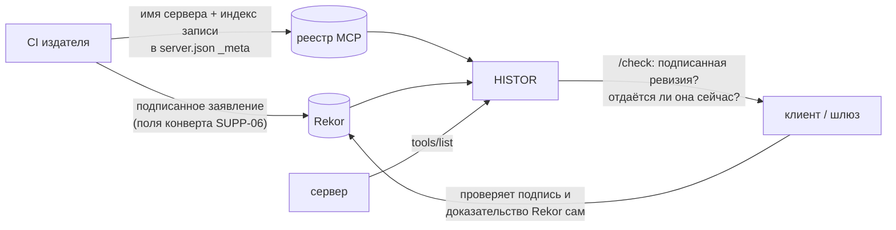

# Подписанные издателем ревизии манифестов: HISTOR и OWASP SUPP-06

Проект от 10.11.2026. Не реализован. Что делать и делать ли — решает владелец.

## Зачем

OWASP MCPSTG **SUPP-06** (PR #21, версия fb60e1cd) проверяет одно: прежде чем сделать привилегированный `tools/call`,
клиент требует три вещи:
1. подпись ожидаемого издателя;
2. доказательство включения в публичный журнал;
3. совпадение дайджеста полученного манифеста с записанным.

09.11 vermava оставил уровень серьёзности Medium «until a public log exists». В разделе Remediation этого теста
Sigstore Rekor назван примером журнала.

Чего сегодня нет ни у кого:
- нельзя по **имени сервера из реестра MCP** найти подписанные ревизии его манифеста;
- нельзя сверить эти ревизии с тем, что сервер **на самом деле отдаёт**.

У Rekor и HISTOR — по одной половине:
- **Rekor** хранит подписи, но не знает имён серверов и не смотрит, что они отдают.
- **HISTOR** смотрит, что отдают 97 506 серверов из реестра (замер 10.11), но подписей издателей не принимает. Заявления в
  `dev.modelmarket.histor/tool-sets` (`histor/declared.py`) — слово издателя, удостоверенное только пространством
  имён реестра, а не ключом.

## Два варианта

**A. HISTOR сам принимает подписанные ревизии** и пишет их новым типом листа в своё дерево RFC 9162. Это дерево уже
подписано, засвидетельствовано и отдаётся тайлами.

**B. Журнал — Rekor, а HISTOR — индекс и монитор поверх него.**
- Издатель подписывает ревизию и пишет её в Rekor, как и советует SUPP-06.
- HISTOR находит эти записи по имени сервера и сверяет их с тем, что сервер отдаёт.
- Клиенту HISTOR отвечает: «подписано X, лежит в Rekor под номером N, сервер сейчас отдаёт эту ревизию» (или не эту).

| | A: журнал HISTOR | B: Rekor + HISTOR |
|---|---|---|
| Кому верит клиент | ключу HISTOR и его свидетелям | Rekor, как в тексте SUPP-06; HISTOR — подсказка, которую клиент проверяет сам |
| Что делает издатель | наш формат и наш адрес приёма | стандартный клиент Sigstore, нашего кода у издателя нет |
| Риск цензуры | HISTOR может не принять запись | запись в Rekor от нас не зависит |
| Что можно честно сказать в OWASP | «HISTOR — публичный журнал» (спорно: журнал одного оператора) | «есть публичный индекс и монитор ревизий поверх Rekor» |
| Работы | приём, тип листа, спецификация, ограничения — около недели | чтение Rekor, поле в `/check`, монитор — 2–3 дня |

**Рекомендация: B.** Он меньше и не требует доверять нам. Он совпадает с тем, что OWASP уже написал, и даёт то,
чего нет ни у Rekor, ни у кого-то ещё: связь имени сервера, подписи и реально отданного манифеста. Вариант A имеет
смысл, только если издатели не смогут пользоваться Sigstore.

## Как устроен B

1. **Заявление.** Это поля конверта из SUPP-06: `server`, `revision`, `canonicalization: RFC8785-JCS`,
   `manifestDigest`, `toolDigests`, `previousManifestDigest`. Оно подписано без долгоживущего ключа, OIDC-идентичностью
   CI, как это делают npm и PyPI. Тип записи в Rekor и имя предиката выбрать при реализации; точные команды
   cosign/sigstore-python здесь не приводятся, потому что не проверены.
2. **Чья подпись считается.**
   - Пространство `io.github.<user>/*`: сертификат Fulcio, выданный рабочему процессу репозитория пользователя
     `<user>`. Реестр доказал пространство имён тем же аккаунтом.
   - Доменное пространство `com.example/*`: издатель публикует на своём домене список разрешённых OIDC-идентичностей.
     HISTOR берёт его так же, как сейчас берёт файл tool-sets с того же домена (`declared.py`).
3. **Как HISTOR находит запись.**
   - Основной путь: издатель указывает индекс записи Rekor в `server.json`, в новом поле рядом с
     `dev.modelmarket.histor/tool-sets`. HISTOR уже читает этот блок.
   - Поиск в Rekor по дайджесту, который HISTOR вычислил сам, работал бы без участия издателя. **Проверить:** по моим
     данным, Rekor v2 онлайн-поиска по хешу не даёт.
4. **Ответ.** `/api/v1/check` получает блок `signedRevision`: индекс в Rekor, идентичность подписавшего, результат
   проверки подписи и совпадает ли отданный сейчас дайджест с подписанным. Клиент, которому нужен Secure по SUPP-06,
   всё равно проверяет подпись и доказательство включения в Rekor сам. HISTOR экономит ему поиск и добавляет сверку с
   тем, что сервер реально отдаёт.
5. **Монитор** публикует два события, в RSS и в `/check`:
   - сервер отдаёт дайджест, которого нет ни в одной подписанной ревизии (случай (f) теста, но в проде);
   - у одного сервера две «текущие» ревизии (сигнал случая (e)).

   SUPP-06 советует каждому издателю следить за своим именем; HISTOR может делать это за всех.
6. **Каноническая форма.** Дайджест SUPP-06 считается по объекту с ключами-именами, в котором есть `title` и
   `annotations`. MTL/1 считается по списку из четырёх полей. HISTOR хранит и поля, которые MTL/1 не учитывает
   (`tool_extras` в `dataset.py`), поэтому может считать оба дайджеста для каждого наблюдённого набора. Нужно
   согласовать правило «execution hints» и проход по страницам (шаги 1–4 SUPP-06).

## Чего это не даст

- **Кража идентичности издателя.** Защиты от неё нет: ревизия станет публичной и атрибутируемой, но не будет
  заблокирована. SUPP-06 говорит то же.
- **Подписанные ревизии сейчас никто не публикует.** Нужен пилот, и проще всего начать с наших 8 записей в реестре.
  Но подписывать через GitHub Actions нельзя: запись в GitHub запрещена. По моим данным, Fulcio не принимает OIDC
  от Gitea (**проверить**). Остаются интерактивный OIDC владельца или вариант A для пилота.
- **Пока пилота нет, в OWASP #21 ничего нового сказать нельзя.** После пилота можно писать: «индекс и монитор
  ревизий поверх Rekor работает, вот пример».

## Решения владельца

1. Вариант B, A или ничего.
2. Кто подписывает пилотные ревизии наших серверов: владелец через интерактивный OIDC или другой путь.
3. Писать ли в OWASP #21 после пилота.

## Обновление 11.11: владелец — «давай сделаем публичный журнал»

**Что именно сказал OWASP.** vermava, 09.11, PR #21: «leave the severity at Medium until a public log exists».
HISTOR уже публичный журнал: дерево RFC 9162, подписанные головы, тайлы и три независимых свидетеля (kt-witness,
MinimalWitness, CrawlCheck). Но это журнал того, что серверы **отдают**. SUPP-06 спрашивает о журнале того, что
**подписал издатель**. Не хватает трёх вещей:
- подписанной ревизии;
- записи о ней в журнале;
- клиента, который всё это проверяет.

**Рекомендация меняется: с B на «A плюс копия в Rekor».** Две причины:
1. **Пилот B упирается в личность подписавшего.** Все наши записи в реестре находятся в пространстве
   `io.github.alexar76/*`. Для него Sigstore без ключа выдаёт сертификат рабочему процессу GitHub Actions, а писать в
   GitHub нельзя. Есть путь без GitHub: ключ издателя лежит в `_meta` его `server.json`. Реестр MCP пускает
   публиковать `server.json` только владельца пространства имён, так что ключ привязан к имени без нас.
2. **Довод «журнал одного оператора» слабее, чем я писал 10.11.** Головы дерева HISTOR соподписывают три сторонних
   свидетеля, поэтому разные ответы разным клиентам (split view) заметны. Остаётся риск, что HISTOR откажется принять
   запись. От него защищает копия той же подписи в Rekor.

**План (моя работа — 4–5 дней, сначала всё локально):**
1. `histor revision sign` — подписать конверт SUPP-06 ключом Ed25519. Поля `server`, `revision`,
   `canonicalization: RFC8785-JCS`, `manifestDigest`, `toolDigests`, `previousManifestDigest`.
2. Ключ издателя в `server.json` → `_meta` → `dev.modelmarket.histor/revision-keys`. HISTOR уже читает этот блок.
3. Приём: `POST /api/v1/revisions`. Подпись должна проверяться ключом из записи реестра для этого имени. Ревизия
   ложится листом нового типа в то же дерево, под те же подписи голов и свидетелей.
4. Копия в Rekor, если публичный Rekor принимает запись `hashedrekord` с обычным открытым ключом. Это проверяется
   первым, только чтением документации и API. Запись в Rekor — публичное действие, которое нельзя отменить, поэтому
   первая запись только с «да» владельца.
5. Проверка:
   - `/api/v1/check` отдаёт блок `signedRevision` с доказательством включения;
   - `histor revision verify` проверяет офлайн;
   - WARDEN проверяет ревизию перед привилегированным `tools/call`. Это первый клиент, который проходит случаи
     (b)–(f) SUPP-06 как Secure.
6. Монитор, события в RSS и `/check`:
   - сервер отдаёт дайджест, которого нет ни в одной подписанной ревизии (случай f);
   - у одного имени две «текущие» ревизии (случай e).
7. Пилот: наши 8 записей в реестре (`io.github.alexar76/*`, проверено 11.11) подписывают свои ревизии. Ключи попадают в реестр — это шаг владельца, тот же
   вход, что `publish_mcp_registry.sh --login` в §44.
8. Комментарий в OWASP #21 публикует владелец: журнал есть, вот запись, вот как её проверить.

**Честно о пределах:**
- Пока подписывают только наши серверы, это демонстрация, а не практика экосистемы.
- Кражу ключа издателя журнал не предотвращает, а только делает видимой (как сказано в SUPP-06).
- Решать, «существует ли публичный журнал», будет vermava, а не мы.

## Решение 11.11

Владелец решил так:
- подписывать через GitHub Actions, как советует сам SUPP-06 («short-lived CI identity»); настраивает коллега;
- журнал — HISTOR, копия в Rekor — «ок».

Подпись Sigstore без ключа сама кладёт запись в Rekor. Ключ в `server.json` не нужен: имя `io.github.alexar76/*`
привязано к сертификату процесса через расширение Source Repository Owner URI.

**Сделано (fd6aaf651):**
- `histor revision build|envelope|record|verify`;
- рабочий процесс `histor/.github/workflows/sign-manifest-revision.yml`;
- ветка `manifest-revisions` с `index.json`.

**Первая подпись** — colleague-tasks §92.

**Дальше (Claude):**
- HISTOR читает индекс ревизий;
- `/check` отдаёт `signedRevision`;
- ревизия записывается листом в дерево HISTOR, у которого есть свидетели;
- монитор ловит случаи (e) и (f);
- такие же процессы для остальных 7 записей;
- проверка в WARDEN;
- черновик комментария в OWASP #21.
